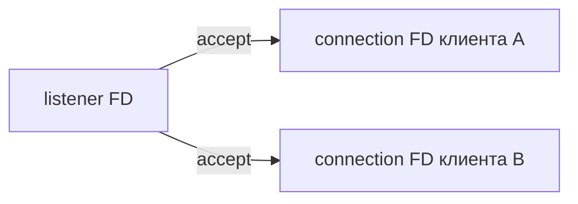

# Sockets

Socket — конец сетевого обмена. Listener принимает соединения, а каждый accept создаёт отдельный FD для передачи байтов конкретному клиенту.

Socket — kernel communication endpoint, представленный file descriptor. Server path: `socket` → `setsockopt` → `bind` → `listen` → `accept`; `accept` возвращает новый connected FD, listener остаётся принимать следующие.

`listen(backlog)` ограничивается kernel settings и относится к очереди установленных connections; incomplete TCP handshakes имеют отдельные механизмы/limits. Backlog saturation (очередь работы, которая ждёт ресурс) проявляется drops/retransmits/timeouts, а не обязательно application error.

Nonblocking `accept4(..., SOCK_NONBLOCK|SOCK_CLOEXEC)` и read/write возвращают `EAGAIN`, когда сейчас нечего выполнить. Partial reads/writes нормальны; TCP — byte stream без message boundaries.

## States и exhaustion

`TIME_WAIT` защищает новый connection tuple от старых segments; обычно его создаёт active closer. Массовые outbound short connections могут исчерпать ephemeral ports `(src IP, src port, dst IP, dst port)` — reuse pools/keep-alive важнее агрессивных sysctl hacks.

```bash
ss -lntp
ss -s
ss -tan state time-wait
lsof -nP -p "$PID" -a -i
cat /proc/$PID/net/sockstat
```

Смотрите accept rate, states, retransmits, listen drops, socket memory, FD/port limits. Socket buffer size не равен application throughput автоматически; большой buffer расходует kernel/cgroup memory.

`SO_REUSEPORT` может распределять incoming flows между listeners, но load/ordering behavior зависит от protocol/kernel/program. Не включайте без измерения.

## Узнать, кто слушает порт

```bash
ss -lntp 'sport = :8080'
ss -tan state established
```

`127.0.0.1:8080` доступен только в соответствующем network namespace; `0.0.0.0:8080` — на всех IPv4 interfaces этого namespace. Видимость process names может требовать прав.



TCP не хранит границы вызовов write: два write могут быть получены одним read или несколькими. Приложение определяет framing (правило выделения сообщений из потока bytes). TIME_WAIT обычно нормальная защита протокола после active close, а не утечка открытого FD приложения; CLOSE_WAIT у приложения требует проверки закрытия после EOF.

## Источники

- [socket(7)](https://man7.org/linux/man-pages/man7/socket.7.html)
- [listen(2)](https://man7.org/linux/man-pages/man2/listen.2.html)
- [accept(2)](https://man7.org/linux/man-pages/man2/accept.2.html)

## Проверь себя

1. Закрывает ли accept listener?
2. Почему Read может вернуть половину write?

<details>
<summary>Ориентиры для ответа</summary>

1. Нет, возвращает новый connected FD, listener остаётся.
2. TCP — поток байтов; границы системных вызовов не являются границами сообщений.

</details>
