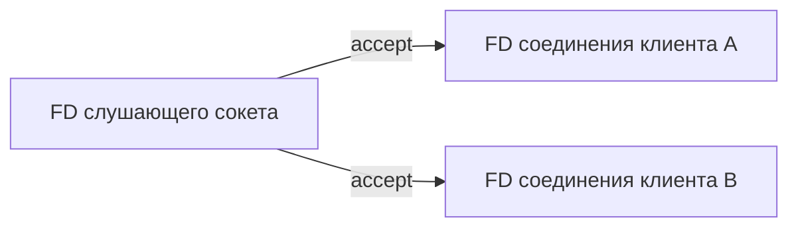

# Сокеты

**Сокет** — объект ядра для обмена данными, доступный через файловый дескриптор. Сервер создаёт сокет, настраивает его, привязывает адрес через `bind` и начинает слушать через `listen`. Каждый `accept` создаёт отдельный соединённый сокет; слушающий остаётся принимать следующих клиентов.

## Очередь и частичные операции

`listen(backlog)` ограничивается настройками ядра и относится к очереди установленных соединений. Для незавершённых рукопожатий TCP есть отдельные механизмы. При переполнении могут появиться потери, повторные передачи и таймауты ещё до обработки приложением.

Неблокирующий `accept4` или чтение/запись возвращает `EAGAIN`, если сейчас продолжать нечем. Частичный результат нормален: TCP передаёт поток байтов без границ вызовов записи.

## Состояния и лимиты

```bash
ss -lntp
ss -s
ss -tan state time-wait
lsof -nP -p "$PID" -a -i
cat /proc/$PID/net/sockstat
```

Изучайте число принятых соединений, состояния, повторные передачи, потери очереди, память сокетов и лимиты дескрипторов. Большой буфер сам по себе не увеличивает скорость сервиса, но расходует память ядра и cgroup.

`TIME_WAIT` защищает новое соединение от старых сегментов; обычно появляется у стороны, которая закрывает первой. Много коротких исходящих соединений может исчерпать доступные комбинации адресов и портов. Повторное использование соединений часто полезнее агрессивного изменения настроек ядра. `CLOSE_WAIT` означает, что другая сторона закончила передачу, а приложение ещё должно завершить свою сторону.

`SO_REUSEPORT` может распределять входящие потоки между слушателями; поведение зависит от протокола и реализации. Его эффект тоже нужно измерять.

## Кто слушает порт

```bash
ss -lntp 'sport = :8080'
ss -tan state established
```

`127.0.0.1:8080` доступен только внутри соответствующего сетевого пространства; `0.0.0.0:8080` слушает все его IPv4-интерфейсы. Для имён процессов могут потребоваться права.



Две записи могут прийти одним чтением или несколькими. Приложение должно задать длину, разделитель или другое правило выделения сообщений. `TIME_WAIT` не означает утечку открытого дескриптора приложения.

## Источники

- [socket(7)](https://man7.org/linux/man-pages/man7/socket.7.html)
- [listen(2)](https://man7.org/linux/man-pages/man2/listen.2.html)
- [accept(2)](https://man7.org/linux/man-pages/man2/accept.2.html)

## Проверь себя

1. Закрывает ли `accept` слушающий сокет?
2. Почему чтение может вернуть лишь половину отправленных байтов?

<details>
<summary>Ответы</summary>

1. Нет: он возвращает новый сокет соединения.
2. TCP не сохраняет границы операций записи; приложение собирает сообщение само.

</details>
