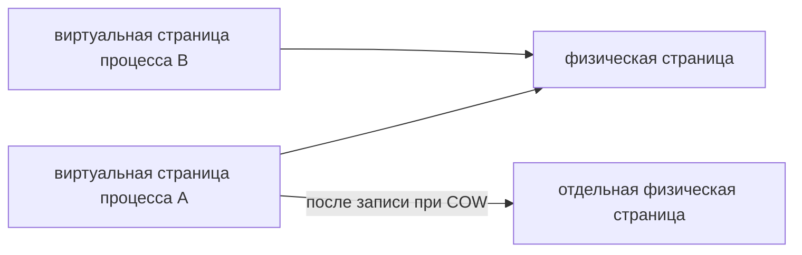

# Виртуальная память

Адрес, который видит процесс, не является прямым номером ячейки RAM. Ядро сопоставляет виртуальные страницы физическим страницам через таблицы отображения. У процесса может быть большой диапазон адресов, но лишь небольшая часть реально находится в RAM.

## Отображения памяти

Анонимные отображения содержат, например, кучу и стеки. Файловые отображения связаны с программой, библиотекой или `mmap` файла. Общая физическая страница может быть видна нескольким процессам.

После `fork` страницы часто разделяются до первой записи — это **copy-on-write**. Запись требует отдельной копии страницы. Поэтому большой родитель и активно пишущий потомок могут увеличить физический расход, хотя сразу после `fork` страницы были общими.

## Page fault

Когда нужной страницы нет в текущем отображении, возникает **page fault**: ядро должно подготовить доступ. Minor fault обходится без чтения с устройства, например при уже закешированных данных или создании копии. Major fault требует ввода-вывода и обычно дороже. Сам факт не ошибка; важны частота и задержки.

`mmap` не обещает, что все байты уже прочитаны в RAM. Выделение физической памяти часто происходит при первом доступе. Overcommit допускает обещание виртуального объёма сверх доступной памяти; реальные обращения могут позднее привести к освобождению страниц или OOM.

## Диагностика

```bash
cat /proc/$PID/maps
cat /proc/$PID/smaps_rollup
vmstat 1
perf stat -p "$PID"
```

VSZ включает отображения и резерв адресов. RSS — страницы в RAM, PSS распределяет общие страницы между процессами. `Private_Dirty`, деление на анонимные и файловые данные и частота page faults объясняют расход точнее одного числа.

Пример условного `smaps_rollup`: `Rss: 200000 kB`, `Pss: 150000 kB`, `Private_Dirty: 100000 kB`. RSS учитывает все видимые страницы в RAM, PSS уменьшает вклад разделяемых страниц, а Private_Dirty показывает изменённые частные страницы. Эти строки не описывают всю физическую память машины; сравнивайте несколько процессов и состав отображений.

## Обещанная и используемая память

VSZ=8 ГиБ при RSS=200 МиБ не доказывает утечку на 8 ГиБ: программа могла зарезервировать адреса, но не использовать страницы.



Схема показывает отображение, а не обязательное выделение всей RAM. Счётчики minor и major faults сравнивайте за интервал. Отображение файла также не доказывает, что изменённые данные уже устойчиво записаны на диск.

## Источники

- [proc_pid_smaps(5)](https://man7.org/linux/man-pages/man5/proc_pid_smaps.5.html)
- [mmap(2)](https://man7.org/linux/man-pages/man2/mmap.2.html)

## Проверь себя

1. Почему VSZ может быть намного больше RSS?
2. Когда copy-on-write увеличивает физический расход?

<details>
<summary>Ответы</summary>

1. VSZ включает резерв и отображения, RSS — только страницы в RAM.
2. При записи в общую страницу, требующей независимой копии.

</details>
