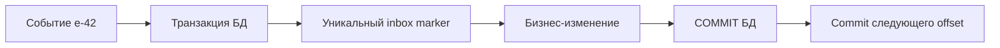

# Inbox и deduplication

Inbox — таблица обработанных идентификаторов событий. Она позволяет безопасно повторить доставку: одно событие меняет бизнес-данные лишь при первой успешной вставке marker в той же транзакции.

## Задача

At-least-once consumer может повторно получить event после crash между database commit и offset commit. Проверка «сначала SELECT, потом INSERT» race-ит между workers.

## Механизм

В одной transaction вставьте dedup marker с unique key и выполните business change:

```sql
BEGIN;

INSERT INTO consumer_inbox(consumer_name, event_id, received_at)
VALUES ($1, $2, clock_timestamp())
ON CONFLICT DO NOTHING;

-- выполнять изменение только если INSERT добавил строку

COMMIT;
```

Удобно использовать `INSERT ... RETURNING` или affected rows. Unique `(consumer_name, event_id)` сериализует concurrent duplicates. Offset commit выполняется после commit БД; повтор безопасно увидит marker.

## Гарантии и границы

Inbox обеспечивает effectively-once effect только для изменений в той же transaction/database. HTTP call или другая БД снова создаёт dual write и требует idempotency key downstream, saga/reconciliation или собственного outbox.

Producer должен повторять тот же `event_id`, а не генерировать новый на каждой publish attempt. Dedup retention должен покрывать максимальное время Kafka retention, replay, DLQ и backup restore; ранний cleanup оживит старый duplicate.

## Компромиссы

Inbox растёт, добавляет write/index contention и lifecycle job. Иногда естественный business key или monotonic aggregate version даёт более компактную идемпотентность. Для commutative operation (`max(version)`, set membership) отдельная inbox table может не требоваться.

Poison message после permanent validation error обычно фиксируют отдельно и отправляют в DLQ; не отмечайте transient failure как успешно обработанный.

## Связанные темы

- [Kafka delivery semantics](kafka/delivery-semantics.md)
- [Transactional Outbox](transactional-outbox.md)
- [PostgreSQL transactions](../databases/postgresql/transactions.md)

## SQL без гонки SELECT → INSERT

```sql
CREATE TABLE consumer_inbox(
    consumer_name text NOT NULL,event_id text NOT NULL,
    received_at timestamptz NOT NULL DEFAULT now(),
    PRIMARY KEY(consumer_name,event_id)
);
CREATE TABLE inbox_totals(id integer PRIMARY KEY,total bigint NOT NULL);
INSERT INTO inbox_totals VALUES (1,0);
WITH accepted AS (
    INSERT INTO consumer_inbox(consumer_name,event_id)
    VALUES ('billing','e-42') ON CONFLICT DO NOTHING RETURNING event_id
)
UPDATE inbox_totals SET total=total+100
WHERE id=1 AND EXISTS(SELECT 1 FROM accepted)
RETURNING total;
-- первый запуск: 100; повтор: 0 обновлённых строк, total остаётся 100
```

Один statement выполняется в одной транзакции. В production отсутствие бизнес-строки не должно незаметно зафиксировать marker: проверяйте affected rows и откатывайте явную транзакцию при нарушении ожиданий.



После crash между двумя commit событие повторится, но marker исключит второй эффект. DELETE marker раньше окна replay снова разрешит эффект. Отправка HTTP внутри транзакции БД не входит в её атомарность; сохраните исходящее событие через outbox или передайте внешний idempotency key.

## Источники

- [PostgreSQL INSERT / ON CONFLICT](https://www.postgresql.org/docs/18/sql-insert.html)
- [Kafka consumer offsets and external storage](https://kafka.apache.org/43/javadoc/org/apache/kafka/clients/consumer/KafkaConsumer.html)

## Проверь себя

1. **Почему marker и изменение должны быть в одной транзакции?**

   <details>
   <summary>Ответ</summary>

   Отдельный marker до эффекта потеряет обработку, marker после эффекта разрешит повтор.

   </details>

2. **Какое окно хранения inbox?**

   <details>
   <summary>Ответ</summary>

   Максимум всех replay/DLQ/retention/restore сценариев, не только обычного retry.

   </details>
