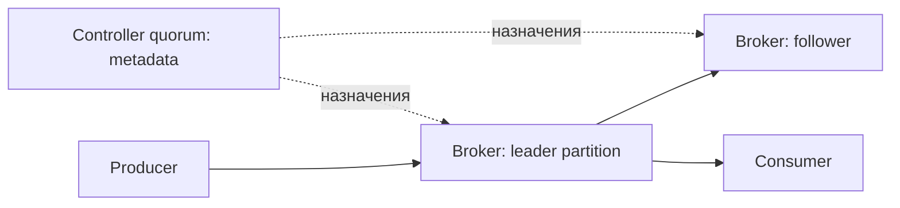

# Архитектура Kafka

Kafka хранит последовательности записей на brokers. Controllers управляют тем, где находятся partitions и кто их leader; клиенты читают данные напрямую у brokers, а не через controller.

Kafka cluster разделяет data plane и metadata control plane. Brokers хранят partition logs и обслуживают produce/fetch requests. KRaft controllers ведут replicated metadata log: topics, partition assignments, ISR, broker registrations, configs и ACL-related metadata.

## Путь клиентского запроса

`bootstrap.servers` нужен только для первого контакта. Client получает cluster metadata и затем обращается напрямую к leader нужной partition. При смене leader или topology он обновляет metadata; bootstrap list должна содержать несколько достижимых brokers, но не обязана перечислять весь cluster.

Producer выбирает partition, отправляет batch её leader. Followers этой partition fetch-ят log у leader. Consumer fetch-ит records начиная с offset; group coordinator управляет membership и assignments, но payload читается у partition leaders.

## Partition как единица данных

Topic состоит из partitions. Каждая — ordered append-only log с offset, который уникален только внутри partition. Partition задаёт:

- предел параллелизма обычной consumer group;
- область ordering;
- leader/follower replication unit;
- единицу reassignment и recovery.

Увеличение числа partitions не бесплатно: растут metadata, open files, replication/rebalance work, а keyed data может перераспределиться при повторном хэшировании.

## Управление метаданными

Controller quorum реплицирует metadata через Raft. Active controller применяет committed metadata и координирует leaders/ISR; остальные controllers готовы продолжить после election. Quorum требует majority, поэтому обычно используют 3 или 5 controller voters в независимых failure domains.

ZooKeeper — только historical context для Kafka 3.x и миграций. Kafka 4.x удалил ZooKeeper mode; новый дизайн и runbooks должны быть KRaft-only.

## Путь данных и метаданных



bootstrap.servers помогает найти cluster. Полученные advertised.listeners должны быть достижимы клиенту: если bootstrap доступен, а broker рекламирует внутренний DNS, последующие requests сломаются.

```text
bin/kafka-topics.sh --bootstrap-server localhost:9092 --describe --topic ads
```

Команда показывает partitions, leader, replicas и ISR. Это команда для существующего кластера/topic, не полный рецепт установки. Leader=-1 означает отсутствие доступного leader. Coordinator группы управляет назначением, но не передаёт все payload. Partition хранит порядок append; бизнес-порядок дополнительно зависит от производителя, key, retries и workers.

## Источники

- [Kafka design](https://kafka.apache.org/43/design/design/)
- [KRaft](https://kafka.apache.org/43/operations/kraft/)

## Проверь себя

1. **Почему доступный bootstrap ещё не доказывает работоспособность?**

   <details>
   <summary>Ответ</summary>

   Клиент далее обращается к advertised addresses partition leaders.

   </details>

2. **Controller хранит все сообщения topics?**

   <details>
   <summary>Ответ</summary>

   Нет, ведёт metadata; данные хранят brokers.

   </details>
