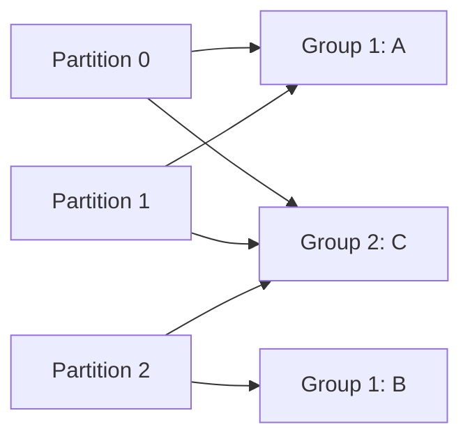

# Consumer groups

Обычная consumer group делит partitions между участниками: одну partition читает один участник группы. Другая группа может независимо читать те же записи.

Обычная consumer group распределяет каждую topic partition не более чем одному member группы. Несколько групп читают topic независимо; consumers сверх числа partitions остаются idle.

## Назначение partitions и перераспределение

Coordinator хранит membership и committed offsets. При join/leave, subscription/topology change группа меняет assignment. Eager rebalance отзывает всё сразу; cooperative/incremental assignment старается перемещать только нужные partitions и уменьшает stop-the-world pause.

Assignor определяет баланс и affinity: range может создавать перекос между topics, round-robin распределяет шире, sticky сохраняет прежние assignments, cooperative sticky поддерживает incremental transfer. Проверяйте совместимость strategy при rolling change.

Rebalance callback должен:

- остановить выдачу новой работы для revoked partitions;
- дождаться/отменить bounded in-flight processing;
- commit-ить только contiguous успешно обработанный prefix;
- освободить partition-scoped state.

Static membership (`group.instance.id`) уменьшает rebalance при кратком restart, но duplicate identity fence-ится, а реальный failure всё равно ждёт timeout.

## Classic и consumer protocol

Kafka 4.x поддерживает classic protocol и новый consumer rebalance protocol. Server support нового protocol включён; Java client выбирает его через `group.protocol=consumer`. В новом protocol assignment logic находится на broker, rebalance incremental, а heartbeat/session settings в большей степени задаёт server. Default клиента и доступные assignors проверяйте для конкретной 4.x версии перед rollout.

Миграция protocol — изменение поведения: обновите clients, metrics, timeouts и проведите rolling test. Не смешивайте рекомендации по classic heartbeat settings с consumer protocol без проверки.

Kafka 4.2 также сделал production-ready share groups: несколько consumers могут обрабатывать records одной partition с individual acknowledgements и delivery attempts. Это отдельная queue-like модель, а не новый assignor обычной consumer group.

## Пример распределения

Topic имеет partitions P0,P1,P2. В группе analytics consumers A и B могут получить A:{P0,P1}, B:{P2}. При добавлении C возможно назначение по одной partition каждому; точное распределение зависит от assignor. Четвёртый участник не добавит parallelism обычной группы.



```text
bin/kafka-consumer-groups.sh --bootstrap-server localhost:9092 \
  --describe --group analytics
```

CURRENT-OFFSET, LOG-END-OFFSET и LAG помогают оценить backlog. Нулевой lag не доказывает завершение внешней операции, если приложение commit сделало раньше.

Classic client heartbeat.interval.ms не переносится механически на group.protocol=consumer: новый протокол получает интервалы heartbeat/session от broker. Static membership уменьшает краткие перестановки, но требует уникальной стабильной identity. Share groups — другая модель с record acknowledgements и несколькими readers partition; обычное правило один owner относится к consumer groups. Для строгого порядка не выбирайте share group автоматически.

## Источники

- [Consumer rebalance protocol](https://kafka.apache.org/43/operations/consumer-rebalance-protocol/)
- [Kafka Queues and share groups](https://kafka.apache.org/43/operations/kafka-queues/)

## Проверь себя

1. **Что даст 20 consumers для topic из 3 partitions?**

   <details>
   <summary>Ответ</summary>

   Обычная группа использует максимум три для partition чтения; остальные простаивают.

   </details>

2. **Почему rebalance способен привести к двойному side effect?**

   <details>
   <summary>Ответ</summary>

   Старый worker может продолжить после передачи partition новому; нужна идемпотентность.

   </details>
