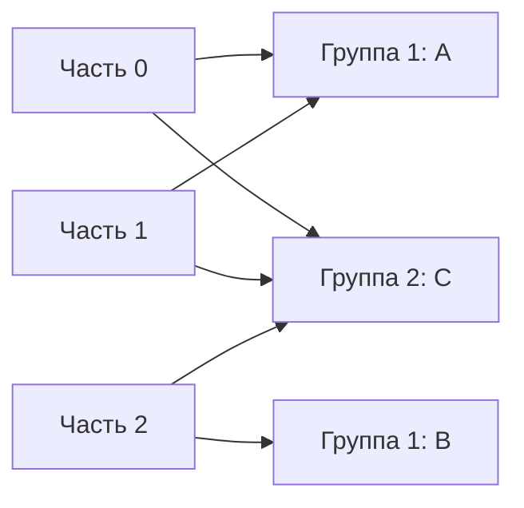

# Группы получателей

Группа получателей делит части потока между участниками: одну часть одновременно читает один участник **обычной consumer group**. Другая группа читает те же данные независимо — например, поиск и аналитика не мешают друг другу.

## Что происходит при смене состава

При добавлении участника, отказе или изменении подписки координатор перераспределяет назначения — это rebalance. Одни стратегии отзывают назначения сразу, другие перемещают их постепенно, уменьшая остановку. Стратегия должна быть совместима у участников при обновлении.

Перед отдачей части прекратите новую работу, дождитесь ограниченного числа начатых задач или отмените их, сохраните только успешно обработанный непрерывный префикс. Старый исполнитель может успеть сделать внешний эффект после потери назначения; отмена контекста не откатывает уже выполненный HTTP-запрос. Поэтому нужна идемпотентность получателя.

Стабильный `group.instance.id` уменьшает лишние перераспределения при коротком перезапуске. Но идентификаторы должны быть уникальны, а реальный отказ всё равно определяется по сроку ожидания.

## Два протокола группы

В Kafka 4.x есть classic и новый consumer rebalance protocol. В новом протоколе больше решений о назначении и интервалах heartbeat принимает брокер; Java-клиент выбирает его через `group.protocol=consumer`. Перед переходом проверяют поддержку конкретных клиентов, настройки, метрики и постепенное обновление. Настройки classic нельзя переносить автоматически.

Share groups, готовые для эксплуатации с Kafka 4.2, — отдельная модель: несколько получателей могут обрабатывать записи одной части с индивидуальным подтверждением. Она ближе к очереди и не является новой стратегией обычной группы. Для задачи со строгим порядком её выбирают отдельно.

## Пример распределения

Поток состоит из P0, P1, P2. Группа analytics может назначить A части P0 и P1, B — P2. С появлением C возможно по одной каждому; точный результат зависит от стратегии назначения. Четвёртому участнику части не хватит. Вторая группа читает те же части независимо, что и показано на схеме.



```text
bin/kafka-consumer-groups.sh --bootstrap-server localhost:9092 \
  --describe --group analytics
```

`CURRENT-OFFSET` — сохранённая позиция, `LOG-END-OFFSET` — конец журнала, `LAG` — разность. Если приложение сохранило позицию до эффекта, нулевое отставание не доказывает завершения работы.

Для нового consumer protocol интервалы контрольных сигналов и сессии задаёт брокер. Не переносите classic-настройку `heartbeat.interval.ms` механически. Стабильный идентификатор уменьшает перестановки, но должен быть уникален. Share groups имеют индивидуальные подтверждения записей и другую модель порядка, чем обычная группа.

## Источники

- [Consumer rebalance protocol](https://kafka.apache.org/43/operations/consumer-rebalance-protocol/)
- [Kafka Queues and share groups](https://kafka.apache.org/43/operations/kafka-queues/)

## Проверь себя

1. **Что дадут двадцать участников обычной группы для трёх частей?**

   <details>
   <summary>Ответ</summary>

   Одновременно читать части смогут максимум трое; остальные простаивают.

   </details>

2. **Почему перераспределение может повторить внешний эффект?**

   <details>
   <summary>Ответ</summary>

   Старый исполнитель способен закончить после передачи части новому. Эффект должен быть защищён от повтора.

   </details>
