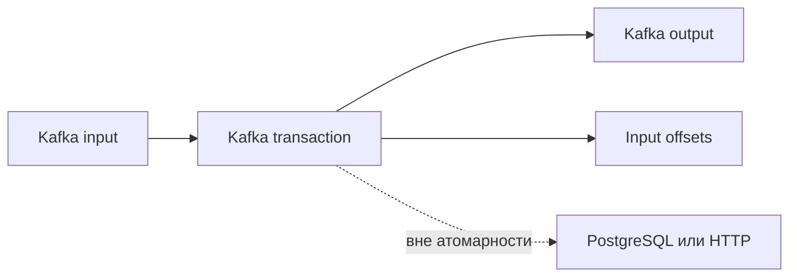

# Delivery semantics

Гарантия доставки описывает конкретную границу: Kafka, базу или внешний API. Запись в Kafka ровно один раз не означает, что платёжная операция тоже прошла ровно один раз.

Delivery semantics описывают границу системы. Producer → broker, broker → consumer и consumer → внешняя БД могут иметь разные гарантии; слово «exactly-once» без границы почти бессодержательно.

## At-most-once

Offset commit до side effect или отсутствие retries исключает повтор на выбранной границе, но crash создаёт потерю. Подходит только когда loss дешевле duplicate и это явно принято.

## At-least-once

Side effect выполняется до commit offset. Crash между ними повторит record. Это распространённая и надёжная модель, если handler idempotent или deduplicate-ит stable event ID.

```text
read → apply idempotently → commit offset
```

Atomic `INSERT ... ON CONFLICT` в authoritative DB, inbox table с unique `(consumer, event_id)` или version/state transition часто надёжнее distributed lock.

## Kafka exactly-once semantics

Idempotent producer deduplicate-ит retried produce requests в producer session. Kafka transaction может атомарно публиковать records в несколько partitions и commit-ить consumed offsets. Consumers с `isolation.level=read_committed` не возвращают aborted transactional records.

Это даёт exactly-once processing для consume → Kafka produce pipeline при корректной configuration. Оно не делает atomic обычную запись в PostgreSQL, HTTP call, email или платёж вместе с Kafka transaction.

## Effectively-once

Effectively-once — архитектурный результат: transport допускает duplicates, но idempotency key, deduplication и commutative/state-machine semantics делают наблюдаемый итог эквивалентным одному применению. Нужны:

- стабильный event ID от producer, не новый ID на retry;
- durable dedup state и retention не меньше окна повторов;
- atomicity dedup marker с business change;
- определённая политика поздних/переупорядоченных events.

Тестируйте crash в каждой точке между read, side effect, publish и commit; happy path не доказывает semantics. Для внешних effects продолжите с [idempotency](../../backend-patterns/idempotency.md), [Transactional Outbox](../../backend-patterns/transactional-outbox.md) и [Inbox/deduplication](../inbox-pattern.md).

## Четыре точки падения

| Точка crash | Side effect → offset commit | Offset commit → side effect |
| --- | --- | --- |
| До первого шага | Повтор записи | Повтор записи |
| Между шагами | Повтор эффекта без dedup | Эффект потерян |
| После обоих | Продолжение со следующей записи | Продолжение со следующей записи |

Таблица предполагает успешно сохранённые commits и отсутствие отдельного reconciliation. At-least-once с inbox сохраняет запись marker и изменение одной transaction, поэтому повтор доставки не меняет итог второй раз. Если операция — increment баланса, повтор опасен; если поставить статус paid при ожидаемой версии, повтор может быть безопасен при правильной state machine.



EOS Kafka pipeline требует transactional producer, правильного offset commit в той же transaction и read_committed downstream. Оно не обещает отсутствие повторного исполнения кода: неуспешная попытка могла выполняться, но её Kafka outputs не станут видимы committed reader. Для внешних effects границу расширяют inbox/outbox/idempotency, а не рекламное название broker.

## Источники

- [Kafka message delivery semantics](https://kafka.apache.org/43/design/design/#message-delivery-semantics)
- [Producer idempotence configuration](https://kafka.apache.org/43/configuration/producer-configs/#producerconfigs_enable.idempotence)

## Проверь себя

1. **EOS исключает повторный запуск обработчика?**

   <details>
   <summary>Ответ</summary>

   Нет, оно ограничивает видимый результат в поддерживаемой границе, не число попыток исполнения.

   </details>

2. **Почему increment требует другой защиты, чем присвоение статуса?**

   <details>
   <summary>Ответ</summary>

   Повтор прибавляет второй раз; присвоение может быть идемпотентно при проверке перехода/версии.

   </details>
