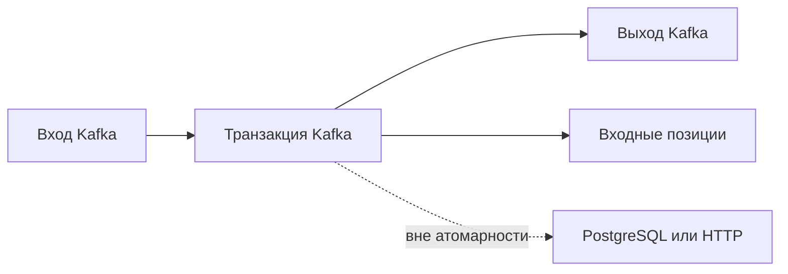

# Гарантии доставки

Гарантия доставки отвечает на вопрос: что произойдёт, если процесс упадёт между чтением, эффектом и сохранением позиции? Название «ровно один раз» всегда нужно привязывать к конкретной границе системы.

## Не более одного раза

Получатель сохраняет позицию до эффекта. Повтор не произойдёт, но падение между шагами потеряет обработку. Это **at-most-once**: допустима потеря, не повтор. Иногда подходит для необязательных наблюдений.

## Не менее одного раза

Сначала эффект, затем позиция. Падение между ними повторяет запись после перезапуска. Это **at-least-once**: приложение должно выдержать повтор, например через [Inbox: защита эффекта от повторов](../inbox-pattern.md) в той же транзакции, что изменение данных.

## Где Kafka может связать шаги

В обработке Kafka → Kafka транзакция связывает выходные записи и входные позиции. Получатели `read_committed` видят только завершённые записи. Это гарантия внутри согласованного механизма Kafka, не автоматическая транзакция с PostgreSQL или платёжным HTTP API.

Для внешнего эффекта нужны собственные средства: уникальный ключ операции, транзакционный inbox, [Outbox: сохранение намерения отправить](../transactional-outbox.md) или сверка результата. Эффект «как один раз», effectively-once, получается из повторяемой доставки и защиты эффекта от повтора.

Идемпотентный producer устраняет повтор пакета при сетевой ошибке. Он не распознаёт два заново созданных бизнес-события одной оплаты. Назовите стабильный идентификатор, срок хранения защиты и поведение после восстановления старой резервной копии.

## Четыре точки падения

| Точка crash | Side effect → offset commit | Offset commit → side effect |
| --- | --- | --- |
| До первого шага | Повтор записи | Повтор записи |
| Между шагами | Повтор эффекта без dedup | Эффект потерян |
| После обоих | Продолжение со следующей записи | Продолжение со следующей записи |

Таблица предполагает успешно сохранённые позиции и отсутствие отдельной сверки результатов. Inbox связывает отметку события и SQL-эффект одной транзакцией. Повтор прибавления увеличивает баланс снова; повтор установки статуса может быть безопасным, если переход и версия корректно проверены.

Гарантия Kafka → Kafka требует транзакционного отправителя, входных позиций в той же транзакции и читателя `read_committed`. Сам обработчик может выполняться повторно: скрываются незавершённые выходные записи, а не отменяются все попытки исполнения кода. Внешний эффект требует своей защиты.

## Источники

- [Kafka message delivery semantics](https://kafka.apache.org/43/design/design/#message-delivery-semantics)
- [Producer idempotence configuration](https://kafka.apache.org/43/configuration/producer-configs/#producerconfigs_enable.idempotence)

## Проверь себя

1. **Исключает ли гарантия Kafka повторный запуск обработчика?**

   

   
Ответ

   Нет. Она ограничивает видимые выходные записи в поддерживаемой границе, не число попыток выполнения кода.

   

2. **Почему повтор прибавления опаснее присвоения статуса?**

   

   
Ответ

   Прибавление меняет итог ещё раз. Присвоение может быть безопасным при правильной проверке перехода и версии.

   

