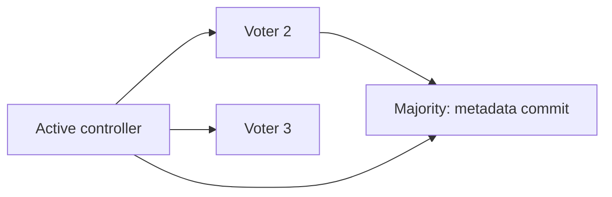

# KRaft

KRaft хранит метаданные cluster в журнале с большинством голосов controllers. Метаданные — назначения partitions и состояния brokers, а не все пользовательские сообщения.

KRaft — metadata quorum Kafka на основе Raft. Начиная с Kafka 4.0 ZooKeeper mode удалён: production baseline — KRaft.

## Роли

Process имеет `broker`, `controller` или обе roles. Combined mode удобен для local development и малых окружений; для critical production controllers обычно выделяют отдельно, чтобы data-plane load/failure не затрагивал quorum.

Каждый node имеет уникальный `node.id`; controllers образуют quorum. Active controller — leader metadata partition, остальные voters реплицируют log. Metadata change считается committed после majority, поэтому quorum из трёх переносит отказ одного voter, из пяти — двух. Два controllers не дают полезной majority fault tolerance.

Dynamic controller quorum в актуальных Kafka позволяет менять voters через поддерживаемые administrative procedures. Не редактируйте quorum configuration/metadata files вручную; следуйте upgrade documentation конкретной версии.

## Журнал метаданных

Metadata records хранятся в internal `__cluster_metadata` log; snapshots ускоряют recovery, но log остаётся source of changes. Brokers регистрируются и получают metadata images/updates от controllers. Fencing epochs не позволяет старому broker/controller продолжать работу как актуальный после смены состояния.

Storage directories перед первым стартом форматируются единым cluster ID. Повторное случайное форматирование уничтожает локальную identity/metadata; cluster ID и disaster-recovery procedure должны быть сохранены.

## Эксплуатация

Наблюдайте active controller, quorum leader/epoch, voter lag, metadata log end offset, commit latency, offline partitions и broker heartbeats. Controller majority loss останавливает metadata changes/elections и в зависимости от события нарушает доступность data plane.

ZooKeeper-to-KRaft migration относится только к legacy upgrade path до Kafka 4.x. Не добавляйте ZooKeeper в новую architecture «на всякий случай».

## Большинство на числах

| Controller voters | Нужно для majority | Переживает отказ |
| --- | --- | --- |
| 1 | 1 | 0 |
| 2 | 2 | 0 |
| 3 | 2 | 1 |
| 5 | 3 | 2 |

```text
bin/kafka-metadata-quorum.sh --bootstrap-server localhost:9092 describe --status
```

Вывод содержит LeaderId, LeaderEpoch, HighWatermark и участников; конкретные значения зависят от cluster. Потеря majority мешает committed metadata changes и elections. Существующие leaders могут какое-то время обслуживать data, но это не гарантия доступности при дальнейших изменениях/отказах.



При dynamic quorum используйте документированное добавление/удаление voter и version/feature requirements; простая замена списка в конфиге не безопасная membership change. Разделяйте controllers по зонам отказа. Повторный format storage — не способ исправить ошибку startup: он способен уничтожить identity и recovery history.

## Источники

- [KRaft operations](https://kafka.apache.org/43/operations/kraft/)
- [KRaft configuration](https://kafka.apache.org/43/configuration/kraft/)

## Проверь себя

1. **Почему два controllers не лучше одного по числу переживаемых отказов?**

   <details>
   <summary>Ответ</summary>

   Для majority нужны оба; отказ одного теряет quorum.

   </details>

2. **Quorum lost означает немедленное исчезновение всех сообщений?**

   <details>
   <summary>Ответ</summary>

   Нет, данные на brokers остаются; блокируются metadata progress/elections и возможна потеря availability.

   </details>
