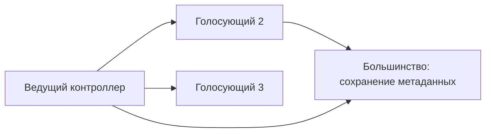

# KRaft

KRaft — механизм согласованного хранения метаданных Kafka. Он хранит расположение частей, роли брокеров и конфигурацию, а не весь поток пользовательских сообщений. С Kafka 4.0 режим ZooKeeper удалён.

## Почему нужны несколько контроллеров

Один контроллер руководит журналом метаданных, остальные голосующие участники повторяют его записи. Изменение сохраняется после подтверждения большинства. Поэтому три участника переживают отказ одного, пять — двух; двум нужны оба.

Процесс может иметь роль `broker`, `controller` или обе. Совмещённый режим удобен для разработки. Раздельные контроллеры уменьшают влияние нагрузки данных и отказов брокеров на управление. Размещайте их в независимых областях отказа.

## Что происходит при потере большинства

Существующие данные остаются на брокерах. Но согласованные изменения метаданных и выбор новых ведущих затрудняются или останавливаются. Возможность временно обслужить текущие записи не гарантирует доступность при следующем отказе.

Журнал `__cluster_metadata` и его снимки обеспечивают восстановление состояния. Номера эпох помогают не принимать работу старого участника как текущую. Следите за ведущим, эпохой, отставанием участников и задержкой сохранения метаданных.

## Как менять состав безопасно

Современный динамический кворум поддерживает изменение участников штатной административной процедурой. Нельзя заменить её случайным редактированием файлов. Проверяйте требования версии и возможностей.

Первичная подготовка дисков использует общий cluster ID и уникальный node ID. Повторное форматирование не является ремонтом старта: оно может уничтожить локальную идентичность и историю восстановления.

## Большинство на числах

| Controller voters | Нужно для majority | Переживает отказ |
| --- | --- | --- |
| 1 | 1 | 0 |
| 2 | 2 | 0 |
| 3 | 2 | 1 |
| 5 | 3 | 2 |

```text
bin/kafka-metadata-quorum.sh --bootstrap-server localhost:9092 describe --status
```

`LeaderId` обозначает ведущего контроллера, `LeaderEpoch` — эпоху его полномочий, `HighWatermark` — границу согласованного журнала. Значения зависят от кластера. Потеря большинства препятствует согласованным изменениям и выборам; временная работа текущих брокеров не гарантирует доступность при следующем отказе.



Динамический состав меняют документированной процедурой добавления и удаления участника с учётом версии и возможностей. Простое редактирование списка не заменяет согласованное изменение. Размещайте контроллеры независимо и не форматируйте существующее хранилище ради устранения ошибки запуска.

## Источники

- [KRaft operations](https://kafka.apache.org/43/operations/kraft/)
- [KRaft configuration](https://kafka.apache.org/43/configuration/kraft/)

## Проверь себя

1. **Почему два контроллера не переживают отказ одного?**

   <details>
   <summary>Ответ</summary>

   Для большинства нужны оба. После отказа одного согласованный прогресс останавливается.

   </details>

2. **Исчезают ли сообщения при потере большинства контроллеров?**

   <details>
   <summary>Ответ</summary>

   Нет, данные остаются на брокерах. Но управление и выбор ведущих блокируются, доступность при изменениях не гарантирована.

   </details>
