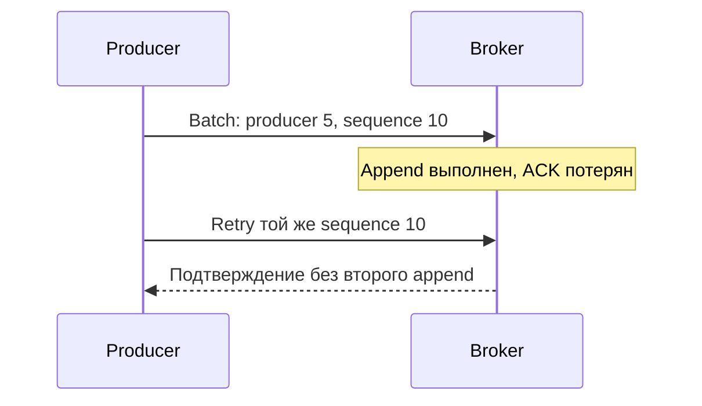

# Kafka producer

Producer собирает записи в batches и отправляет leader нужной partition. Подтверждение означает выбранную гарантию приёма Kafka, а не успешное применение записи получателем.

Producer сериализует key/value, выбирает partition, накапливает records в per-partition batches и отправляет их leader broker. Настройки latency, throughput и durability связаны: нельзя оптимизировать одну независимо.

## Выбор partition

Явно заданная partition имеет приоритет. При key стандартный partitioner детерминированно хэширует serialized key; изменение serializer/partition count меняет routing. Без key современный Java producer не обязан работать round-robin: он использует sticky batching и по умолчанию может адаптивно предпочитать partitions на brokers с меньшей ожидаемой очередью, сохраняя batch locality.

## Пакеты и сжатие

- `batch.size` ограничивает target batch buffer для partition, но record больше него всё ещё может отправляться с учётом request limits.
- `linger.ms` разрешает немного подождать заполнения batch; в Kafka 4.x Java producer default — 5 ms.
- compression применяется к batch (`gzip`, `snappy`, `lz4`, `zstd`), поэтому хорошее batching улучшает ratio.
- `buffer.memory`, `max.block.ms`, request/delivery timeouts задают backpressure и верхнюю границу ожидания.

`flush()` на каждом record уничтожает batching. Измеряйте end-to-end p99 и throughput, а не только broker request latency.

## Подтверждения записи

- `acks=0`: producer не ждёт response и может не узнать о потере.
- `acks=1`: leader подтвердил local append; его failure до replication способен потерять record.
- `acks=all`/`-1`: leader ждёт все текущие ISR и проверяет `min.insync.replicas`.

`acks=all` не означает «все brokers cluster записали record». Если ISR ниже `min.insync.replicas`, write завершается retriable error вместо ослабления гарантии.

## Повторы, идемпотентность и порядок

Java producer по умолчанию включает idempotence, если configuration не конфликтует: нужны `acks=all`, retries > 0 и `max.in.flight.requests.per.connection <= 5`. Broker deduplicate-ит sequence numbers producer session, поэтому retried batch не добавляется второй раз и order сохраняется в поддерживаемых пределах.

Idempotence ограничена producer → Kafka и lifetime producer state. Она не устраняет duplicate business events, повтор DB transaction или duplicate consumer side effect. `delivery.timeout.ms` ограничивает полный срок доставки record, включая batching/retries; после ambiguous timeout приложение не всегда знает, был ли record committed.

Для atomic writes в несколько partitions и offset commit используйте [transactions](transactions.md), но всё равно проектируйте stable event identity.

## Конфигурация и неоднозначный timeout

```properties
# Java producer 4.3: пример согласованного набора
acks=all
enable.idempotence=true
max.in.flight.requests.per.connection=5
delivery.timeout.ms=120000
linger.ms=5
```

Это имена Java client settings. Sarama, franz-go и confluent-kafka-go имеют разные API/defaults; проверьте выбранную библиотеку, не копируйте properties в Go-код. Default linger 5ms и правила enable.idempotence здесь относятся к Java4.x.

Broker мог записать batch, а ответ потерялся. Внутренний retry с producer ID/sequence устраняет повтор этого batch. Если приложение после ошибки создаёт новый producer и новое business event с новым event_id, broker уже не распознает его как тот же смысл.



Backpressure должен ограничивать очередь в приложении: заполнение buffer и max.block.ms не повод бесконечно создавать goroutines. Compression лучше работает на batches; flush каждого сообщения увеличивает requests и разрушает throughput. Определяйте latency по полному пути от принятия операции до результата обработки.

## Источники

- [Producer configuration](https://kafka.apache.org/43/configuration/producer-configs/)
- [Message delivery semantics](https://kafka.apache.org/43/design/design/#message-delivery-semantics)

## Проверь себя

1. **Идемпотентный producer исключает два бизнес-события одной оплаты?**

   <details>
   <summary>Ответ</summary>

   Нет, он дедуплицирует protocol retries; stable business event_id нужен отдельно.

   </details>

2. **Что означает delivery timeout?**

   <details>
   <summary>Ответ</summary>

   Клиент больше не ждёт; запись могла сохраниться, поэтому исход может быть неоднозначен.

   </details>
