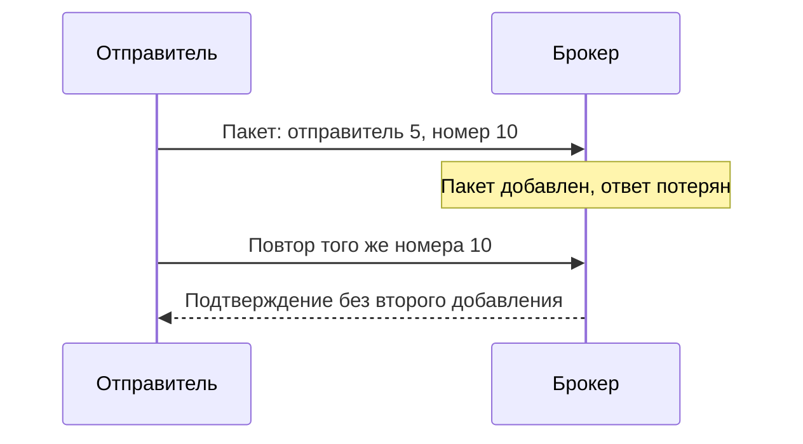

# Отправитель Kafka

Отправитель, producer, превращает ключ и значение в байты, выбирает часть потока и отправляет записи её ведущему брокеру. Подтверждение Kafka означает выбранную гарантию приёма, а не выполнение бизнес-операции получателем.

## Почему записи объединяют

Отдельный сетевой запрос на каждое сообщение дорог. Клиент собирает записи одной части в пакет — batch. `linger.ms` позволяет немного подождать наполнения, `batch.size` задаёт целевой размер буфера пакета. Пакетное сжатие обычно эффективнее сжатия каждого сообщения. Java producer Kafka 4.x по умолчанию ждёт до 5 мс; у Go-библиотек настройки и значения могут отличаться.

Частый `flush()` разрушает объединение. Измеряйте полный срок доставки, включая ожидание в приложении и обработку получателем, а не только быстрый запрос брокеру.

## Что означает подтверждение

`acks=0` не ждёт ответа, поэтому клиент может не узнать о потере. `acks=1` ждёт только ведущую копию: отказ до передачи другим может потерять запись. `acks=all` ждёт текущий набор синхронизированных копий ISR и проверяет `min.insync.replicas`. Это не все брокеры кластера.

## Что делает безопасный повтор

Ответ может потеряться после сохранения записи. Идемпотентный отправитель повторяет пакет с тем же идентификатором и номером последовательности; брокер распознаёт повтор. Для Java-клиента нужны согласованные `acks=all`, повторы и максимум пять одновременных неподтверждённых запросов на соединение.

Это защита повторов протокола, не двух разных событий одной оплаты. Стабильный бизнес-идентификатор события нужен отдельно. `delivery.timeout.ms` ограничивает ожидание клиента; после ошибки исход сохранения может оставаться неизвестным.

Ключ помогает сохранять порядок сущности, но изменение сериализации или числа частей меняет маршрут. Ограничивайте очередь приложения: заполненный буфер клиента не оправдывает бесконечное создание горутин.

## Конфигурация и неоднозначный timeout

```properties
# Java producer 4.3: пример согласованного набора
acks=all
enable.idempotence=true
max.in.flight.requests.per.connection=5
delivery.timeout.ms=120000
linger.ms=5
```

Это настройки Java producer 4.3. У Sarama, franz-go и confluent-kafka-go другие API и исходные значения. В примере клиент ждёт синхронизированные копии, включает защиту протокольных повторов, ограничивает число незавершённых запросов и ждёт пакет до 5 мс. Не вставляйте этот файл настроек в Go-код без проверки библиотеки.

Брокер мог сохранить пакет, а ответ потерялся. Внутренний повтор того же номера последовательности не добавляет пакет ещё раз. Но если приложение создаёт новое событие с другим `event_id`, брокер не знает, что смысл оплаты повторён. Для этого нужна бизнес-защита получателя.



Если отправка медленнее приёма работы, очередь приложения должна иметь предел: заполнение буфера клиента не повод создавать всё больше горутин. Пакеты сокращают запросы и лучше сжимаются; отдельный `flush` после каждого сообщения убирает выгоду. Измеряйте время от принятия операции до результата обработки.

## Источники

- [Producer configuration](https://kafka.apache.org/43/configuration/producer-configs/)
- [Message delivery semantics](https://kafka.apache.org/43/design/design/#message-delivery-semantics)

## Проверь себя

1. **Исключает ли идемпотентный отправитель два события одной оплаты?**

   <details>
   <summary>Ответ</summary>

   Нет. Он распознаёт повтор протокольного пакета. Постоянный бизнес-id и защита эффекта нужны отдельно.

   </details>

2. **Что означает истечение delivery.timeout.ms?**

   <details>
   <summary>Ответ</summary>

   Клиент больше не ждёт. Запись могла сохраниться, поэтому исход не всегда известен.

   </details>
