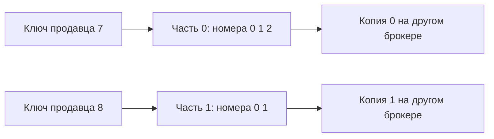

# Потоки, части и копии Kafka

Topic — имя потока, partition — отдельная последовательность записей. Каждая запись получает номер **offset** внутри своей части. Offset 10 в первой части нельзя сравнивать с offset 10 во второй как глобальное время: общего порядка между частями Kafka не обещает.

## Какие копии подтверждают запись

Replication factor задаёт число копий части. Одна ведущая принимает запись, остальные догоняют её. **ISR**, in-sync replicas, — текущий набор достаточно синхронизированных копий, включая ведущую. Этот набор меняется при отставании и отказах.

При `acks=all` отправитель ждёт текущие ISR, а не все серверы кластера. `min.insync.replicas` задаёт минимум ISR для успешной защищённой записи. При трёх копиях и минимуме двух отказ одной обычно позволяет продолжать запись; при оставшейся одной защищённая запись отказывается вместо молчаливого ослабления гарантии.

Выбор отставшей копии ведущей, unclean election, возвращает доступность ценой возможной потери подтверждённого хвоста. Политика выбора ведущего — часть гарантии сохранности.

В Kafka 4.x дополнительно есть **ELR**, eligible leader replicas: контроллер помнит некоторые копии вне текущего ISR, которые всё ещё безопасны для выбора ведущего. На новых кластерах с 4.1 механизм включён по умолчанию. Поэтому «вне ISR» не всегда означает «выбор с потерей»: безопасный кандидат ELR отличается от произвольной отставшей копии. Проверяйте возможности конкретного кластера и его состояние, а не только число ISR.

## Когда удаляются старые записи

Политика `delete` удаляет старые сегменты по сроку или размеру, независимо от прочтения получателем. Медленный получатель может не успеть. `compact` постепенно оставляет актуальное значение каждого ключа; это не обещание одной физической записи на ключ в каждый момент. Значение `null` с ключом, tombstone, обозначает удаление состояния. Поздний получатель может пропустить его после очистки.

## Как сохранить порядок одной сущности

Направляйте события одного продавца по стабильному ключу в одну часть. Изменение числа частей может изменить маршрутизацию того же ключа: новая история попадёт в другую часть раньше окончания чтения старой. Миграцию порядка нужно предусмотреть отдельно.

## Порядок и репликация



```text
bin/kafka-topics.sh --bootstrap-server localhost:9092 --create \
  --topic ads --partitions 3 --replication-factor 3 \
  --config min.insync.replicas=2
```

Команда требует не менее трёх доступных брокеров. Отправитель отдельно задаёт `acks=all`. При трёх ISR ждёт текущий набор, при двух запись ещё допустима, при одном получает отказ. Это проверка актуального ISR и протокол копирования, а не обещание ответа всех серверов на любую запись.

Уплотнение постепенно сохраняет последнее значение ключа, оставляя пропуски номеров. Получатель, пропустивший удаляющую запись до её очистки, может сохранить старое состояние. Ограничение размера действует на часть и удаляет сегменты, не точное число самых старых сообщений. Новые части также могут изменить маршрут ключа.

## Источники

- [Kafka 4.3: безопасные кандидаты ведущего ELR](https://kafka.apache.org/43/operations/eligible-leader-replicas/)

- [Kafka replication design](https://kafka.apache.org/43/design/replication/)
- [Topic configurations](https://kafka.apache.org/43/configuration/topic-configs/)

## Проверь себя

1. **Есть ли общий порядок между всеми потоками Kafka?**

   <details>
   <summary>Ответ</summary>

   Нет. Гарантирован порядок отдельной части; более широкая область требует своего протокола.

   </details>

2. **Достаточно ли acks=all при ISR из одного узла?**

   <details>
   <summary>Ответ</summary>

   Он подтвердит текущий ISR, то есть только ведущего. Минимальное число копий задаётся отдельно через min.insync.replicas.

   </details>
