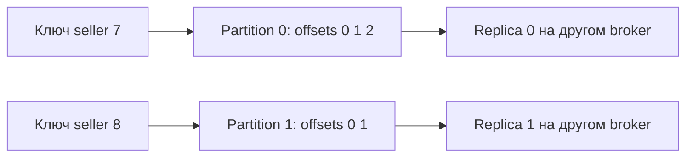

# Topics, partitions и replication

Topic — имя потока, partition — отдельная последовательность с номерами offset. Порядок существует внутри partition; offset 10 первой partition нельзя сравнивать с offset 10 второй как время событий.

Topic — логическое имя stream, partition — физическая ordered log. Record получает monotonically increasing offset после append. Kafka не гарантирует глобальный порядок между partitions.

## Replicas и ISR

Replication factor задаёт число replicas partition. Одна replica — leader, остальные followers. In-Sync Replica (ISR) — follower, который удовлетворяет критериям синхронности с leader; ISR меняется во времени.

Leader принимает writes. При `acks=all` producer ждёт подтверждения всех текущих ISR, а не всех brokers и не обязательно всех назначенных replicas. `min.insync.replicas` задаёт минимальный размер ISR для успешной записи с `acks=all`; типичная защищённая комбинация RF=3, min ISR=2, acks=all выдерживает потерю одного replica для writes, но конкретный RPO также зависит от leader election и durability.

`unclean.leader.election.enable=true` может восстановить availability, выбрав out-of-sync replica ценой потери acknowledged tail. Default безопаснее, но оставляет partition unavailable, пока не вернётся подходящая ISR.

## Жизненный цикл журнала

Partition хранится сегментами. Cleanup policy:

- `delete` удаляет старые segments по времени/размеру;
- `compact` сохраняет последнее значение для каждого key, но compaction asynchronous и не обещает одну физическую запись на key в каждый момент;
- обе политики можно сочетать.

Tombstone (`key` с null value) обозначает удаление при compaction и хранится достаточно долго, чтобы consumers успели его увидеть согласно configuration. Record без key плохо подходит compacted topic.

Retention — не delivery acknowledgement: медленный consumer может потерять ещё не прочитанные records, если они вышли за retention. Наблюдайте lag относительно времени/bytes и sizing storage.

## Ключ распределения

Records одного entity направляют в одну partition по стабильному key, если нужен per-entity order. Добавление partitions меняет modulo/hash mapping стандартного partitioner, поэтому существующий key может пойти в новую partition и нарушить порядок относительно старой history. Планируйте partition count заранее или используйте routing/versioning strategy.

## Порядок и репликация



```text
bin/kafka-topics.sh --bootstrap-server localhost:9092 --create \
  --topic ads --partitions 3 --replication-factor 3 \
  --config min.insync.replicas=2
```

Требуются минимум три доступных brokers; на одном broker команда с RF=3 не создаст желаемый topic. Producer отдельно настраивает acks=all. При RF=3 и ISR из трёх write ждёт текущие ISR; при ISR=2 ещё допустим, при ISR=1 отказ. Это не quorum на каждый произвольный write, а проверка размера текущего ISR плюс replication protocol.

Compaction оставляет актуальное значение key со временем, сохраняя offsets с возможными дырками. Tombstone удаляет состояние; consumer, слишком долго не читавший, может пропустить tombstone после его cleanup и сохранить ошибочное старое состояние. Retention размер задаётся per-partition и удаляет segments, а не точно N самых старых records. Новая partition может изменить routing того же key: миграцию порядка надо проектировать.

## Источники

- [Kafka replication design](https://kafka.apache.org/43/design/replication/)
- [Topic configurations](https://kafka.apache.org/43/configuration/topic-configs/)

## Проверь себя

1. **Kafka даёт общий порядок topics?**

   <details>
   <summary>Ответ</summary>

   Нет, порядок области partition; общий порядок требует отдельного протокола.

   </details>

2. **acks=all с ISR=1 безопасен без minISR?**

   <details>
   <summary>Ответ</summary>

   Он ждёт текущий ISR, который может содержать только leader; требование minISR нужно отдельно.

   </details>
