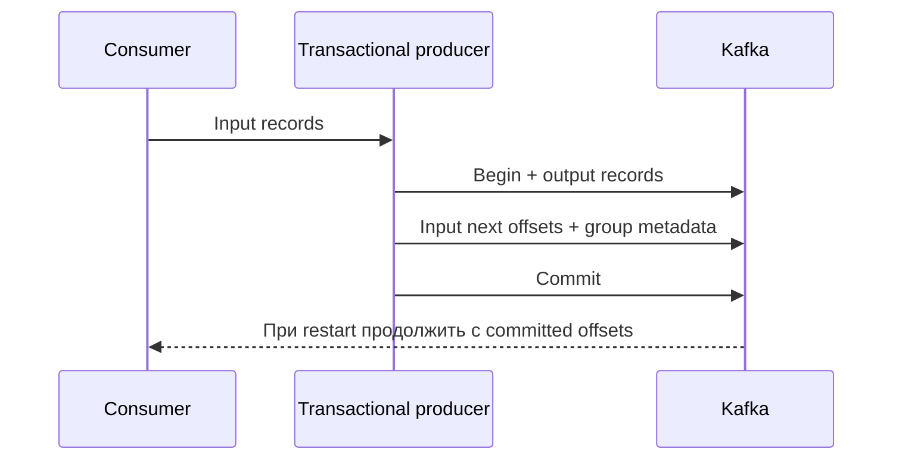

# Kafka transactions

Транзакция Kafka связывает выходные records и позицию прочитанных records. Получатель read_committed видит только завершённые записи; внешний SQL commit в этот набор не входит.

Kafka transaction атомарно помечает набор writes в нескольких topic partitions и, при processing pipeline, offsets consumer group. Она не включает внешнюю database.

## Producer lifecycle

Producer получает стабильный уникальный `transactional.id`, вызывает initialization, затем для каждой unit of work:

```text
beginTransaction
send records
sendOffsetsToTransaction(offsets, group metadata)
commitTransaction
```

При ошибке transaction abort-ится и input offsets не продвигаются. Broker выдаёт producer ID/epoch; новый instance с тем же `transactional.id` fence-ит старый, что защищает от zombie producer. Поэтому ID должен быть уникален для одновременно работающего application instance/partition of work, но стабилен через restart для recovery.

## Видимость записей для читателя

`read_uncommitted` возвращает обычные записи и transactional records, включая записи отменённых транзакций. `read_committed` возвращает только committed records и ограничивает чтение Last Stable Offset; открытая долгая transaction может удерживать видимость последующих records partition.

## Сроки ожидания и ошибки

Обычная transaction должна завершиться в пределах producer `transaction.timeout.ms`, ограниченного broker `transaction.max.timeout.ms`; слишком длинная обработка повышает latency, удерживает LSO и усложняет retry. Некоторые errors retriable, другие требуют abort, пересоздание producer или остановку из-за fencing — используйте client library classification, а не retry любого exception.

## Граница atomicity

Сценарий «записать PostgreSQL и publish Kafka» остаётся dual write: Kafka transaction не координирует commit БД. Используйте [transactional outbox](../transactional-outbox.md), CDC или idempotent reconciliation. Аналогично external API side effect требует idempotency/inbox.

## LSO и остановка видимости

Partition содержит обычную запись offset10, открытую transactional запись offset11 и обычную запись offset12. Пока transaction11 не завершена, read_committed ограничен LSO и не возвращает последующую 12, даже если она не transactional. После commit доступны11 и12; после abort11 пропускается,12 доступна. Offsets имеют дырки, поэтому не вычисляйте число бизнес-records как простую разность offsets.



transaction.timeout.ms — producer setting, broker ограничивает максимально разрешённое значение transaction.max.timeout.ms. Transaction может завершаться раньше из-за иных ошибок. Стабильный transactional.id позволяет новому instance увеличить epoch и fence старый. Два живых instances с одним ID не должны бесконечно перезапускать друг друга.

После abort приложение должно снова получить/перепозиционировать input по правилам библиотеки: локальная consumer position могла уже продвинуться, отсутствие offset commit само не перематывает работающий consumer. Producer API разных Go clients различается; используйте библиотечный transaction lifecycle и классификацию ошибок.

## Источники

- [Kafka transactions design](https://kafka.apache.org/43/design/design/#transactions)
- [Producer API transactions](https://kafka.apache.org/43/javadoc/org/apache/kafka/clients/producer/KafkaProducer.html)

## Проверь себя

1. **Зачем read_committed, если producer transactional?**

   <details>
   <summary>Ответ</summary>

   read_uncommitted возвращает и незавершённые/aborted записи; committed фильтрация находится у читателя.

   </details>

2. **Почему abort не всегда достаточно для повтора?**

   <details>
   <summary>Ответ</summary>

   Consumer position могла продвинуться в памяти; требуется восстановить входную позицию согласно API.

   </details>
