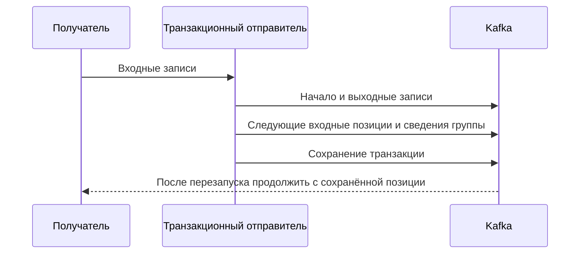

# Транзакции Kafka

Транзакция Kafka связывает несколько выходных записей и сохранённые входные позиции. Это удобно для цепочки «прочитать событие → преобразовать → отправить новое»: либо результат и продвижение позиции сохраняются вместе, либо работа повторяется.

## Последовательность отправителя

Клиент инициализирует транзакционный producer со стабильным `transactional.id`. Затем начинает транзакцию, отправляет записи, добавляет входные **следующие** offsets и сведения группы, завершает `commitTransaction`. При отмене выход не должен стать виден `read_committed`, а сохранённые позиции не продвигаются.

Новый экземпляр с тем же id получает новую эпоху и отстраняет старый — fencing. Это защищает от проснувшегося прежнего отправителя. Id стабилен при восстановлении, но не должен одновременно принадлежать двум независимым живым исполнителям.

## Что увидит читатель

`read_uncommitted` может вернуть и записи отменённой транзакции. `read_committed` фильтрует их и не проходит через незавершённую транзакцию. Граница видимости называется **Last Stable Offset**, LSO; ниже разобрано, почему долгая транзакция задерживает даже последующие обычные записи.

`transaction.timeout.ms` ограничивает срок транзакции клиента, брокер задаёт максимальный допустимый `transaction.max.timeout.ms`. Разные ошибки требуют повтора, отмены или остановки отправителя: используйте классификацию библиотеки.

## Где заканчивается атомарность

SQL-запись и HTTP-платёж не входят в Kafka transaction. Для PostgreSQL + отправки используйте [Outbox: сохранение намерения отправить](../transactional-outbox.md), для безопасной повторной записи — [Inbox: защита эффекта от повторов](../inbox-pattern.md).

После отмены сохранённый offset не продвинут, но локальная позиция работающего consumer могла уже уйти вперёд. Для повтора восстановите входную позицию по правилам конкретной библиотеки: сама отмена не перематывает клиента.

## LSO и остановка видимости

В одной части есть обычная запись 10, открытая транзакционная 11 и обычная 12. `read_committed` пока не возвращает 12: граница LSO остановилась перед незавершённой транзакцией. После её сохранения доступны 11 и 12, после отмены 11 пропускается, а 12 доступна. Пропуски offsets не обязательно означают потерю бизнес-записей.

Срок клиента `transaction.timeout.ms` ограничивается брокером через `transaction.max.timeout.ms`; другие ошибки могут завершить попытку раньше. Стабильный id позволяет новому экземпляру получить новую эпоху и отстранить старый. Два независимых живых экземпляра не должны делить один id и постоянно отстранять друг друга.

После отмены восстановите входную позицию по правилам Go-библиотеки. Её локальное чтение могло уйти вперёд, даже когда сохранённая позиция не менялась. API и классификация ошибок различаются между клиентами; отсутствие сохранения позиции само не перематывает работающего получателя.

## Источники

- [Kafka transactions design](https://kafka.apache.org/43/design/design/#transactions)
- [Producer API transactions](https://kafka.apache.org/43/javadoc/org/apache/kafka/clients/producer/KafkaProducer.html)

## Проверь себя

1. **Зачем read_committed при транзакционном отправителе?**

   

   
Ответ

   Read_uncommitted может вернуть незавершённые и отменённые записи. Фильтрация выполняется на стороне читателя.

   

2. **Почему после отмены транзакции может понадобиться восстановить чтение?**

   

   
Ответ

   Локальная позиция получателя уже могла продвинуться. Несохранённый offset сам не перематывает работающий клиент.

   

