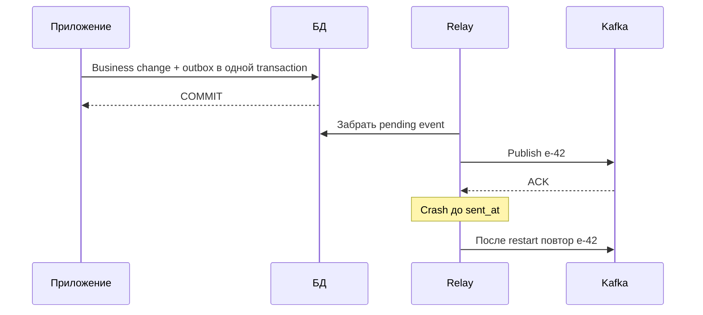

# Transactional Outbox

Outbox — запись намерения отправить событие в той же БД и транзакции, что бизнес-изменение. Отдельный отправитель может повторять публикацию, поэтому получатель всё равно должен выдерживать дубли.

## Задача

Последовательность `COMMIT database → publish event` теряет event при crash между шагами. Обратный порядок публикует event о transaction, которая затем rollback-нулась. Distributed transaction часто недоступна или непропорциональна задаче.

## Механизм

В одной local database transaction измените aggregate и вставьте outbox row:

```sql
BEGIN;
UPDATE orders SET status = 'paid' WHERE id = $1;
INSERT INTO outbox(event_id, aggregate_id, event_type, payload, created_at)
VALUES ($2, $1, 'order.paid.v1', $3, clock_timestamp());
COMMIT;
```

Отдельный relay публикует pending rows. Варианты:

- polling publisher выбирает batches (`FOR UPDATE SKIP LOCKED`), публикует и помечает sent;
- CDC читает WAL/change log и преобразует outbox inserts в events, например через Debezium.

## Guarantees и failure modes

Atomicity БД гарантирует: business change и intent-to-publish существуют вместе. Но relay crash после publish до mark/offset создаёт duplicate. Поэтому `event_id` стабилен, producer/consumer идемпотентны, а outbox cleanup хранит данные дольше максимального retry/replay window.

Polling проще контролировать, но добавляет queries/locking и latency. CDC снижает polling load и сохраняет log order в своей области, но добавляет connector, schema mapping, replication slot retention и сложный recovery.

Ordering требует явного aggregate key и стратегии нескольких relay workers. «Глобальный порядок commit» обычно не нужен и дорог.

## Когда не применять

Если операция целиком Kafka-to-Kafka, Kafka transaction проще. Если потеря уведомления допустима и есть reconciliation job, outbox может быть избыточен. Не используйте outbox как бесконечный event store без отдельного retention/contract design.

## Таблица и падение отправителя

```sql
CREATE TABLE outbox_demo(
    event_id text PRIMARY KEY,aggregate_id bigint NOT NULL,
    aggregate_version bigint NOT NULL,payload jsonb NOT NULL,
    created_at timestamptz NOT NULL DEFAULT now(),sent_at timestamptz,
    UNIQUE(aggregate_id,aggregate_version)
);
INSERT INTO outbox_demo VALUES
('e-42',42,7,'{"status":"paid"}',now(),NULL);
SELECT event_id,aggregate_id,payload FROM outbox_demo
WHERE sent_at IS NULL ORDER BY created_at,event_id LIMIT 100;
-- e-42,42,{"status":"paid"}
```

Вставка выше показывает форму записи; в приложении она выполняется вместе с изменением aggregate. Unique version предотвращает две разные записи одной версии при правильно согласованной версии aggregate.



Не держите row lock во время неограниченного network call. Poller может коротко захватить batch, записать lease/owner и commit, потом отправить; lease expiry возвращает потерянную работу. Это требует идемпотентности и защиты от старого owner при отметке sent. Другой вариант — ограниченная по времени транзакция с publish, но он занимает connection/locks и ухудшает capacity.

SKIP LOCKED не сохраняет порядок одного aggregate: второй worker способен отправить версию 8 раньше 7. Нужны последовательный dispatch по aggregate/shard, проверка версии или получатель с политикой gaps. created_at и sequence ID не обязаны совпадать с порядком commit.

## Источники

- [Debezium outbox event router](https://debezium.io/documentation/reference/stable/transformations/outbox-event-router.html)
- [PostgreSQL SKIP LOCKED](https://www.postgresql.org/docs/18/sql-select.html#SQL-FOR-UPDATE-SHARE)

## Проверь себя

1. **Устраняет ли outbox дубли Kafka?**

   <details>
   <summary>Ответ</summary>

   Нет, обеспечивает совместное сохранение бизнес-данных и намерения; crash после publish создаёт повтор.

   </details>

2. **Почему ORDER BY id плюс SKIP LOCKED не доказывает порядок?**

   <details>
   <summary>Ответ</summary>

   Workers пропускают занятые строки и могут отправить более новую версию раньше.

   </details>
