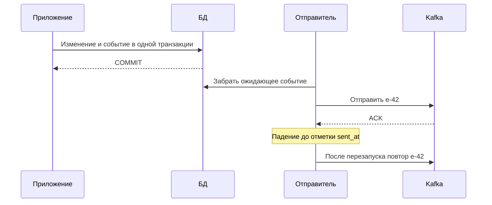

# Outbox: сохранение намерения отправить

Сервис меняет заказ в PostgreSQL и должен сообщить об этом Kafka. Если сначала сохранить заказ, падение до отправки потеряет событие. Если отправить раньше, можно сообщить об изменении, которое база затем откатит.

**Outbox** решает это сохранением намерения: бизнес-изменение и строка будущего события попадают в одну транзакцию той же базы. Отдельный отправитель затем доставляет событие.

## Два способа доставки

Опрос таблицы выбирает ещё не отправленные строки, публикует и помечает их. Это проще наблюдать, но добавляет запросы и задержку. CDC читает изменения журнала, например через Debezium, и преобразует строки outbox в события. Он уменьшает опрос, но добавляет соединитель, настройку схем и удержание журнала репликационным слотом.

## Почему повторы остаются

Отправитель может упасть после подтверждения Kafka, но до отметки в базе. После перезапуска событие отправится снова. Его `event_id` должен остаться прежним, а получатель — выдержать повтор через [Inbox: защита эффекта от повторов](inbox-pattern.md) или другую защиту.

База гарантирует совместное существование изменения и намерения. Она не гарантирует однократную отправку в другую систему. Планируйте повтор, восстановление зависшего отправителя, возраст очереди и безопасную очистку.

## Когда важен порядок

Несколько исполнителей могут отправить версию 8 раньше занятой версии 7. Нужна последовательная доставка по сущности, проверка версии получателем или явная обработка пропусков. Время создания строки и номер sequence не обязательно равны порядку сохранения транзакций.

Для Kafka → Kafka бывает достаточно собственных Kafka transactions. Если потеря необязательного уведомления допустима и есть сверка состояния, цена outbox может быть излишней. Это выбор требуемой гарантии, не обязательный шаблон для любой отправки.

## Таблица и падение отправителя

```sql
CREATE TABLE outbox_demo(
    event_id text PRIMARY KEY,aggregate_id bigint NOT NULL,
    aggregate_version bigint NOT NULL,payload jsonb NOT NULL,
    created_at timestamptz NOT NULL DEFAULT now(),sent_at timestamptz,
    UNIQUE(aggregate_id,aggregate_version)
);
CREATE TABLE outbox_orders(
    id bigint PRIMARY KEY,status text NOT NULL,version bigint NOT NULL
);
INSERT INTO outbox_orders VALUES (42,'new',6);
BEGIN;
UPDATE outbox_orders SET status='paid',version=7
WHERE id=42 AND version=6 RETURNING version;
-- продолжать только после одной возвращённой строки; иначе ROLLBACK
INSERT INTO outbox_demo VALUES
('e-42',42,7,'{"status":"paid"}',now(),NULL);
COMMIT;
SELECT event_id,aggregate_id,payload FROM outbox_demo
WHERE sent_at IS NULL ORDER BY created_at,event_id LIMIT 100;
-- e-42,42,{"status":"paid"}
```

Пример меняет заказ 42 с версии 6 на 7 и сохраняет событие e-42 в той же транзакции. Если вставка события завершится ошибкой, нужен ROLLBACK: изменение заказа также не сохранится. Возвращённая версия 7 подтверждает успешное условное обновление; при нуле строк обработчик не должен вставлять событие. После COMMIT выборка отправителя возвращает e-42 с содержимым оплаченного заказа. Уникальная пара сущности и версии запрещает две строки одной версии, если версия самого заказа согласованно обновляется.



Не удерживайте строковую блокировку во время неограниченного сетевого ожидания. Отправитель может коротко назначить себе пакет со сроком владения, сохранить назначение, затем отправить. Истечение срока возвращает зависшую работу; старый отправитель не должен пометить чужую работу завершённой. Альтернатива — ограниченная по времени отправка внутри транзакции, но она дольше занимает соединения и блокировки.

`SKIP LOCKED` не сохраняет порядок событий одной сущности: занятая версия 7 может быть пропущена, а 8 отправлена раньше. Используйте последовательную отправку по сущности, проверку версий или явную политику пропусков. Время создания строки и номер sequence не гарантируют порядок сохранения транзакций.

## Источники

- [Debezium outbox event router](https://debezium.io/documentation/reference/stable/transformations/outbox-event-router.html)
- [PostgreSQL SKIP LOCKED](https://www.postgresql.org/docs/18/sql-select.html#SQL-FOR-UPDATE-SHARE)

## Проверь себя

1. **Устраняет ли outbox повторную доставку?**

   <details>
   <summary>Ответ</summary>

   Нет. Падение после отправки до отметки в базе повторит событие. Outbox связывает изменение и намерение.

   </details>

2. **Доказывает ли ORDER BY id со SKIP LOCKED порядок событий?**

   <details>
   <summary>Ответ</summary>

   Нет. Один исполнитель пропустит занятую старую строку и отправит новую раньше.

   </details>
