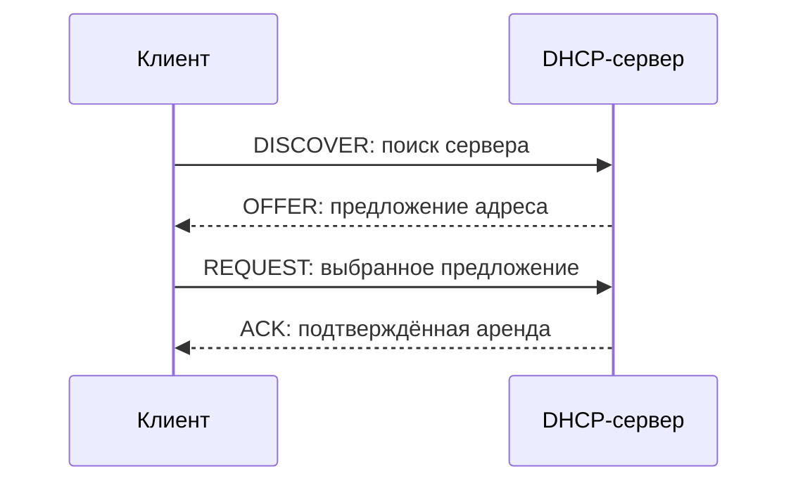

# DHCP: как устройство получает настройки сети

DHCPv4 позволяет устройству автоматически получить IPv4-адрес, маску, шлюз и другие параметры, например адрес DNS-сервера. Сервер выделяет адрес на срок — аренду (lease). Клиент должен продлевать её; связь с сервером не нужна каждую секунду, но адрес нельзя сохранять навсегда без продления.

## Получение новой аренды

Клиент сначала ищет сервер сообщением DISCOVER. Сервер предлагает адрес и параметры в OFFER. Клиент выбирает предложение и отправляет REQUEST; ACK подтверждает аренду. Эти четыре шага часто называют DORA. Предложение ещё не означает, что адрес разрешён к использованию.

Серверов может быть несколько; схема показывает успешный обмен с выбранным. При неподходящем запросе сервер может вернуть NAK. Если клиент обнаружил конфликт полученного адреса, он сообщает DECLINE. RELEASE освобождает аренду; INFORM позволяет уже настроенному клиенту запросить дополнительные параметры без новой аренды.

## Как работает продление

В момент T1 клиент обращается к исходному серверу. Если ответ не получен, в момент T2 он пытается продлить у доступного сервера. По умолчанию T1 равен половине срока, T2 — 0,875 срока; сервер может задать другие значения. При истечении непродлённой аренды клиент прекращает использование адреса. Ниже показана аренда восемь часов.

Обычно продление использует уже назначенный адрес и не повторяет полный DORA. Сервер хранит выделенные адреса. Резервирование связывает адрес с выбранным идентификатором клиента; это не всегда исключительно MAC. Автоматическое постоянное назначение и динамическая ограниченная аренда — разные режимы.

## Почему нужен relay

Изначально клиент может ещё не знать свой адрес и сервер, поэтому используются широковещательные сообщения. Обычный маршрутизатор не пересылает такой обмен в другую сеть. DHCP Relay принимает его на локальном участке и передаёт серверу с необходимыми сведениями о сети клиента.

DHCPv4 использует UDP-порт 67 сервера и 68 клиента. Направление broadcast/unicast зависит от состояния и полей сообщения; нельзя описывать все сообщения как широковещательные. Отсутствие RELEASE также не означает немедленную выдачу адреса другому клиенту: действует срок аренды.

DHCPv6 — другой протокол с другим обменом сообщений; DORA к нему не применяется. DHCP не является механизмом поиска экземпляров прикладного сервиса: настройки сети и service discovery решают разные задачи.

[Адресация](../fundamentals/ip-addressing.md), [UDP](../transport/udp.md), [DNS](dns.md).

## Разбор на примере

Учебная аренда — 8 часов, T1/T2 не заданы отдельно. Обычные значения: через 4 часа клиент пробует прямое продление исходному серверу; через 7 часов обращается к доступным серверам (rebinding). После 8 часов без продления он прекращает использовать адрес. Эти часы вычислены из 0.5 и 0.875 срока аренды, а не универсальные заданные времена.

Клиент перезапустился с известным адресом и хочет подтвердить его — такой обмен может отличаться от полной DORA. Сервер недоступен через широковещательный запрос за маршрутизатором — требуется relay; продление настроенного клиента может идти напрямую по маршруту.

Для backend важно последствие: сменился IP, старые соединения стали недоступны, но DNS/пул ещё живут со старым состоянием. DHCP настраивает устройство, а не обновляет список экземпляров сервиса. Резервирование не гарантирует корректную аутентификацию устройства по MAC.

## Источники

- [RFC 2131: DHCPv4, обмен сообщениями и аренда](https://datatracker.ietf.org/doc/html/rfc2131)
- [RFC 2132: DHCP options](https://datatracker.ietf.org/doc/html/rfc2132)
- [RFC 9915: DHCPv6, отдельный протокол](https://www.rfc-editor.org/info/rfc9915/)

## Проверь себя

1. Что обязан сделать клиент после истечения аренды без продления?
2. Всегда ли продление требует широковещательного поиска и relay?

Ответы

1. Перестать использовать адрес; он может быть выдан другому клиенту.

2. Нет: продление настроенного клиента может быть прямым; первоначальный широковещательный поиск имеет другие условия.

