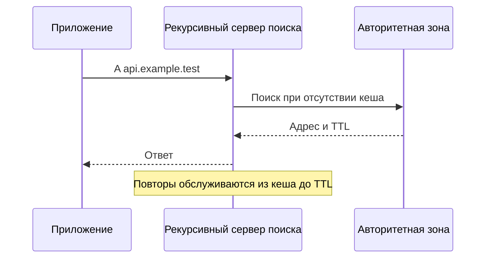

# DNS: как имя превращается в сетевой адрес

Приложению известно имя `api.example.test`, а для соединения нужен IP-адрес. DNS хранит записи имён и помогает их найти. Ответ может быть взят из кэша, поэтому изменение DNS не мгновенно переключает всех клиентов.

## Кто отвечает на запрос

Системный клиент DNS, называемый stub resolver, обращается к настроенному серверу поиска. Рекурсивный сервер (recursive resolver) находит ответ от имени клиента и сохраняет его. Авторитетный сервер (authoritative server) хранит записи своей зоны — части пространства имён — и отвечает за их содержимое. Один сервер может выполнять несколько ролей, но роли различаются.

`A` содержит IPv4-адрес, `AAAA` — IPv6-адрес. `CNAME` указывает другое имя, `MX` — почтовый сервер, `SRV` — параметры службы. Имя может иметь несколько адресов. К какому подключится приложение, зависит от его правил выбора, а не только от порядка DNS-записей.

## Как работает кэш

TTL задаёт, сколько времени полученный ответ можно использовать без нового запроса. Клиенты получают записи в разное время, поэтому срок заканчивается у них не одновременно. Уже открытое соединение обычно продолжает работать без повторного поиска имени.

Ответ «имя не существует» (`NXDOMAIN`) тоже может кэшироваться по правилам отрицательного кэша. Создание записи после такого ответа не гарантирует, что клиент сразу её увидит. Правила срока отрицательного ответа связаны с записью SOA зоны.

## Как менять адрес сервиса

Заранее уменьшите TTL и дождитесь, пока истекут ранее полученные ответы с большим сроком. После смены адреса сохраняйте возможность обслужить клиентов со старыми ответами и открытыми соединениями. Проверяйте не только содержимое DNS, но и успешность подключения к каждому возвращаемому адресу.

Выдача адресов по кругу не гарантирует равномерную нагрузку: один клиент может долго использовать закэшированный адрес и одно соединение. Настройки поиска, `/etc/hosts` и разные ответы для внутренних и внешних сетей также объясняют, почему ноутбук и контейнер видят разные адреса.

## Защита и транспорт

DNSSEC проверяет происхождение и целостность подписанных DNS-данных. Он не скрывает запросы и не заменяет проверку сертификата TLS. Шифрованные способы DNS защищают обмен с выбранным сервером, но имеют свои правила доверия.

Небольшие запросы часто передаются по UDP. Усечённый ответ обычно требует TCP; передача зоны использует TCP. Возможны также DNS поверх TLS, HTTPS и QUIC. Проверка только UDP не подтверждает исправность всех используемых путей.

## Как различать ошибки

`NXDOMAIN` означает отсутствие имени, `SERVFAIL` — невозможность завершить поиск, timeout — отсутствие своевременного ответа. Пустой ответ на конкретный тип записи не обязательно означает отсутствие самого имени. Запишите точное имя, тип запроса, используемый DNS-сервер, код ответа, адреса и TTL. Затем отдельно проверьте подключение и TLS: правильный DNS-ответ ещё не делает сервер доступным. [DNS и TLS в задержке запроса](../backend/dns-and-tls.md).

## Разбор на примере

В 12:00 рекурсивный сервер получил `api.example.test → 192.0.2.10` с TTL 300. В 12:01 владелец зоны сменил адрес на `.20`. Рекурсивный сервер вправе вернуть старый ответ до 12:05: обновление зоны не рассылает очистку всех кешей. Уже открытое TCP-соединение продолжит работать с `.10` и после следующего DNS-поиска.

Для переезда сначала уменьшите TTL и дождитесь истечения ранее выданного большого TTL. Затем подготовьте оба сервера, поменяйте запись и оставьте старый сервер до завершения кешей и соединений. Отдельно проверьте IPv4/IPv6 и негативный кеш: ответ NXDOMAIN тоже может сохраняться по правилам RFC 2308.

```bash
dig api.example.test A
dig api.example.test AAAA
dig @192.0.2.53 api.example.test A
```

Адрес DNS-сервера в примере условный. Сравните `status`, TTL, ответ и время с тем сервером, которым пользуется приложение. SERVFAIL, NXDOMAIN и timeout требуют разных гипотез. DNSSEC подтверждает происхождение данных при сервере с проверкой DNSSEC, но не шифрует запросы; способы DNS поверх HTTPS/TLS (DoH/DoT) защищают соединение с сервером поиска, но не заменяют DNSSEC.



## Источники

- [DNS concepts, RFC 1034](https://www.rfc-editor.org/rfc/rfc1034)
- [DNS implementation, RFC 1035](https://www.rfc-editor.org/rfc/rfc1035)
- [Negative caching, RFC 2308](https://www.rfc-editor.org/rfc/rfc2308)

## Проверь себя

1. Почему новый IP не начинает использоваться сразу после изменения DNS?
2. Чем NXDOMAIN отличается от SERVFAIL?

<details>
<summary>Ответы</summary>

1. Ответ может быть кеширован, а существующее соединение вообще не делает новый поиск.

2. NXDOMAIN — имя не существует; SERVFAIL — сервер поиска не смог получить корректный результат.

</details>
