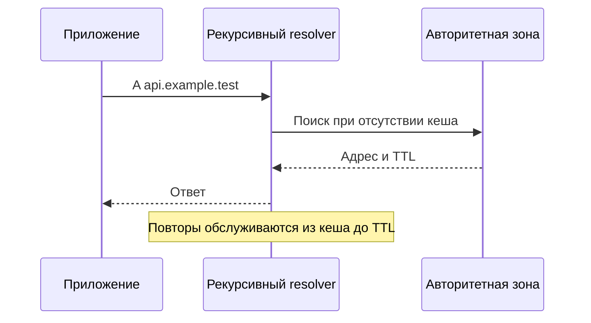

# DNS

DNS находит записи для имени. Рекурсивный resolver ищет ответ и кеширует его, а авторитетный сервер отвечает за содержимое своей зоны. TTL ограничивает срок использования конкретного кешированного ответа.

## Термины в этой статье

- **TTL** — срок действия записи; для DNS — допустимое время её хранения в кэше.
- **endpoint** — конкретный адрес службы или сторона соединения.
- **latency** — время ожидания результата конкретной операции.

DNS — distributed hierarchical database, сопоставляющая names с typed records. Authoritative server хранит данные zone; recursive resolver выполняет/кэширует поиск от имени client-а. Stub resolver приложения обычно обращается к настроенному recursive service.

## Resolution и records

Для имени могут использоваться `A`/`AAAA`, alias `CNAME`, mail `MX`, service metadata `SRV`, delegation `NS`, policy/text `TXT`. Alias и target создают несколько lookup/cache steps. DNS не проверяет, что application на returned IP готово.

Resolver кэширует ответ по TTL. Negative response тоже может кэшироваться по SOA-defined semantics. TTL не гарантирует одновременное обновление клиентов: lookup мог выполняться раньше, а существующий pooled connection вообще не делает новый DNS query.

UDP широко используется, но response с truncation ведёт к TCP; zone transfers используют TCP, а encrypted DNS может идти по TLS/HTTPS/QUIC. Нельзя диагностировать DNS только одним transport assumption.

## Consistency и изменения

До смены endpoint-а уменьшите TTL заранее, затем учитывайте старые cache entries и connection draining. После change наблюдайте queries/answers и connect success по returned IP. Round-robin ordering не гарантирует равномерный request balancing из-за caches, address selection и connection reuse.

DNSSEC даёт origin authentication/integrity DNS data, но не шифрует queries и не заменяет TLS certificate validation. Split-horizon/search suffix и `/etc/hosts` могут дать разные ответы в pod, node и laptop.

## Диагностика

Различайте `NXDOMAIN`, `SERVFAIL`, timeout и empty/no-data response. Фиксируйте resolver, queried name/type, response code, TTL, addresses, latency и затем connect/TLS outcome. Подробнее: [DNS и TLS на critical path](../backend/dns-and-tls.md).

## Разбор на примере

В 12:00 resolver получил `api.example.test → 192.0.2.10` с TTL 300. В 12:01 владелец зоны сменил адрес на `.20`. Resolver вправе вернуть старый ответ до 12:05: обновление зоны не рассылает очистку всех кешей. Уже открытое TCP-соединение продолжит работать с `.10` и после следующего DNS lookup.

Для переезда сначала уменьшите TTL и дождитесь истечения ранее выданного большого TTL. Затем подготовьте оба endpoint, поменяйте запись и оставьте старый endpoint до завершения кешей и соединений. Отдельно проверьте IPv4/IPv6 и негативный кеш: ответ NXDOMAIN тоже может сохраняться по правилам RFC 2308.

```bash
dig api.example.test A
dig api.example.test AAAA
dig @192.0.2.53 api.example.test A
```

Адрес resolver в примере условный. Сравните `status`, TTL, ответ и время с тем resolver, которым пользуется приложение. SERVFAIL, NXDOMAIN и timeout требуют разных гипотез. DNSSEC подтверждает происхождение данных при валидирующем resolver, но не шифрует запросы; DoH/DoT защищают транспорт к resolver, но не заменяют DNSSEC.



## Источники

- [DNS concepts, RFC 1034](https://www.rfc-editor.org/rfc/rfc1034)
- [DNS implementation, RFC 1035](https://www.rfc-editor.org/rfc/rfc1035)
- [Negative caching, RFC 2308](https://www.rfc-editor.org/rfc/rfc2308)

## Проверь себя

1. Почему новый IP не начинает использоваться сразу после изменения DNS?
2. Чем NXDOMAIN отличается от SERVFAIL?

<details>
<summary>Ответы</summary>

1. Ответ может быть кеширован, а существующее соединение вообще не делает новый lookup.

2. NXDOMAIN — имя не существует; SERVFAIL — resolver не смог получить корректный результат.

</details>
