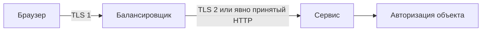

# HTTPS

HTTPS — HTTP внутри защищённого канала TLS. Он защищает путь до точки завершения TLS, но не исправляет ошибки приложения и не гарантирует шифрование следующего участка после reverse proxy.

## Термины в этой статье

- **proxy** — посредник, который принимает соединение или запрос и передаёт его дальше.
- **identity** — подтверждённая личность пользователя или службы.
- **endpoint** — конкретный адрес службы или сторона соединения.
- **mTLS** — TLS с проверкой сертификатов обеих сторон.
- **handshake** — начальный обмен, в котором стороны устанавливают параметры соединения.

HTTPS — HTTP semantics поверх TLS-secured connection. URL scheme `https` определяет secure origin и default port 443; negotiated wire protocol может быть HTTP/1.1, HTTP/2 или HTTP/3.

## Что защищено

При корректной validation TLS защищает HTTP content от чтения/изменения на пути и аутентифицирует server identity по certificate. Он не скрывает все metadata, не защищает compromised endpoint и не заменяет authentication/authorization/input validation.

Для HTTP/1.1/2 обычно выполняются DNS → TCP → TLS → HTTP. HTTP/3 использует QUIC+TLS поверх UDP. Reuse/resumption уменьшает setup cost; измеряйте cold/reconnect path отдельно.

## Termination

TLS может завершаться на edge/load balancer. Тогда proxy видит plaintext и становится trust boundary; hop до backend защищают согласно threat model (TLS/mTLS/network isolation). Forwarded scheme/client-IP headers edge очищает, backend доверяет только известному proxy.

Reverse proxy может использовать другую HTTP version к upstream, поэтому client-side HTTP/3 не означает HTTP/3 во всём path. Certificate/SNI относятся к каждому TLS hop отдельно.

## Browser controls

HSTS заставляет browser использовать HTTPS для host после получения policy; `includeSubDomains`/preload требуют готовности всех names. Secure cookie ограничивает отправку HTTPS, HttpOnly закрывает JavaScript access, SameSite влияет на cross-site sending — ни один attribute не заменяет остальные controls.

Mixed content и insecure redirects снижают protection. Secrets/tokens не помещают в URL даже под HTTPS: URL остаётся в application/proxy logs, history и analytics.

## Разбор на примере

Браузер устанавливает HTTPS с балансировщиком, а тот отправляет обычный HTTP в сервис. Внешний участок защищён, внутренний — нет. Нужно явно определить доверие к этой сети и при необходимости защитить второй hop TLS/mTLS. mTLS удостоверяет workload, а разрешение редактировать объявление всё равно проверяет приложение.

Если edge передаёт `X-Forwarded-Proto: https`, сервис должен доверять этому заголовку только от edge. Прямой клиент может сам отправить такой заголовок. Public edge очищает пришедшие forwarding fields и формирует свои. Ошибка доверия приводит к обходу secure-cookie/redirect policy и ложному client IP.

HTTPS не скрывает всё: наблюдателю доступны IP, размеры, время, иногда имя в handshake. HSTS инструктирует браузер использовать HTTPS после получения политики; includeSubDomains/preload требуют готовности всех охваченных имён.

## Источники

- [HTTP Semantics, RFC 9110](https://www.rfc-editor.org/rfc/rfc9110)
- [HSTS, RFC 6797](https://www.rfc-editor.org/rfc/rfc6797)
- [TLS](tls.md)

## Проверь себя

1. Защищает ли внешний HTTPS участок proxy → backend?
2. Можно ли доверять X-Forwarded-Proto от любого отправителя?

Ответы

1. Только если на этом участке отдельно настроена защита; TLS termination завершает первый канал.

2. Нет, только очищенным полям от доверенного proxy.

