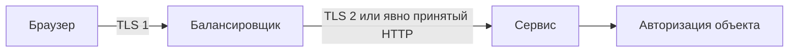

# HTTPS: где заканчивается защита HTTP-запроса

HTTPS передаёт HTTP через защищённое соединение. При правильной проверке сертификата клиент убеждается, что подключился к ожидаемому серверу, а участники на пути не могут незаметно прочитать или изменить содержимое обмена. Для HTTP/1.1 и HTTP/2 обычно используется TLS поверх TCP; HTTP/3 использует QUIC с TLS 1.3 поверх UDP.

## Что защищено, а что видно

Шифруются HTTP-заголовки и тело между участниками защищённого соединения. IP-адреса, время отправки и размеры пакетов могут оставаться видимыми. Клиент и сервер видят расшифрованные данные: заражённый участник или ошибка приложения не исправляются шифрованием канала.

Проверка сервера не проверяет права пользователя. Приложение отдельно устанавливает, кто отправил запрос, что ему разрешено и допустимы ли входные данные. Порт по умолчанию для `https` — 443, но номер порта сам по себе не доказывает наличие защиты.

## Если TLS завершается на балансировщике

Балансировщик принимает защищённое соединение, расшифровывает запрос и отправляет его сервису через другое соединение. Это называют завершением TLS (termination). Защита первого участка не распространяется автоматически на второй: его можно отдельно защитить TLS, при необходимости проверяя обе стороны через mTLS.

Сертификат и имя сервера проверяются для каждого защищённого участка. Балансировщик может говорить с клиентом по HTTP/3, а с сервисом по HTTP/1.1. Сервис доверяет сведениям о клиенте из forwarding-заголовков только от известного посредника, который предварительно удалил поддельные значения.

## Почему важны настройки браузера

HSTS сообщает браузеру использовать HTTPS для имени в течение заданного срока. Политика начинает действовать после её корректного получения; включение поддоменов и предварительного списка браузера требует готовности всех затронутых имён.

Атрибут cookie `Secure` ограничивает передачу защищённым каналом, `HttpOnly` закрывает чтение через JavaScript, `SameSite` влияет на отправку при обращении с другого сайта. Это разные ограничения; ни одно не заменяет проверку прав на сервере. Загрузка небезопасных ресурсов и переход на HTTP могут ослабить ожидаемую защиту.

Не помещайте токены и пароли в URL: даже при HTTPS адрес может попасть в историю браузера, журналы прокси и аналитику. Измеряйте первый запрос отдельно от последующих: поиск DNS, установка соединения и согласование TLS могут отсутствовать при повторном использовании готового соединения.

## Разбор на примере

Браузер устанавливает HTTPS с балансировщиком, а тот отправляет обычный HTTP в сервис. Внешний участок защищён, внутренний — нет. Нужно явно определить доверие к этой сети и при необходимости защитить второй участок TLS/mTLS. mTLS удостоверяет сервис по сертификату, а разрешение редактировать объявление всё равно проверяет приложение.

Если внешний прокси передаёт `X-Forwarded-Proto: https`, сервис должен доверять этому заголовку только от этого прокси. Прямой клиент может сам отправить такой заголовок. Внешний прокси очищает полученные заголовки пересылки и формирует свои. Ошибка доверия приводит к ошибочному выбору правил cookie и перенаправления и ложному адресу клиента.

HTTPS не скрывает всё: наблюдателю доступны IP, размеры, время, иногда имя в начальном обмене. HSTS инструктирует браузер использовать HTTPS после получения политики; охват поддоменов и включение в предварительный список браузера требуют готовности всех охваченных имён.

## Источники

- [HTTP Semantics, RFC 9110](https://www.rfc-editor.org/rfc/rfc9110)
- [HSTS, RFC 6797](https://www.rfc-editor.org/rfc/rfc6797)
- [TLS](tls.md)

## Проверь себя

1. Защищает ли внешний HTTPS участок от прокси к backend?
2. Можно ли доверять X-Forwarded-Proto от любого отправителя?

Ответы

1. Только если на этом участке отдельно настроена защита; завершение TLS заканчивает первый канал.

2. Нет, только очищенным полям от доверенного прокси.

