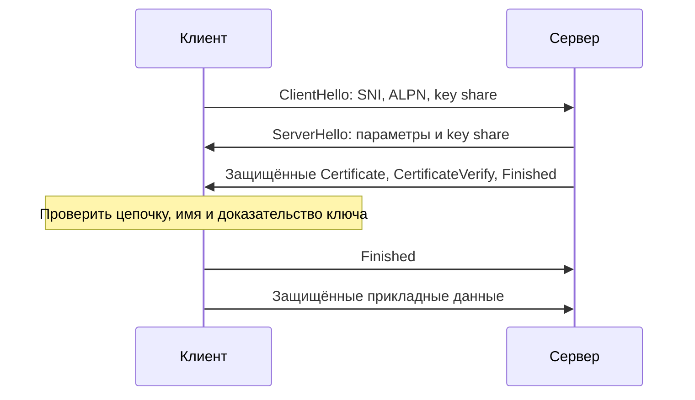

# TLS: шифрование и проверка стороны соединения

TLS защищает данные между участниками соединения от чтения и незаметного изменения на пути. При обычном HTTPS клиент также проверяет сервер. Сертификат связывает открытый ключ с именем, а сервер доказывает владение соответствующим секретным ключом. Для шифрования основного обмена стороны получают отдельные симметричные ключи.

## Как клиент понимает, кому доверять

Клиент хранит доверенные корневые сертификаты. Сервер предъявляет сертификат своего имени и нужные промежуточные сертификаты. Проверка строит цепочку до доверенного корня, проверяет подписи, имя сервера, сроки и допустимое назначение сертификата. Доверенная подпись для чужого имени не разрешает подключение к нужному сайту.

Согласование имени SNI помогает серверу выбрать сертификат среди нескольких сайтов. Оно не заменяет проверку имени клиентом. ALPN согласует прикладной протокол, например HTTP/2. Настройки доверия и разрешённых алгоритмов также часть проверки.

## Обмен TLS 1.3 по шагам

ClientHello сообщает поддерживаемые параметры и данные для согласования ключей. ServerHello выбирает вариант. После согласования ключей следующие сообщения начального обмена зашифрованы. CertificateVerify доказывает владение секретным ключом, а Finished подтверждает целостность предыдущего обмена.

В обычном полном обмене используется временный обмен ключами (EC)DHE. Он позволяет не раскрывать прошлый обычный обмен при последующей утечке долговременного ключа сервера — это свойство forward secrecy. Старый способ передачи секретного ключевого материала через RSA не является вариантом TLS 1.3. Для возобновления на основе заранее известного секрета (PSK) условия отличаются.

Ключи для направлений клиент→сервер и сервер→клиент выводятся отдельно функцией HKDF. Данные шифруются с проверкой целостности (AEAD). Эти названия полезны при чтении спецификации, но не требуют самостоятельного написания криптографии: приложение использует поддерживаемую библиотеку.

## Почему TLS не выделяет сообщения приложения

TLS делит поток на защищённые записи (records). Границы записей не обязаны совпадать с запросами приложения. HTTP или другой протокол выше задаёт собственные границы сообщений. После расшифровки входные данные всё ещё недоверенны и требуют безопасного разбора.

Содержимое скрыто от наблюдателя на пути, однако адреса, время передачи, размеры и часть начальных параметров могут быть видны. Шифрование канала не защищает данные от самого сервера и не исправляет утечку в его журнал.

## Возобновление и ранние данные

Сервер может выдать билет сессии для следующего соединения. Это уменьшает часть работы при повторном подключении; ключи билетов и сроки их действия требуют управления. Режим 0-RTT позволяет передавать ранние данные, но они могут быть воспроизведены повторно. Для них также отличаются условия forward secrecy. Отключайте этот режим для недопустимых повторных изменений или применяйте явно предусмотренные правила защиты.

## Что проверять при ошибке

Сравните имя подключения и SNI, часы, цепочку сертификатов и набор доверенных корней. Затем проверьте совместимость версий/алгоритмов и выбранный ALPN. Если TLS завершается на прокси, проверяйте каждый защищённый участок отдельно. Отключение проверки сертификата скрывает ошибку и лишает клиента нужной гарантии.

Автоматизируйте продление сертификатов и предупреждайте об истечении срока заранее. mTLS проверяет сертификаты обеих сторон; какие операции разрешены этой стороне, решает отдельная политика приложения. [TLS в безопасности backend](../../security/tls.md).

## Разбор на примере

Клиент идёт на `api.example.test`, но балансировщик выдаёт сертификат для `internal.example.test`. Цепочка может быть доверенной и не просроченной, однако проверка имени провалится. Подмена `Host` в HTTP не исправляет TLS: имя для SNI и проверки сертификата требуется раньше HTTP-запроса.

```bash
openssl s_client -connect api.example.test:443   -servername api.example.test -verify_hostname api.example.test   -verify_return_error </dev/null
```

Команда рассчитана на Unix-оболочку с OpenSSL. Адрес учебный: замените его доступным сервером. `-servername` передаёт SNI, `-verify_hostname` проверяет имя, `-verify_return_error` останавливает обмен при ошибке проверки. Сопоставьте цепочку, результат проверки и выбранную версию TLS. Если нужно проверить выбор HTTP/2 через ALPN, добавьте `-alpn h2,http/1.1` и найдите выбранный прикладной протокол в выводе. Сам факт подключения через s_client без параметров проверки не подтверждает проверку имени.

В TLS 1.3 обычный полный обмен с временными ключами (EC)DHE даёт forward secrecy: поздняя кража долговременного ключа сертификата сама по себе не раскрывает сохранённые прошлые соединения. Возобновление только по PSK и ранние данные имеют другие свойства. 0-RTT может быть воспроизведён: банковское изменение состояния нельзя разрешать лишь потому, что канал зашифрован.



## Источники

- [TLS 1.3, RFC 8446](https://www.rfc-editor.org/rfc/rfc8446)
- [Secure use of TLS, RFC 9325](https://www.rfc-editor.org/rfc/rfc9325)

## Проверь себя

1. Почему доверенной цепочки недостаточно?
2. Безопасен ли POST в 0-RTT автоматически?

<details>
<summary>Ответы</summary>

1. Нужны правильное имя, срок, назначение и политика доверия; проверка цепочки закрывает только часть условий.

2. Нет. Ранние данные могут быть воспроизведены повторно; нужна предусмотренная безопасность повторения или запрет этого режима для операции.

</details>
