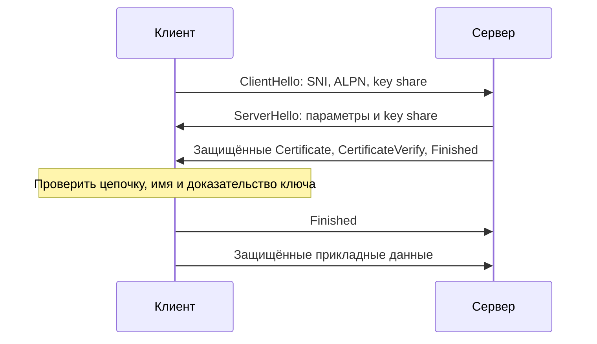

# TLS

TLS шифрует канал и позволяет проверить сторону соединения. Сертификат связывает открытый ключ с именем; секретный ключ доказывает владение им. Сертификат сам по себе не шифрует весь HTTP-трафик: для него выводятся симметричные ключи.

## Термины в этой статье

- **handshake** — начальный обмен, в котором стороны устанавливают параметры соединения.
- **SNI** — имя сервера, которое клиент передаёт во время установки TLS.
- **ALPN** — согласование прикладного протокола во время установки защищённого соединения.
- **AEAD** — шифрование, которое одновременно позволяет проверить целостность данных и связанных заголовков.
- **payload** — полезные данные сообщения, без служебных заголовков.
- **0-RTT** — передача ранних данных до завершения обычного обмена подтверждениями; возможен повтор данных.
- **RTT** — время прохождения запроса и ответа по сети.

TLS защищает конфиденциальность и целостность обмена и проверяет сторону соединения по выбранной политике доверия. SSL 2.0/3.0 и старые версии TLS относятся к истории протокола, а не к современному варианту подключения.

## TLS 1.3 handshake

Клиент отправляет ClientHello: поддерживаемые версии, наборы алгоритмов, данные для согласования ключей и расширения, включая SNI и ALPN. Сервер выбирает параметры в ServerHello. После согласования ключей следующие сообщения handshake зашифрованы. Сервер передаёт цепочку сертификатов; CertificateVerify доказывает владение секретным ключом, Finished подтверждает целостность предыдущего обмена. Клиент проверяет цепочку доверия, имя сервера, сроки, назначение сертификата и свою политику до передачи обычных прикладных данных.

TLS 1.3 использует (EC)DHE для обычного full handshake и AEAD record protection; старый RSA key transport не является TLS 1.3 flow. Симметричные traffic keys выводятся через HKDF и меняются независимо по направлениям.

## Records и границы

Record layer фрагментирует и защищает данные, но application message boundaries задаёт верхний protocol. TLS скрывает content, не все metadata: addresses, timing, sizes и часть handshake информации могут быть видимы. TLS не делает недоверенный payload безопасным для parser-а.

## Resumption и 0-RTT

После handshake server может выдать session tickets для PSK resumption. Это уменьшает setup cost, но tickets/keys имеют lifecycle и rotation. 0-RTT early data replayable: server не может дать обычную replay protection TLS; разрешайте только явно replay-safe semantics или отключайте.

## Certificates и operations

Сертификат связывает открытый ключ с именем или личностью через цепочку издателей. Автоматизируйте выпуск и продление, защищайте секретные ключи, обеспечивайте период перехода на новый сертификат и предупреждение до истечения срока. mTLS проверяет сертификат клиента; решение о разрешённых действиях принимает приложение.

Диагностика: точные hostname/SNI, clock, chain/intermediates, trust store, protocol/cipher, ALPN, alert и termination hop. Никогда не отключайте verification как production mitigation. См. [TLS security](../../security/tls.md).

## Разбор на примере

Клиент идёт на `api.example.test`, но балансировщик выдаёт сертификат для `internal.example.test`. Цепочка может быть доверенной и не просроченной, однако проверка имени провалится. Подмена `Host` в HTTP не исправляет TLS: имя для SNI/verification требуется раньше HTTP-запроса.

```bash
openssl s_client -connect api.example.test:443   -servername api.example.test -verify_hostname api.example.test   -verify_return_error </dev/null
```

Пример запускается в Unix shell и требует доступного endpoint. Сопоставьте цепочку, verification result и выбранный протокол. Обычный `s_client` без нужных flags не является доказательством успешной проверки имени.

В TLS 1.3 обычный full handshake с эфемерным (EC)DHE даёт forward secrecy: поздняя кража долговременного ключа сертификата сама по себе не раскрывает сохранённые прошлые соединения. PSK-only resumption и early data имеют другие свойства. 0-RTT может быть воспроизведён: банковскую mutation нельзя разрешать лишь потому, что канал зашифрован.



## Источники

- [TLS 1.3, RFC 8446](https://www.rfc-editor.org/rfc/rfc8446)
- [Secure use of TLS, RFC 9325](https://www.rfc-editor.org/rfc/rfc9325)

## Проверь себя

1. Почему доверенной цепочки недостаточно?
2. Безопасен ли POST в 0-RTT автоматически?

<details>
<summary>Ответы</summary>

1. Нужны правильное имя, срок, назначение и политика доверия; проверка цепочки закрывает только часть условий.

2. Нет. Early data replayable; нужна доказанная безопасность повторения или запрет early data для операции.

</details>
