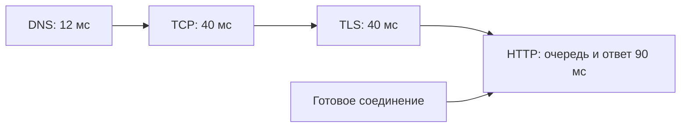

# DNS и TLS на critical path

Перед первым HTTPS-запросом обычно нужно найти адрес, установить транспорт и проверить защищённый канал. Эти этапы имеют разные ошибки и могут вообще отсутствовать при использовании готового соединения из пула.

## Термины в этой статье

- **TTL** — срок действия записи; для DNS — допустимое время её хранения в кэше.
- **pool** — набор объектов, например соединений, которые используются повторно.
- **rotation** — замена ключа или секрета с прекращением использования предыдущего.
- **endpoint** — конкретный адрес службы или сторона соединения.
- **handshake** — начальный обмен, в котором стороны устанавливают параметры соединения.
- **SNI** — имя сервера, которое клиент передаёт во время установки TLS.
- **ALPN** — согласование прикладного протокола во время установки защищённого соединения.

## DNS resolution

Application может обращаться через stub resolver, OS service, local cache и recursive resolver; caching существует на нескольких уровнях и зависит от runtime/platform. Positive TTL задаётся DNS data, negative caching имеет отдельную semantics. Нельзя предполагать, что client мгновенно увидит новый address после DNS change.

Для connection pool DNS обычно применяется при создании нового connection, не для уже открытого. Долгоживущие connections могут пережить rotation endpoint-а; lifetime/drain и retry должны согласовываться с service discovery. Слишком частый lookup увеличивает latency/load, слишком долгий собственный cache удерживает stale адреса.

Измеряйте lookup latency/outcome, returned address family, cache layer, connect outcome по IP и timestamp. Не используйте DNS round-robin как гарантию равномерной нагрузки: resolver/client caching и connection reuse меняют distribution.

## TLS 1.3 handshake

После TCP (для HTTP/1.1/2) client отправляет ClientHello с versions, cipher suites, extensions, SNI и ALPN; server выбирает параметры, предоставляет certificate chain и доказательство private key, стороны выводят traffic keys. Client обязан проверить chain, hostname, validity и policy. ALPN выбирает, например, `h2` или `http/1.1`.

TLS 1.3 full handshake обычно позволяет application data после одного network round trip сверх transport establishment. Session resumption через PSK уменьшает cryptographic/setup cost. 0-RTT early data может быть replayed и не имеет полной forward secrecy для early data: допускайте только операции с безопасной replay semantics и explicit server policy.

QUIC интегрирует TLS 1.3 handshake с transport establishment; HTTP/3 избегает отдельного TCP handshake, но UDP reachability/fallback и connection migration добавляют свои состояния.

## Operations

Разделяйте DNS, connect и TLS latency/errors. Проверяйте clock, SNI/hostname, chain/intermediate, trust store, certificate expiry, ALPN, proxy termination и MTU/firewall. Connection reuse скрывает handshake cost в steady state, поэтому cold-start и reconnect storm тестируются отдельно.

См. [TLS security](../../security/tls.md), [DNS protocol](../application/dns.md) и [TLS protocol](../application/tls.md).

## Разбор на примере

В условном trace DNS занял 12 мс, TCP connect 40 мс, TLS 40 мс, ожидание ответа 90 мс: холодный запрос около 182 мс плюс передача. Повтор по готовому соединению может не платить первые 92 мс. Поэтому сравнение «после оптимизации стало быстрее» без доли reuse может измерять прогрев, а не изменение приложения.

При failover DNS показывает новый IP, но старый пул остаётся соединён со старым сервером. TTL не закрывает эти соединения. Согласуйте drain, lifetime, readiness и безопасное повторение на новом endpoint. Не сбрасывайте все пулы одновременно: reconnect storm нагружает resolver и TLS CPU.

В Go `httptrace.ClientTrace` позволяет разделить DNSStart/DNSDone, ConnectStart/Done, TLSHandshakeStart/Done, GotConn и GotFirstResponseByte. GotFirstResponseByte после готового соединения ещё включает proxy, серверную очередь и приложение: это не чистое время БД.

## Источники

- [DNS concepts and facilities, RFC 1034](https://www.rfc-editor.org/rfc/rfc1034)
- [TLS 1.3, RFC 8446](https://www.rfc-editor.org/rfc/rfc8446)
- [QUIC-TLS, RFC 9001](https://www.rfc-editor.org/rfc/rfc9001)

## Проверь себя

1. Почему тёплый и холодный запрос нельзя смешивать при оценке TLS?
2. Гарантирует ли истёкший TTL переподключение?

Ответы

1. Тёплый reuse может вообще не выполнять handshake; распределение нагрузки меняет итог.

2. Нет, TTL относится к DNS-ответу, не к сроку существующего соединения.

