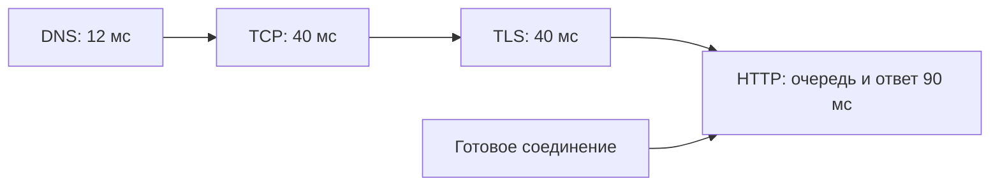

# DNS и TLS: почему первый запрос бывает медленнее

Перед первым HTTPS-запросом клиент обычно находит IP по имени, устанавливает соединение и проверяет защищённый канал. Затем сервер выполняет запрос. При повторном использовании соединения первые этапы могут отсутствовать: сравнение только общей задержки смешивает разные причины.

## Когда приложение снова ищет адрес

DNS-ответ может храниться в системном сервисе, локальном кэше или рекурсивном сервере поиска. TTL ограничивает срок использования полученной записи, но правила конкретных библиотек и платформ различаются. Отрицательные ответы имеют собственный срок хранения.

Пул соединений — набор уже открытых связей — обычно ищет DNS при создании новой связи. Существующее соединение не обязано переподключаться после изменения записи. Поэтому при смене адресов нужно учитывать и кэши, и завершение старых соединений. Слишком частый поиск создаёт лишнюю нагрузку, а чрезмерно долгий собственный кэш удерживает недоступный адрес.

Запишите время поиска, точный DNS-сервер, семейство адреса IPv4/IPv6 и выбранный IP. Если поиск успешен, отдельно проверьте подключение к этому адресу. Выдача нескольких адресов по кругу не гарантирует одинаковый поток запросов к каждому серверу.

## Что происходит после подключения

Для HTTP/1.1 и HTTP/2 клиент сначала устанавливает TCP-соединение. Затем TLS согласует версию, алгоритмы и ключи. SNI передаёт имя нужного сервера, ALPN выбирает прикладной протокол, например `h2`. Сертификат проверяют по цепочке доверия, имени, срокам и допустимому назначению.

Обычный TLS 1.3 позволяет начать передачу прикладных данных после одного обмена туда-обратно сверх установки TCP. Возобновление ранее установленной сессии уменьшает часть затрат. Ранние данные 0-RTT могут быть воспроизведены повторно и не имеют полной forward secrecy: последующая компрометация соответствующих секретов может нарушить их защиту. Используйте только явно разрешённые безопасные для такого режима операции.

QUIC совмещает TLS и установку транспорта. Это убирает отдельный TCP-handshake, но добавляет необходимость доступности UDP и возможный переход на другой протокол.

## Как найти медленный этап

Разделяйте DNS, подключение, TLS и ожидание ответа сервера. Ошибка имени сертификата, просроченный сертификат, неправильные часы и отсутствие промежуточного сертификата требуют разных исправлений. Большой пакет может застрять из-за MTU или сетевого фильтра, даже если небольшой начальный обмен прошёл.

Проверьте массовое переподключение после обновления: обычная нагрузка может хорошо работать на готовых соединениях, а одновременный поиск имён и установка тысяч новых соединений создадут отдельный всплеск. Ниже показан расчёт этапов; он не предсказывает задержку всех запросов. [Безопасность TLS](../../security/tls.md), [DNS](../application/dns.md), [TLS](../application/tls.md).

## Разбор на примере

В учебном измерении DNS занял 12 мс, подключение TCP 40 мс, TLS 40 мс, ожидание ответа 90 мс: холодный запрос около 182 мс плюс передача. Повтор по готовому соединению может не платить первые 92 мс. Поэтому сравнение «после оптимизации стало быстрее» без доли повторно использованных соединений может измерять прогрев, а не изменение приложения.

После переключения на резервный сервер DNS показывает новый IP, но старый пул остаётся соединён со старым сервером. TTL не закрывает эти соединения. Согласуйте завершение старых запросов, срок соединений и готовность нового сервера. Массовый сброс пулов создаёт одновременный поиск DNS и согласование TLS: они тоже требуют мощности.

В Go `httptrace.ClientTrace` сообщает отдельные события: DNSStart/DNSDone — начало и завершение поиска; ConnectStart/ConnectDone — подключения; TLSHandshakeStart/TLSHandshakeDone — TLS; GotConn — получение соединения; GotFirstResponseByte — первый байт ответа. Время между готовым соединением и первым байтом включает прокси, очередь и приложение, а не только БД.

## Источники

- [DNS concepts and facilities, RFC 1034](https://www.rfc-editor.org/rfc/rfc1034)
- [TLS 1.3, RFC 8446](https://www.rfc-editor.org/rfc/rfc8446)
- [QUIC-TLS, RFC 9001](https://www.rfc-editor.org/rfc/rfc9001)

## Проверь себя

1. Почему тёплый и холодный запрос нельзя смешивать при оценке TLS?
2. Гарантирует ли истёкший TTL переподключение?

Ответы

1. Запрос по готовому соединению может вообще не выполнять согласование TLS. Доля таких запросов меняет общую оценку.

2. Нет, TTL относится к DNS-ответу, не к сроку существующего соединения.

