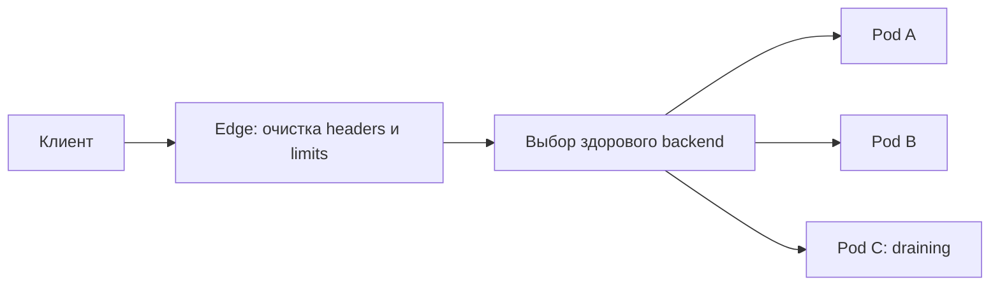

# Reverse proxy и load balancing

Reverse proxy принимает запросы вместо сервисов, а балансировщик выбирает, куда их отправить. Выбор по соединениям и выбор по отдельным запросам ведут себя по-разному при HTTP/2.

## Термины в этой статье

- **proxy** — посредник, который принимает соединение или запрос и передаёт его дальше.
- **endpoint** — конкретный адрес службы или сторона соединения.

Forward proxy действует от имени client-а; reverse proxy принимает traffic от имени origin services. Load balancer выбирает backend target, но может одновременно завершать TLS, нормализовать HTTP, ограничивать нагрузку и собирать telemetry.

## L4 и L7

| Уровень | Видит | Сильные стороны | Цена/ограничение |
|---|---|---|---|
| L4 | адреса, ports, transport connection | protocol-agnostic, меньше parsing, passthrough | не маршрутизирует по HTTP route/header, coarse policy |
| L7 | application protocol/request | host/path/header routing, auth/rate limit, retries | termination/parsing cost, protocol semantics и новый failure point |

Конкретный продукт может смешивать уровни. Выбирайте по требуемой policy и encryption boundary, не по лозунгу «L7 умнее».

## Balancing и affinity

Round robin, least connections/load, hashing и locality имеют разные assumptions. Одна HTTP/2/QUIC connection несёт много requests, поэтому connection-level L4 балансировка может дать менее ровное request distribution. Sticky session уменьшает cache/session movement, но создаёт hotspots и усложняет failover; server-side shared state обычно устойчивее.

## Health и lifecycle

Liveness target-а не равна readiness обслужить новый traffic. Passive health видит реальные failures; active probe должна проверять необходимые dependencies, но не создавать cascade. При deploy: mark unready → прекратить новые connections/requests → drain in-flight до deadline → close. Keep-alive, LB deregistration delay и application shutdown согласуются.

L7 retry опасен для streaming/mutations и усиливает load; он должен знать idempotency, retryable condition и общий budget. Проксируемые `Forwarded`/`X-Forwarded-*` очищайте на public edge и доверяйте только известным hops, особенно для client IP/scheme/security policy.

## Failure modes

Load balancer не создаёт capacity: при перегрузке всех targets нужна admission/load shedding. Control-plane update, stale discovery, uneven connection age, DNS cache, NAT/port limits и correlated zone failure должны иметь metrics и rehearsal.

См. [load balancing](../../system-design/fundamentals/load-balancing.md), [retries](../../backend-patterns/retries.md) и [Kubernetes Service/Ingress](../../containers/kubernetes/networking.md).

## Разбор на примере

Два клиента открыли по одному HTTP/2-соединению. Первый посылает 1000 запросов/с, второй — 10. L4-балансировщик закрепил их за разными pod: соединений поровну, нагрузки — нет. L7 может распределять отдельные requests, но требует завершения и разбора протокола. Least-connections не измеряет число активных streams автоматически.

При rolling deploy pod стал unready, но обновление endpoint ещё не дошло до всех proxy. Закрытие listener в ту же миллисекунду создаёт refused/reset. Нужно учесть propagation и bounded drain; текущие длинные streams имеют отдельную политику.

Если client, proxy и сервис делают по три попытки, один логический запрос может породить до `3 × 3 × 3 = 27` downstream вызовов. Выбирайте один владеющий повтором уровень, deadline и retry budget. Истинный client IP извлекают из доверенной цепочки proxy; нельзя брать первый произвольный X-Forwarded-For.

## Проверь себя

1. Почему равное число HTTP/2-соединений не означает равную нагрузку?
2. Почему retry на каждом hop опасен?

Ответы

1. Разные соединения несут разное число streams и запросов.

2. Попытки перемножаются, увеличивают нагрузку и могут повторить mutation.

