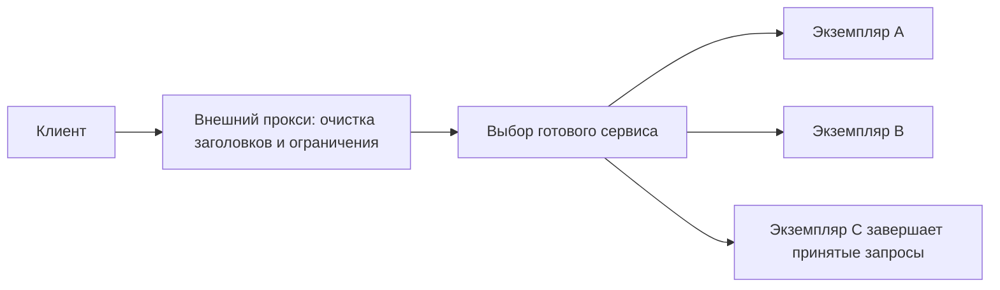

# Прокси и балансировка нагрузки

Обратный прокси (reverse proxy) принимает запросы вместо сервисов и пересылает их дальше. Балансировщик выбирает экземпляр сервиса, который получит работу. Это могут быть функции одного компонента. Прямой прокси (forward proxy) решает обратную задачу: действует от имени клиента, например для его выхода в сеть.

## Почему балансировка соединений отличается от запросов

Балансировщик транспортного уровня (L4) обычно выбирает назначение по адресу, порту и соединению. Он не должен разбирать HTTP-путь и может пропускать защищённый трафик без расшифровки. Балансировщик прикладного уровня (L7) читает запросы и может выбирать сервис по имени сайта, пути или заголовку. Разбор, завершение TLS и дополнительные проверки расходуют ресурсы и создают ещё одну точку отказа.

## Как выбирается экземпляр

Выбор по кругу прост, но не учитывает цену запросов. Выбор по числу соединений тоже может ошибаться при разном числе запросов внутри них. Можно учитывать текущую нагрузку или закреплять ключ за экземпляром через хеширование. Любой способ зависит от того, какие показатели доступны и насколько они свежие.

Закрепление сессии за сервером (affinity) уменьшает перенос локального состояния, но перегружает популярный экземпляр и осложняет его потерю. Если возможно, храните необходимое состояние так, чтобы другой экземпляр мог продолжить работу.

## Как остановить экземпляр без обрыва всех запросов

Живой процесс не обязательно готов принимать новые запросы. Проверка готовности должна показывать возможность обслуживания, а не только существование процесса. Наблюдения за реальными ошибками дополняют отдельные проверочные запросы; сами проверки не должны создавать перегрузку зависимостей.

При обновлении сначала исключают экземпляр из новых назначений, ждут распространения этого решения, затем дают уже принятым запросам завершиться до срока. Этот этап называется draining. Задержка обновления балансировщика, старые соединения и срок остановки приложения должны согласовываться.

## Повторы и доверие

Повтор на прокси может увеличить нагрузку и дважды выполнить изменение состояния. Нужны известные условия повтора, общий срок операции и воспроизводимое тело запроса. Потоковую передачу нельзя повторить, если уже прочитанные данные недоступны.

`Forwarded` и `X-Forwarded-*` могут описывать адрес клиента и исходный протокол. Публичный посредник удаляет поддельные значения, а backend принимает сведения только от доверенного участка. Иначе пользователь может сам объявить себя внутренним клиентом.

Балансировщик не создаёт вычислительную мощность. Если перегружены все экземпляры, нужно контролировать входящую работу, снижать её цену или добавлять ресурсы. Также проверяйте устаревший список назначений, неравномерный возраст соединений и общий отказ зоны. [Механизмы балансировки](../../system-design/fundamentals/load-balancing.md), [повторы](../../backend-patterns/retries.md), [Kubernetes networking](../../containers/kubernetes/networking.md).

## Разбор на примере

Два клиента открыли по одному HTTP/2-соединению. Первый отправляет 1000 запросов/с, второй — 10. Транспортный балансировщик закрепил их за разными экземплярами: соединений поровну, работы нет. Прикладной балансировщик может выбирать назначение отдельно для запросов. Алгоритм «меньше соединений» сам не измеряет количество активных потоков.

При обновлении экземпляр перестал объявлять готовность, но новый список назначений ещё не дошёл до всех посредников. Если сразу закрыть слушающий сокет, продолжающие приходить подключения получат отказ или сброс. Нужно учесть распространение изменения и дать уже принятым запросам завершиться до срока. Для долгих потоков предусмотрите отдельную политику завершения.

Если клиент, прокси и сервис делают по три попытки, один запрос может породить до `3 × 3 × 3 = 27` вызовов зависимости. Выберите ответственный уровень, общий срок и предел попыток. Адрес исходного клиента получают из доверенной цепочки, а не из первого произвольного X-Forwarded-For.

## Проверь себя

1. Почему равное число HTTP/2-соединений не означает равную нагрузку?
2. Почему повтор на каждом участке опасен?

Ответы

1. Разные соединения несут разное число потоков и запросов.

2. Попытки перемножаются, увеличивают нагрузку и могут повторить изменение состояния.

