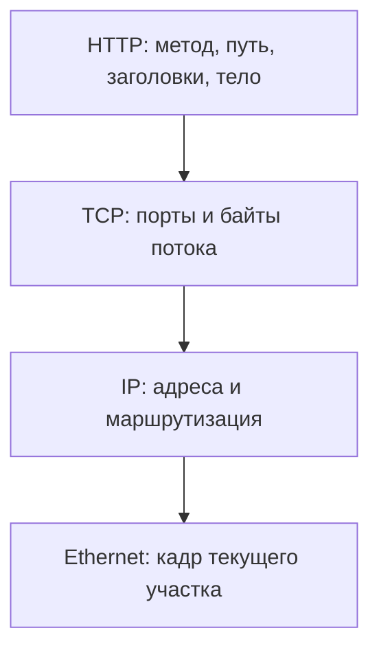

# Модель TCP/IP

TCP/IP — семейство протоколов Интернета и удобная модель разделения обязанностей. В распространённом представлении четыре уровня. Это модель для объяснения, а не требование иметь четыре библиотеки в программе.

## Термины в этой статье

- **NAT** — преобразование адресов, часто вместе с портами, при прохождении через сетевой узел.

| Уровень | Ответственность | Пример |
|---|---|---|
| Прикладной | Смысл операции, формат сообщения | HTTP, DNS |
| Транспортный | Обмен между конечными процессами | TCP, UDP |
| Интернет | Адресация и перенос между сетями | IPv4, IPv6 |
| Канальный | Перенос в пределах конкретного участка | Ethernet, Wi-Fi |

## Инкапсуляция на примере

HTTP-запрос сериализуется в байты. TCP разбивает поток для отправки; IP добавляет адреса отправителя/назначения. Ethernet добавляет адреса локального участка. На следующем маршрутизаторе Ethernet-оболочка меняется, а конечный IP-адрес обычно сохраняется, если нет NAT.

Это упрощённый путь HTTP/1.1 без TLS. HTTPS добавляет защиту TLS, HTTP/3 использует QUIC поверх UDP, ICMP передаётся непосредственно в IP. Поэтому правило «всегда ровно один протокол каждого уровня» неверно.

## Почему это важно для Senior

Сбой HTTP-запроса можно локализовать по границе: нет маршрута — IP; не устанавливается соединение — транспорт/доступность listener; неправильный сертификат — TLS; `403` — прикладная политика. Но симптом верхнего уровня не доказывает причину: HTTP timeout может быть вызван очередью БД.

Приложение пользуется интерфейсом сокетов и не обязано знать MAC удалённого сервера. TCP даёт поток с порядком байтов; UDP — дейтаграммы без гарантии доставки. Название транспортного уровня само по себе не обещает надёжность.

## Источники

- [RFC 1122: уровни Internet protocol suite](https://datatracker.ietf.org/doc/html/rfc1122)
- [TCP, RFC 9293](https://datatracker.ietf.org/doc/html/rfc9293)
- [QUIC, RFC 9000](https://datatracker.ietf.org/doc/html/rfc9000)

## Проверь себя

1. Почему MAC меняется на пути через router, а адрес назначения IP обычно нет?
2. Почему HTTP/3 опровергает буквальную схему HTTP → TCP?

Ответы

1. MAC адресует текущий локальный участок; IP служит для маршрутизации к конечному назначению. NAT может менять IP.
2. HTTP/3 идёт через QUIC поверх UDP; модель описывает обязанности, а не единственную комбинацию протоколов.

