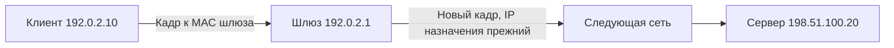

# Как пакет проходит TCP/IP-сеть

Рассмотрим клиент `192.0.2.10/24`, шлюз `192.0.2.1` и сервер `198.51.100.20:443`. Адреса зарезервированы для документации; это учебная топология.

## Термины в этой статье

- **NAT** — преобразование адресов, часто вместе с портами, при прохождении через сетевой узел.
- **namespace** — изолированная область системных ресурсов, например собственная таблица сетевых интерфейсов.
- **endpoint** — конкретный адрес службы или сторона соединения.

## Выбор следующего узла

Клиент проверяет таблицу маршрутов. Сервер вне локального `/24`, поэтому следующий узел — шлюз. ARP разрешает MAC шлюза, а не удалённого сервера. Ethernet-кадр получает MAC шлюза, IP-пакет — IP сервера. Router снимает канальную оболочку и строит новую для следующего участка.



MAC часто имеет заводское значение, но может назначаться программно или рандомизироваться. Он не является неизменной личностью устройства. Не всякая link-технология использует Ethernet MAC.

## Порты и соединения

Порт — 16-битное число, поле допускает 0–65535. Нулевой порт зарезервирован в реестре; в API `bind(..., port=0)` обычно просит ОС выбрать свободный порт. Клиент может получить `53000`, сервер слушать `443`. Множество соединений с сервером различаются адресами и портами обеих сторон; номер порта не равен PID процесса.

TCP устанавливает соединение и предоставляет упорядоченный поток. UDP сохраняет границы дейтаграмм, но не повторяет потерянные сообщения. Поэтому нельзя определять UDP просто как «более быстрый TCP».

## Диагностический пример

```bash
ip route get 198.51.100.20
ip neigh show
ss -tn
```

На Linux первая команда показывает выбранные interface/source/next hop, вторая — соседей локального участка, третья — TCP-соединения. Вывод зависит от реальной топологии. Если route выбирает неверный interface, поиск HTTP-багов преждевременен; если маршрут корректен, но ARP остаётся INCOMPLETE, проверьте локальную сеть и шлюз.

В Kubernetes и VPN добавляются виртуальные интерфейсы, туннели и возможный NAT. Проверять нужно namespace приложения, а не только сеть host. IP не является аутентификацией пользователя; авторизацию проверяет приложение.

## Источники

- [RFC 1122: host communication layers](https://datatracker.ietf.org/doc/html/rfc1122)
- [Linux IP socket API](https://man7.org/linux/man-pages/man7/ip.7.html)
- [IANA: реестр портов](https://www.iana.org/assignments/service-names-port-numbers/)

## Проверь себя

1. Какой MAC нужен клиенту для обращения к серверу в другой подсети?
2. Почему один port 443 может обслуживать тысячи соединений?

<details>
<summary>Ответы</summary>

1. MAC выбранного next hop, обычно шлюза; MAC удалённого сервера за router клиент не разрешает.
2. Соединения различаются парой endpoint: локальный и удалённый IP/порт; один listener принимает много отдельных соединений.

</details>
