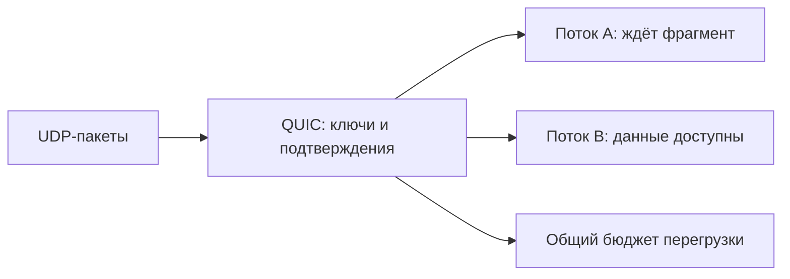

# QUIC: несколько защищённых потоков поверх UDP

QUIC устанавливает защищённое соединение и передаёт по нему несколько потоков. UDP лишь переносит его пакеты; подтверждения, повтор потерянных данных и ограничение перегрузки реализует QUIC. HTTP/3 использует эти потоки для HTTP-запросов и ответов.

## Что означает независимость потоков

Внутри каждого потока байты поступают по порядку. Если поток A ждёт потерянный фрагмент, уже полученные данные потока B можно выдать приложению. TCP с единым порядком байтов так сделать не позволяет.

Независимость не абсолютна: один пакет может содержать данные нескольких потоков, а пропускная способность сети и бюджет соединения общие. Ограничения приёма действуют отдельно для потока и соединения, чтобы медленный получатель не накопил слишком много данных. Для сообщений без повторной доставки существует расширение QUIC DATAGRAM; обычный поток остаётся надёжным.

## Установка соединения и ранние данные

QUIC объединяет согласование транспорта с TLS 1.3. Обычно обычное соединение устанавливается за один обмен туда-обратно — 1 RTT. Возобновление ранее установленного соединения может позволить отправить ранние данные (0-RTT) до завершения обычных подтверждений.

Ранние данные могут быть воспроизведены повторно. Их нельзя автоматически использовать для списания денег или других изменений состояния. Нужны отдельная защита от повторов и допустимые для такого режима операции; иначе 0-RTT отключают.

## Почему смена IP не обязательно рвёт соединение

Соединение распознаётся по идентификатору Connection ID (CID), а не только по паре IP/порт. Это позволяет, например, продолжить обмен после перехода телефона с Wi-Fi на мобильную сеть. Новый путь проходит проверку достижимости. Переход всё равно может вызвать задержку или быть запрещён настройками; CID не гарантирует бесшовность.

Балансировщик должен направлять пакеты с нужным CID к владельцу состояния соединения. Иначе смена адреса приведёт к попаданию на сервер, который не знает это соединение.

## Что проверять при сбое

Некоторые сети блокируют UDP, поэтому клиенту нужен допустимый запасной вариант протокола. Различайте неудачную установку, переход к запасному варианту, потери пакетов, ожидание свободного окна приёма и сброс отдельного потока. Сравнивайте скорость на реальных запросах с потерями и повторным использованием соединений: один ping не показывает работу всего протокола. Шифрование затрудняет чтение сетевого захвата, поэтому особенно важны измерения на клиенте и сервере.

## Разбор на примере

Есть потоки A и B. Потерялся пакет с недостающим фрагментом A, а полный следующий фрагмент B уже пришёл. QUIC может отдать B приложению, пока A ждёт повтор. Если один пакет содержал данные обоих потоков, потеря затрагивает оба. Все потоки всё равно делят сетевую пропускную способность и управление перегрузкой соединения.

## Источники

- [QUIC transport, RFC 9000](https://www.rfc-editor.org/rfc/rfc9000)
- [QUIC: обнаружение потерь и управление перегрузкой, RFC 9002](https://www.rfc-editor.org/rfc/rfc9002)
- [QUIC DATAGRAM, RFC 9221](https://www.rfc-editor.org/rfc/rfc9221)

## Проверь себя

1. Устраняет ли QUIC влияние потерь на другие потоки полностью?
2. Чем CID отличается от адреса соединения?

Ответы

1. Убирает обязательное ожидание порядка общего TCP-потока; общие потери пакета, управление перегрузкой и ресурсы приложения остаются.

2. CID идентифицирует состояние QUIC независимо от конкретного сетевого пути; смена пути требует валидации.

