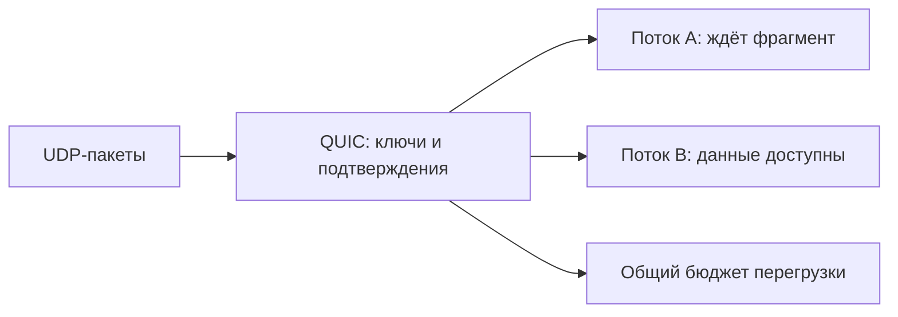

# QUIC

QUIC — транспорт с защищёнными соединениями и независимыми потоками поверх UDP. UDP здесь лишь переносит пакеты; надёжность потоков, подтверждения и управление перегрузкой обеспечивает QUIC.

## Термины в этой статье

- **flow control** — управление скоростью отправки, чтобы получатель успевал принимать данные.
- **congestion control** — ограничение отправки с учётом перегрузки сети.
- **handshake** — начальный обмен, в котором стороны устанавливают параметры соединения.
- **RTT** — время прохождения запроса и ответа по сети.
- **0-RTT** — передача ранних данных до завершения обычного обмена подтверждениями; возможен повтор данных.
- **replay** — повтор ранее переданного сообщения, который может снова вызвать действие.
- **endpoint** — конкретный адрес службы или сторона соединения.

IETF QUIC — secure connection-oriented transport поверх UDP. Он интегрирует TLS 1.3, reliable streams, stream/connection flow control, loss recovery и congestion control. HTTP/3 отображает HTTP semantics на QUIC.

## Streams и loss

Bytes внутри одного stream доставляются упорядоченно; разные streams независимы по delivery. Потеря packet с данными stream A не должна блокировать выдачу уже полученных данных stream B, хотя congestion controller и connection resources общие. Unreliable application messages требуют QUIC DATAGRAM extension, а не обычного stream.

QUIC packets защищены cryptographically, connection IDs позволяют пережить некоторые изменения network path/NAT rebinding. Migration не гарантирует отсутствие interruption и может быть отключена policy.

## Establishment

Initial handshake совмещает transport и TLS 1.3 setup, обычно позволяя 1-RTT establishment. Resumption может сократить стоимость. 0-RTT data уязвимы к replay и разрешаются только для replay-safe application semantics.

## Operations

UDP может блокироваться или ограничиваться middlebox-ами, поэтому clients обычно имеют discovery/fallback. Наблюдайте negotiated version, handshake/fallback, RTT/loss, stream resets, flow-control blocking и connection migration. Не сравнивайте QUIC с TCP только по ping: важны loss, reuse, CPU и request mix.

Connection/stream IDs и encrypted headers усложняют традиционный network inspection; endpoint telemetry становится важнее. Load balancer должен корректно маршрутизировать QUIC connection IDs и поддерживать выбранную retry/token policy.

## Разбор на примере

Есть потоки A и B. Потерялся пакет с недостающим фрагментом A, а полный следующий фрагмент B уже пришёл. QUIC может отдать B приложению, пока A ждёт повтор. Если один пакет содержал данные обоих потоков, потеря затрагивает оба. Все потоки всё равно делят сетевую пропускную способность и congestion control соединения.

Connection ID позволяет узнавать соединение после смены IP/порта, например при переходе телефона с Wi-Fi на мобильную сеть. Новый путь проходит проверку достижимости; это не разрешение отправлять неограниченный трафик на произвольный адрес. Балансировщик должен направлять CID к нужному владельцу состояния.

QUIC DATAGRAM — отдельное расширение для ненадёжных сообщений: его данные не получают надёжность обычного stream. 0-RTT также не равно безопасному повтору изменения состояния.

## Источники

- [QUIC transport, RFC 9000](https://www.rfc-editor.org/rfc/rfc9000)
- [QUIC loss detection and congestion control, RFC 9002](https://www.rfc-editor.org/rfc/rfc9002)
- [QUIC DATAGRAM, RFC 9221](https://www.rfc-editor.org/rfc/rfc9221)

## Проверь себя

1. Устраняет ли QUIC влияние потерь на другие потоки полностью?
2. Чем CID отличается от адреса соединения?

Ответы

1. Убирает обязательное ожидание порядка общего TCP-потока; общие потери пакета, congestion control и ресурсы приложения остаются.

2. CID идентифицирует состояние QUIC независимо от конкретного сетевого пути; смена пути требует валидации.

