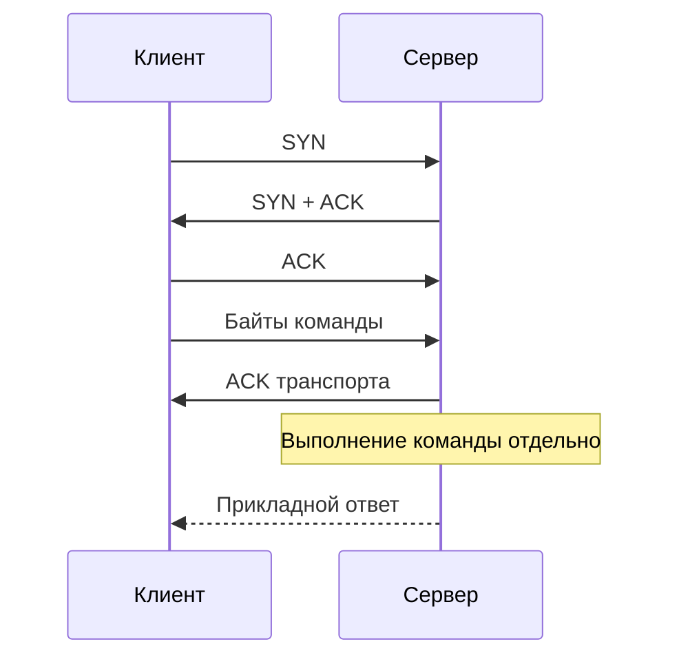

# TCP: надёжный поток байтов

TCP передаёт байты между двумя приложениями и сохраняет их порядок. Обе стороны могут одновременно отправлять и получать данные. Протокол повторяет потерянные данные, но не сообщает, выполнил ли сервер бизнес-операцию.

## Почему чтение не совпадает с записью

Отправитель записал `HELLO`, затем `WORLD`. Получатель может прочитать `HEL`, затем `LOWORLD` или сразу `HELLOWORLD`: TCP не сохраняет границы вызовов `Write`. Приложение должно само различать сообщения — например, передавать длину перед телом или разделять строки. Это называется выделением границ сообщений (framing).

## Как устанавливается соединение

Клиент отправляет SYN, сервер отвечает SYN-ACK, клиент подтверждает ACK. Этот трёхсторонний обмен (handshake) согласует начальные номера байтов и параметры соединения. Он подтверждает возможность обмена с другой стороной, но не её личность: для проверки сервера обычно нужен TLS.

Байты имеют последовательные номера. Получатель сообщает, какие данные получил, через ACK; отправитель повторяет недостающие данные. Контрольная сумма помогает обнаружить повреждение. Если ранний фрагмент потерялся, последующие байты ждут его восстановления, даже если уже пришли. Это блокировка из-за начала очереди (head-of-line blocking); несколько потоков HTTP/2 поверх TCP тоже разделяют это ожидание.

## Два ограничения скорости

Получатель объявляет свободное место в своём буфере — окно `rwnd`. Оно защищает медленного получателя от переполнения (flow control). Отправитель также оценивает, сколько данных выдержит сеть, — окно `cwnd`, используемое управлением перегрузкой (congestion control). Отправлять без подтверждения можно лишь в пределах применимых ограничений. Большой буфер получателя не отменяет перегрузку сети.

Время прохождения данных и ответа называется RTT. Если подтверждения идут медленно, маленькое окно ограничивает скорость даже на быстром канале. Ниже разобран расчёт с конкретными числами.

## Что значит «доставлено»

ACK подтверждает приём байтов протоколом TCP другой стороны. Сервер мог ещё не прочитать запрос или не сохранить результат. Если ответ потерялся, клиент не знает, выполнилась ли операция. Поэтому приложение задаёт срок ожидания и правила безопасного повтора: например, идентификатор операции, который сервер не применяет дважды.

## Как закрывается соединение

FIN завершает отправку в одном направлении: сторона больше не пишет, но может продолжать читать. RST прерывает соединение; ещё не обработанные данные могут быть потеряны. `EOF` сообщает конец входного потока, а не успешное выполнение операции.

`CLOSE-WAIT` означает: удалённая сторона завершила отправку, приложение ещё не закрыло свою сторону. Много таких соединений может указывать на забытое закрытие. `TIME-WAIT` обычно остаётся у стороны, начавшей закрытие: это защита от запоздалых пакетов старого соединения и возможность повторить последнее подтверждение. Подробнее: [жизненный цикл соединения](../backend/connection-lifecycle.md).

## Что проверять в сервисе

Разделяйте срок установки соединения, срок операции и допустимый простой. Повторно используйте соединения, чтобы не платить за установку на каждый запрос, но ограничивайте их число. При сбое смотрите повторные передачи, сбросы, состояния соединений и свободные локальные порты. TCP keepalive отправляет проверки простаивающей стороне; он не заменяет срок ожидания ответа приложения.

## Разбор на примере

Выберем формат сообщения: четыре байта длины и затем ровно столько байтов содержимого. Сначала читают четыре байта и проверяют допустимый размер, затем читают тело циклом или `io.ReadFull`. Проверка длины до выделения памяти не позволит чужому запросу потребовать огромный буфер.

Предположим, RTT = 40 мс. Допустимый объём без подтверждения — 64 KiB (65536 байт): при неизменном окне предел около `64 KiB / 0.04 s = 1.56 MiB/s`, даже если линия рассчитана на гигабит. MiB — 1048576 байт. Реальная скорость зависит от изменения окон, подтверждений и потерь; это оценка, а не замер. Отправку ограничивает минимум окна получателя (`rwnd`) и окна перегрузки (`cwnd`). Первое защищает приложение-получатель, второе — сеть.

Сервер сохранил заказ 42, но ответ потерялся. Повтор с новым идентификатором может создать заказ 43. Повтор с тем же идентификатором должен получить прежний результат, если приложение поддерживает такую гарантию: транспорт не распознаёт дубликат бизнес-операции.

## Источники

- [TCP, RFC 9293](https://www.rfc-editor.org/rfc/rfc9293)
- [TCP congestion control, RFC 5681](https://www.rfc-editor.org/rfc/rfc5681)

## Проверь себя

1. Почему два Write нельзя считать двумя сообщениями?
2. Что ограничивают rwnd и cwnd, и означает ли ACK успешную оплату?

Ответы

1. TCP сохраняет порядок байтов, но не границы записей. Длину или разделитель задаёт прикладной протокол.

2. rwnd ограничивает нагрузку на получателя, cwnd — на сеть; ACK не подтверждает бизнес-результат.

