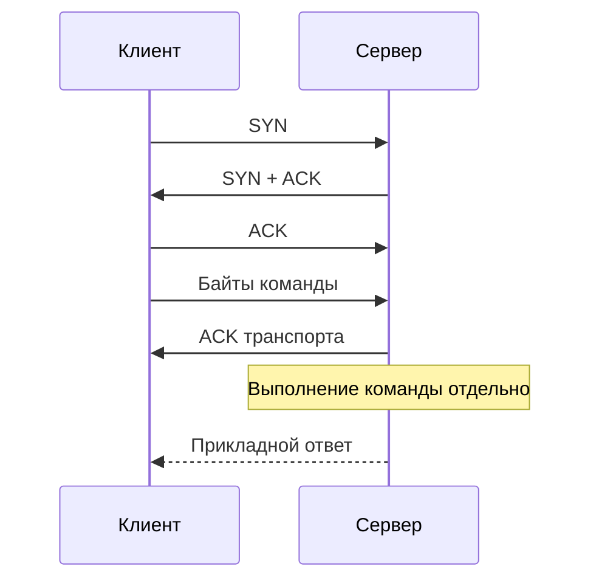

# TCP

TCP доставляет приложению упорядоченный поток байтов. Можно представить его как трубу: отправитель пишет байты, получатель читает их порциями, но границы этих порций не обязаны совпадать.

## Термины в этой статье

- **handshake** — начальный обмен, в котором стороны устанавливают параметры соединения.
- **flow control** — управление скоростью отправки, чтобы получатель успевал принимать данные.
- **congestion control** — ограничение отправки с учётом перегрузки сети.
- **head-of-line** — ожидание последующих данных из-за задержанного предыдущего фрагмента.
- **RTT** — время прохождения запроса и ответа по сети.

TCP предоставляет приложению full-duplex ordered byte stream между endpoints. Он не сохраняет границы application messages: один `Write` может читаться частями или вместе с другими writes. Framing обязан задать протокол выше.

## Установление и передача

Three-way handshake SYN → SYN-ACK → ACK синхронизирует initial sequence numbers и согласует options. Данные нумеруются по bytes; checksum обнаруживает corruption, ACK и retransmission восстанавливают потерю, receiver window реализует flow control, congestion control ограничивает нагрузку на сеть.

«Reliable» не означает бесконечную гарантию доставки. При partition, crash или timeout sender может не знать, применил ли peer уже отправленные bytes. Application protocol нуждается в deadline, idempotency и подтверждении нужного business outcome.

TCP сохраняет порядок, поэтому потерянный segment задерживает выдачу последующих bytes этому connection — transport head-of-line blocking. Несколько application streams HTTP/2 не устраняют это свойство TCP.

## Закрытие

Каждое направление закрывается FIN независимо; RST прерывает connection и может означать потерю buffered data. `CLOSE-WAIT` ждёт local application close; `TIME-WAIT` обычно принадлежит active closer и защищает новую incarnation от delayed segments/повторяет final ACK.

Половина close означает, что одна сторона больше не пишет, но может читать. Ошибка `EOF` сообщает завершение stream, а не business success. Подробнее: [connection lifecycle](../backend/connection-lifecycle.md).

## Production

Используйте persistent connections/pools, но задавайте connect, request/operation и idle deadlines отдельно. Наблюдайте RTT/retransmits/resets, backlog, states, ephemeral ports и cgroup/network saturation. TCP keepalive обнаруживает некоторые idle dead peers, но не заменяет application deadline.

## Разбор на примере

Сервис отправляет `HELLO` и `WORLD` двумя вызовами записи. Получатель вправе прочитать `HE`, затем `LLOWOR`, затем `LD`. Для сообщений нужен собственный формат: например, четыре байта длины и затем ровно столько байтов содержимого. Чтение полного сообщения выполняют циклом или `io.ReadFull`, проверяя лимит длины до выделения памяти.

Предположим, RTT = 40 мс. Начальное окно отправителя — 64 KiB: без изменения окна это примерно `64 KiB / 0.04 s = 1.56 MiB/s` данных в полёте за RTT, даже если линия рассчитана на гигабит. Реальная граница меняется с окнами, подтверждениями и потерями; число иллюстративное, не benchmark. Отправку ограничивает минимум окна получателя (`rwnd`) и окна перегрузки (`cwnd`). Первое защищает приложение-получатель, второе — сеть.

После отправки команды сервер мог выполнить её, но ответ потеряться. TCP ACK подтверждает получение байтов транспортом, а не запись заказа в БД. Повтор команды требует прикладной идемпотентности.

## Источники

- [TCP, RFC 9293](https://www.rfc-editor.org/rfc/rfc9293)
- [TCP congestion control, RFC 5681](https://www.rfc-editor.org/rfc/rfc5681)

## Проверь себя

1. Почему два Write нельзя считать двумя сообщениями?
2. Что ограничивают rwnd и cwnd, и означает ли ACK успешную оплату?

Ответы

1. TCP сохраняет порядок байтов, но не границы записей. Длину или разделитель задаёт прикладной протокол.

2. rwnd ограничивает нагрузку на получателя, cwnd — на сеть; ACK не подтверждает бизнес-результат.

