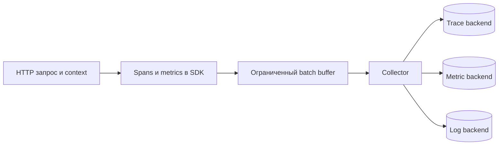

# OpenTelemetry

OTel собирает и передаёт диагностические данные; хранилище и просмотр предоставляет отдельный backend.

OpenTelemetry (OTel) задаёт vendor-neutral APIs, SDKs, semantic conventions и протокол экспорта telemetry (диагностические данные: метрики, логи и traces). Он не является storage/query backend и сам по себе не гарантирует полезные dashboards или alerts.

## Компоненты

- API используется application/library instrumentation;
- SDK создаёт providers, processors/readers, samplers и exporters;
- Resource описывает emitting entity: service, version, environment, pod;
- semantic conventions стабилизируют имена операций и attributes;
- OTLP передаёт traces, metrics и logs;
- Collector принимает, обрабатывает и экспортирует данные в один или несколько backends.

Libraries должны зависеть от API, а приложение — конфигурировать SDK. Иначе библиотека навязывает exporter/sampling глобальному процессу. Collector удобен для retry, batching, filtering и credential isolation, но добавляет собственные очереди, memory limits и failure modes.

## Instrumentation

Начните с поддерживаемой auto/library instrumentation для `net/http`, gRPC, SQL и Kafka client, затем добавляйте manual spans/metrics только для business boundaries. Проверьте, что два слоя не создают дубли. Названия и attributes сверяйте с текущей версией semantic conventions: часть доменов имеет разные stability levels.

На старте процесса настройте Resource и providers; при shutdown вызовите flush/shutdown с bounded (с явным конечным пределом) timeout после остановки приёма новых запросов. Export не должен бесконечно блокировать business path.

## Propagation по transport

| Transport | Inject | Extract | Важная деталь |
|---|---|---|---|
| HTTP | request headers | server request context | route, не raw URL, в low-cardinality (число разных значений или временных рядов) names |
| gRPC | outgoing metadata | incoming context | используйте client/server interceptors |
| Kafka | record headers до send | headers перед process | preserve headers при retry/DLQ; не смешивать trace (связь этапов одной операции) и idempotency IDs |

Для Kafka send и process могут быть разделены во времени и обрабатываться batch-ем. Следуйте messaging conventions и используйте links, когда один parent-child не отражает причинность. Не включайте message payload (полезное содержимое запроса или события) в spans по умолчанию.

## Correlation сигналов

Добавляйте trace/span ID к log records из текущего context. Exemplar связывает histogram observation с trace. Resource attributes дают общий service/deployment dimension. Это позволяет перейти от SLO (цель качества сервиса за заданное окно) metric к representative trace и затем к событию, не превращая request ID в metric label.

## Проверка

После внедрения отправьте synthetic request через все transports и убедитесь, что trace не распадается, server/client times согласованы, ошибки имеют status/category, metrics не дублируются, а shutdown доставляет buffered telemetry. Отдельно протестируйте недоступный Collector: сервис должен сохранять bounded memory и предсказуемое поведение.

## Источники

- [OpenTelemetry concepts](https://opentelemetry.io/docs/concepts/)
- [OpenTelemetry Collector](https://opentelemetry.io/docs/collector/)
- [OpenTelemetry semantic conventions](https://opentelemetry.io/docs/specs/semconv/)
- [Semantic conventions for Kafka](https://opentelemetry.io/docs/specs/semconv/messaging/kafka/)
- [Semantic conventions for RPC](https://opentelemetry.io/docs/specs/semconv/rpc/)

## Разбор с числами

В учебном отказе Collector недоступен 10 минут. Если сервис генерирует 5 MB/s telemetry, неограниченный буфер занял бы 3 GB. SDK/exporter имеет явный bounded buffer, retry/drop policy и метрику потерь; бизнес-запрос не ждёт вечной доставки. Collector сам требует memory/queue limit и контроля oldest age.

На shutdown используем новый bounded context, а не уже отменённый context процесса. Semantic conventions версионируются; стабильность зависит от домена. Автоматически переносить все Kafka headers/baggage в attributes опасно по privacy/cardinality. Проверяем один synthetic request HTTP→Outbox (события, сохранённые вместе с бизнес-изменением)→Kafka→consumer (потребитель работы или контракта) и видим, где trace создаёт links, а не ошибочный один parent для batch.

## Проверь себя

1. Является ли Collector источником бизнес-истины?
2. Почему flush с отменённым context бесполезен?

Ориентиры для ответа

1. Нет, он переносит telemetry и может терять её по заданной политике.
2. Он сразу получает cancellation вместо времени на отправку.

