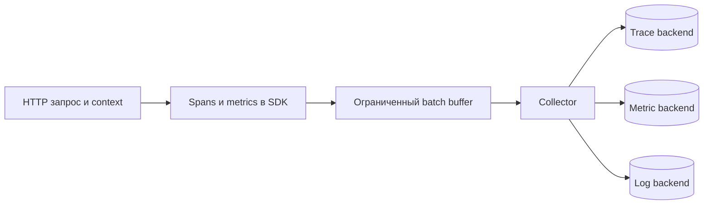

# OpenTelemetry: общий путь диагностических данных

OpenTelemetry предоставляет API, библиотеки и протоколы для метрик, логов и трассировок. Он собирает и передаёт данные, но сам не является системой долговременного хранения и поиска.

## Как это работает

Приложение создаёт наблюдения через API. SDK выбирает обработку и экспорт. Collector — отдельный приёмник — может принять данные, удалить чувствительные поля, добавить сведения об окружении и отправить в выбранное хранилище. Экспорт через OTLP позволяет не привязывать код приложения к одному поставщику.

Для соединения этапов нужен передаваемый контекст, а для объединения экземпляров — стабильные атрибуты ресурса, например имя и версия сервиса. Не помещайте произвольные ID в метки метрик.

Очереди экспорта и обработка имеют пределы. При недоступности получателя данные могут теряться; бесконечно ждать отправку в пользовательском запросе нельзя. Порядок остановки важен: сначала завершается полезная работа, затем до конечного срока отправляется оставшаяся диагностика.

## Разобранный пример

HTTP-операция создаёт этап трассировки, вызов БД — дочерний. Контекст передают следующему сервису через согласованные заголовки. Collector получает данные по OTLP и направляет трассировки и метрики в разные хранилища.

Если очередь экспортёра вмещает десять тысяч записей и при отказе назначения приходит тысяча/с, пустой запас закончится примерно за десять секунд. Это иллюстрация: реальный размер, пакетирование и политика потери измеряются. При остановке сохраняйте возможность экспорта до завершения обработчиков, а затем вызывайте предусмотренный SDK Shutdown с ограниченным контекстом.

## Проверь себя

1. Что делает Collector и чего не обещает?
2. Почему экспорт не должен бесконечно ждать?

Ответы

1. Обрабатывает и пересылает данные; не даёт автоматически бесконечной очереди или долговременного хранения.
2. Отказ диагностики иначе остановит полезную работу и накопит ресурсы.

## Источники

- [OpenTelemetry concepts](https://opentelemetry.io/docs/concepts/)
- [OpenTelemetry Collector](https://opentelemetry.io/docs/collector/)
- [OpenTelemetry semantic conventions](https://opentelemetry.io/docs/specs/semconv/)
- [Semantic conventions for Kafka](https://opentelemetry.io/docs/specs/semconv/messaging/kafka/)
- [Semantic conventions for RPC](https://opentelemetry.io/docs/specs/semconv/rpc/)
