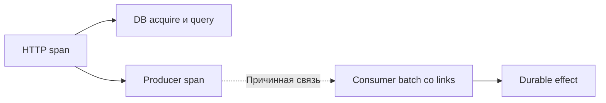

# Трассировка: где прошёл и чего ждал запрос

Трассировка связывает измеренные этапы одной операции. По ней видно, кто вызвал кого и где прошло время: в проверке прав, ожидании БД или внешнем сервисе.

## Как это работает

Каждый этап называют span. У него есть начало, длительность, статус и связь с родительским этапом. Через HTTP и очередь передают контекст трассировки, иначе следующий сервис начнёт отдельную историю. Контекст не заменяет аутентификацию и не должен содержать секреты.

Параллельные этапы перекрываются во времени. Сумма всех длительностей больше ответа и повторно учитывает вложенные вызовы. Ищите критический последовательный путь, а ожидание соединения измеряйте отдельно от SQL.

Хранить все трассировки бывает дорого. Выбор в начале запроса дешёв, но ещё не знает результата. Выбор после завершения позволяет сохранить ошибки, но требует буфера и согласованного сбора этапов. По такой выборке нельзя напрямую вычислить точную долю ошибок всего потока.

## Разобранный пример

Ответ занял 500 мс: проверка прав 20, ожидание соединения 300, SQL 40, Redis 10, формирование 20, остальное 110. Главный видимый участок — пул, а не сам SQL.

Два параллельных вызова на 100 и 150 мс занимают около 150 мс общего участка, не 250. Длительность родительского и дочернего этапов тоже нельзя складывать как независимые. Расхождение часов разных машин способно исказить рисунок начала; связи и локальные длительности помогают интерпретации. Для пакетной обработки событий связь с несколькими источниками выражают links, а не случайно выбирают один родительский запрос.

## Проверь себя

1. Какой участок объясняет основную задержку в примере?
2. Почему выбор 1% в начале не гарантирует сохранение редкой ошибки?

Ответы

1. Ожидание соединения, 300 мс из 500.
2. Решение принято до результата, и ошибочная операция может не попасть в выборку.

## Источники

- [OpenTelemetry traces](https://opentelemetry.io/docs/concepts/signals/traces/)
- [OpenTelemetry context propagation](https://opentelemetry.io/docs/concepts/context-propagation/)
- [OpenTelemetry baggage](https://opentelemetry.io/docs/concepts/signals/baggage/)
- [OpenTelemetry sampling](https://opentelemetry.io/docs/concepts/sampling/)
