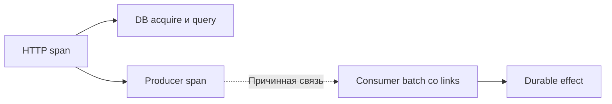

# Distributed tracing

Trace (связь этапов одной операции) связывает этапы одной работы, span (измеряемый этап trace) измеряет одну операцию; их дерево помогает найти критический путь.

Trace представляет причинный путь операции. Span описывает одну операцию за интервал времени: имя, начало/конец, status, attributes, events и links. Parent-child связывает синхронно обусловленные операции; link подходит для batch, fan-in/fan-out и обработки сообщения отдельно от producer span.

## Передача контекста

Клиент inject-ит trace context в carrier, сервер или consumer (потребитель работы или контракта) extract-ит его и создаёт дочерний span. Для HTTP/gRPC carrier — headers/metadata, для Kafka — record headers. Стандартный default OpenTelemetry использует W3C Trace Context.

Propagation нельзя считать доверительной границей. На public ingress валидируйте размеры и формат, решите, продолжать ли внешний trace или начинать новый. Не отправляйте внутренний baggage третьим сторонам без фильтрации.

## Baggage

Baggage — распространяемые key/value рядом с context; это не span attributes автоматически. Он копируется по цепочке, увеличивает headers и может утечь наружу. Не помещайте туда credentials, secrets или PII (персональные данные). Высококардинальные значения добавляйте к нужному span только при диагностической ценности.

## Что инструментировать

- inbound HTTP/gRPC и исходящие remote calls;
- database/cache calls без query secrets;
- Kafka send/receive/process, topic и consumer group с контролем cardinality (число разных значений или временных рядов);
- durable write, queue wait и важные business stages;
- retries как events или child spans так, чтобы видеть amplification.

Не создавайте span на каждую локальную функцию. Имена должны быть low-cardinality (`HTTP GET /ads/{id}`, а не полный URL). Error status ставят по semantic conventions: ожидаемый domain result не всегда техническая ошибка.

## Sampling

Head sampling принимает решение в начале: дёшево и согласованно, но outcome ещё неизвестен. Tail sampling решает после завершения и может сохранять errors/slow/rare traces, но Collector должен буферизовать trace и видеть все его spans. Parent-based policy сохраняет согласованность дочерних решений.

Sampling не исправляет отсутствие propagation или плохую instrumentation. Метрики остаются основой точных ratios: sampled traces не следует напрямую считать denominator SLI (измеренный показатель качества) без статистически корректной схемы.

## Источники

- [OpenTelemetry traces](https://opentelemetry.io/docs/concepts/signals/traces/)
- [OpenTelemetry context propagation](https://opentelemetry.io/docs/concepts/context-propagation/)
- [OpenTelemetry baggage](https://opentelemetry.io/docs/concepts/signals/baggage/)
- [OpenTelemetry sampling](https://opentelemetry.io/docs/concepts/sampling/)

## Разбор с числами

Учебный trace: total=500 ms, auth=20, DB acquire=300, query=40, Redis=10, render=20, оставшееся время=110. Не объявляем query причиной только потому, что БД присутствует; главный видимый участок — ожидание pool. Проверяем длительность удержания соединений и их число.

Параллельные spans 100 и 150 ms дают критический участок около 150 ms, не 250. Сумма длительностей parent+child тоже двойной счёт. Межмашинный clock skew может сделать визуальный порядок странным, поэтому propagation/parent и серверные durations важнее wall timestamps.

Head sampling 1% не гарантирует сохранение редкого error: решение принято до результата. Tail sampling требует достаточного буфера и попадания spans одного trace к одному решающему обработчику. По sampled traces нельзя прямо посчитать точный error ratio всего трафика.

## Проверь себя

1. Почему нельзя сложить все spans?
2. Что нужно tail sampling?

Ориентиры для ответа

1. Они вложены или параллельны, нужен критический путь.
2. Собрать достаточную часть trace, хранить её до решения и учитывать цену буфера.

