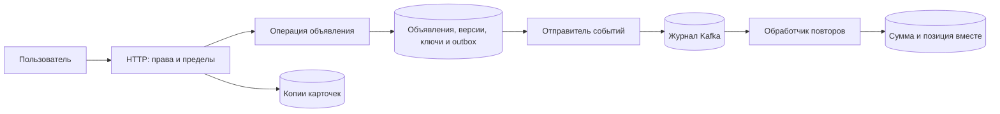

# Сервис объявлений: как компоненты работают вместе

Рассмотрим сервис, в котором пользователь создаёт объявление, меняет цену, добавляет его в избранное и отправляет просмотр. Пример связывает отдельные механизмы базы: права, версии, транзакции, кэш и события. Это архитектурный разбор, а не список заданий на разработку.

## Что хранится и кто отвечает за правду

PostgreSQL хранит объявления и связи избранного. У объявления есть владелец, цена в целых минимальных единицах с валютой, состояние и версия. У избранного уникальна пара пользователя и объявления. Это ограничение БД, а не только предварительная проверка в коде.

Таблица ключей операций хранит параметры и результат создания. Таблица outbox хранит события вместе с изменением объявления. Redis держит удаляемые копии карточек: его потеря может замедлить чтение, но не должна стереть достоверные данные. Нагрузку на БД при потере кэша ограничивают.



## Как клиент меняет цену

GET карточки возвращает сильную метку версии ETag, например "ad-42-v7". PATCH отправляет If-Match с этой меткой: «измени только увиденную мной версию». Сервер определяет пользователя по проверенной сессии и выполняет условное изменение:

```sql
UPDATE ads
SET price_minor = $1, version = version + 1, updated_at = now()
WHERE id = $2 AND owner_id = $3 AND version = $4
RETURNING version;
```

Это фрагмент, не полный SQL-скрипт: параметры задаёт приложение. Два клиента прочитали версию 7. Первый сохранил версию 8, второй не изменил ни одной строки. При невыполненном If-Match второй получает 412, читает актуальное состояние и осознанно решает, повторять ли изменение. 409 относится к другому конфликту продукта, например редактированию закрытого объявления. Для отсутствующего обязательного условия можно документировать 428.

If-Match предотвращает перезапись, но не хранит прежний ответ. Если ответ PATCH потерялся, клиент выясняет состояние либо использует отдельный договор о ключе операции. Для POST создания ключ связывает попытки одного намерения; его параметры и результат сохраняют вместе с объектом.

## Как изменение доходит до других компонентов

Транзакция сохраняет объявление и событие outbox атомарно. Отправитель публикует событие в Kafka, затем помечает отправку. Падение между этими действиями создаёт повтор, а не повод потерять событие. Получатель сохраняет ID события вместе со своим изменением.

Событие содержит ID, тип, версию формата, ID объекта и необходимые данные. Контекст трассировки помогает диагностике, но не является ключом операции: одна операция может иметь несколько попыток и трассировок. Персональные данные и секреты не добавляют автоматически «на всякий случай».

## Счётчик, который можно восстановить

Пусть получатель читает раздел Kafka 2, позицию 140. В одной транзакции он вставляет ID просмотра в таблицу обработанных событий, увеличивает сумму только при новой вставке и сохраняет позицию. После сохранения подтверждает брокеру **следующую** позицию 141. В собственной таблице можно хранить последнюю обработанную 140, но договорённости нельзя смешивать.

Падение до транзакции оставит работу неприменённой. После транзакции до подтверждения придёт повтор: сохранённый ID не позволит прибавить снова. Если позицию сохранить раньше суммы, падение потеряет просмотр; если прибавить без защиты повторов, сумма удвоится.

При параллельной обработке нельзя продвигаться за незавершённый префикс: готовая позиция 142 не разрешает пропустить ещё работающую 141. Позиции разных разделов не сравниваются одним глобальным числом. После перераспределения раздела старый обработчик должен потерять право записи через согласованный номер поколения или корректное единоличное владение. Подтверждение позиции само не останавливает старую горутину.

Пересчёт истории строит новую версию сумм и после сверки переключает чтения. Историю нельзя повторно прибавлять поверх прежней суммы. После удаления сырых событий точная детализация уже не восстанавливается: нужны сохранённые итоговые суммы и явное окно восстановления.

## Кто завершает работу

Код запуска создаёт серверы, фоновых исполнителей, клиентов брокера, пул БД и диагностику. При остановке сначала прекращается новая работа, затем завершаются выбранные принятые операции до общего срока. Пул закрывают после использующих его исполнителей. HTTP Shutdown не ждёт автоматически WebSocket и перехваченные соединения: у них отдельное завершение.

Получатель подтверждает только сохранённый непрерывный префикс; неопределённая отправка outbox остаётся для повтора. Диагностику отправляют до конечного срока с отдельным контекстом: основной уже может быть отменён. Учебный бюджет остановки 30 секунд можно разделить на 20 для работы, пять для отправки диагностики и закрытия, пять запаса. Реальная проверка включает распространение маршрутов и долгие запросы.

## Какие свидетельства подтверждают проект

Разделите ожидание соединения БД и выполнение SQL, намерения пользователей и попытки, время HTTP-ответа и свежесть счётчика. Следите за возрастом outbox и необработанных событий. Используйте шаблон маршрута в метках метрик вместо каждого ID объявления.

Правила можно проверить быстрыми тестами без сети. Свойства транзакций, ограничений БД и позиций брокера требуют настоящих совместимых компонентов. Отдельно воспроизводят потерю ответа, повтор, конфликт версии, отказ кэша и остановку процесса. Профиль снимают через закрытый административный интерфейс и интерпретируют по вопросу: [пример диагностики CPU](../production/high-cpu.md).

## Проверь себя

1. Почему сумма и позиция сохраняются вместе?
2. Почему If-Match не заменяет запись ключа операции?
3. Кто закрывает общий пул БД?

<details>
<summary>Ответы</summary>

1. Иначе падение либо повторит прибавление, либо пропустит ещё не сохранённую сумму.
2. Условие версии предотвращает перезапись, но не сохраняет прежний результат попытки.
3. Код, владеющий жизненным циклом приложения, после завершения всех пользователей ресурса.

</details>

## Связанные объяснения

[API](../backend-architecture/api-design.md), [outbox](../backend-patterns/transactional-outbox.md), [счётчик](../system-design/cases/view-counter.md), [PostgreSQL](../databases/postgresql/README.md), [Kafka](../messaging/kafka/README.md).

## Источники

- [HTTP: условия и статусы](https://www.rfc-editor.org/rfc/rfc9110.html).
- [PostgreSQL 18: UPDATE](https://www.postgresql.org/docs/18/sql-update.html).
- [Go: Server.Shutdown](https://pkg.go.dev/net/http#Server.Shutdown).
- [Kafka: гарантии доставки](https://kafka.apache.org/43/design/design/).
