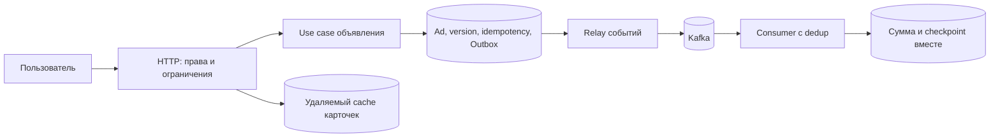

# Ads Service: контракты и компоненты

Ads Service иллюстрирует совместную работу API, PostgreSQL, cache и event pipeline. Разделы можно использовать независимо для обсуждения контрактов, отказов и архитектурных альтернатив. Состав компонентов зависит от требований; решения удобно фиксировать в ADR.

## Product scope

Минимальные capabilities:

- создать объявление с idempotency key;
- получить объявление;
- изменить title/description/price/status с optimistic concurrency;
- добавить/удалить объявление в favorites пользователя;
- принять просмотр и показать eventually consistent counter.

За пределами этого примера: полнотекстовый поиск, billing, moderation ML и media transcoding.

## Целевые contracts

### REST

```text
POST   /v1/ads
GET    /v1/ads/{id}
PATCH  /v1/ads/{id}        If-Match: "ad-<id>-v<version>"
PUT    /v1/users/{uid}/favorites/{ad_id}
DELETE /v1/users/{uid}/favorites/{ad_id}
POST   /v1/ads/{id}/views  Idempotency-Key: <event-id>
```

Определите validation, authorization, stable error codes, page/cursor contract (договорённость о поведении и гарантиях), request limits и semantics повторов. `PATCH` возвращает `412 Precondition Failed`, если `If-Match` не совпал с актуальным сильным ETag (HTTP-метка версии представления). `409 Conflict` означает другой конфликт бизнес-состояния; для отсутствующего обязательного предусловия документируем `428`. Create/view mutation не должны удваивать эффект после retry.

Внутренний gRPC API можно добавить для batch get или moderation capability. Такой контракт требует согласованных protobuf evolution, deadlines, canonical errors и interceptors.

## Data model

PostgreSQL — source of truth (основной достоверный источник данных):

- `ads(id, owner_id, title, description, price_minor, currency, status, version, created_at, updated_at)`;
- `favorites(user_id, ad_id, created_at)` с unique `(user_id, ad_id)`;
- `idempotency_keys(scope, key_hash, request_hash, status, response, expires_at)`;
- `outbox(id, aggregate_id, event_type, payload, created_at, published_at)`.

Money храните integer minor units + currency, timestamps — UTC instant. Foreign keys/constraints поддерживают invariants. Migrations forward/backward compatible: expand → deploy compatible code/backfill → contract. Каждая migration имеет rehearsal на production-like volume и rollback/roll-forward plan.

Redis — необязательный cache read model/counter buffer. Задайте key schema, TTL (время жизни записи)+jitter, memory/eviction, invalidation и behavior при недоступности. Favorites correctness остаётся в PostgreSQL.

## Event flow

В transaction создания/изменения ad запишите outbox (события, сохранённые вместе с бизнес-изменением) row. Relay публикует событие в Kafka, затем отмечает row; crash между publish и mark создаёт duplicate, поэтому consumer (потребитель работы или контракта) idempotent (без второго эффекта при повторе одного намерения). Event envelope содержит event ID, type/version, aggregate ID, occurred time и trace (связь этапов одной операции) context без PII (персональные данные) payload (полезное содержимое запроса или события) по умолчанию.

Для views примите at-least-once event с producer event ID. Consumer дедуплицирует ограниченное окно и сохраняет сумму вместе с обработанной позицией в одной транзакции durable store; отдельный Redis-буфер не является единственным владельцем подтверждённых просмотров. Определите, допустима ли потеря/задержка, как выполняется replay (повторное проигрывание сохранённых событий) и reconciliation (сверка и устранение расхождений). Не обещайте exactly-once end-to-end только из-за Kafka transaction.

## Архитектурный skeleton

```text
cmd/api             composition root
internal/ads        use cases, domain, ports
internal/favorites  capability и persistence
internal/views      ingestion/aggregation
internal/platform   PostgreSQL, Redis, Kafka, telemetry adapters
migrations          versioned SQL
deploy              Docker/Kubernetes/observability config
```

Один из вариантов — [modular monolith](../backend-architecture/modular-monolith.md). Module владеет данными и public contract. Выделение process/service выполняйте только после появления независимого scaling/failure/team boundary.

## Компоненты и свойства

### Lifecycle процесса

Go process, config validation, `/livez` и `/readyz`, structured logs, request ID/trace setup, graceful shutdown. HTTP server имеет read/header/idle timeouts и bounded (с явным конечным пределом) body. CI запускает formatting, static analysis, unit tests и docs/schema checks.

### Хранение и CRUD

Create/get/update, migrations, transactions и optimistic concurrency. Используйте parameterized SQL и least-privilege DB role. Integration tests поднимают настоящую совместимую PostgreSQL version, проверяют constraints, rollback (отмена локальной транзакции или возврат старой версии), concurrent update и cancellation.

### Idempotency и favorites

Idempotency key scoped к caller+operation, request hash обнаруживает повтор ключа с другим body; concurrent duplicates получают один authoritative (владеющий достоверным состоянием) result. Favorites реализуются unique constraint и идемпотентным desired-state `PUT/DELETE`.

### Cache

Добавьте cache-aside для `GET ad`: bounded TTL+jitter, negative cache осторожно, request coalescing для hot miss. Измерьте hit rate и stale window. Cache failure деградирует latency (срок ответа), но не correctness; защитите PostgreSQL от herd.

### Kafka и Outbox

Relay с leasing/batching/retry, idempotent producer по подходящему contract, consumer group и DLQ/retry policy. Тесты моделируют crash до/после publish/commit, duplicate, reorder и poison record. Lag alert основан на oldest event age.

### Observability

Prometheus RED metrics по route template, pool/Kafka/cache signals и business outcomes с bounded labels. OpenTelemetry context проходит HTTP → SQL/Redis/Kafka → consumer. Logs включают trace ID, но не tokens/PII. Определите SLI (измеренный показатель качества): success и latency create/get/update, freshness view counter; задайте SLO (цель качества сервиса за заданное окно) согласно требованиям и burn alerts.

### Packaging и Kubernetes

Multi-stage Docker image, non-root runtime, read-only filesystem где возможно, SBOM/vulnerability process. Kubernetes Deployment/Service/ConfigMap+Secret, requests/limits, startup/readiness/liveness probes, PodDisruptionBudget при необходимости и autoscaling по meaningful signal. Проверьте rolling update и node/pod termination.

## Timeout, retry и shutdown contract

Inbound request получает budget. DB/cache/gRPC/Kafka operations используют меньшие bounded deadlines, оставляя время сформировать ответ. Retry выполняет один owner только для transient (временный, потенциально устранимый повтором) и idempotent operation, с cap, exponential backoff+jitter и общим deadline (крайний срок завершения). Метрики различают logical operation и attempt.

При `SIGTERM` readiness (готовность принять новую работу) становится false, admission прекращается, HTTP/gRPC drain-ятся, consumers перестают получать новые records и завершают/commit-ят текущие, relay останавливается, telemetry (диагностические данные: метрики, логи и traces) flush-ится, затем pools закрываются. Весь порядок ограничен Kubernetes grace period и тестируется.

## Test strategy

- unit: domain invariants, error mapping, retry/backoff с fake clock;
- integration: PostgreSQL/Redis/Kafka contracts и migrations на real services;
- API/contract: status/error/schema/compatibility;
- concurrency: duplicate idempotency key, version conflict, view deduplication (устранение повторов по ID);
- fault: dependency timeout, connection exhaustion, cache loss, consumer restart;
- load/soak: SLO, pool sizing, cache herd, heap/goroutine plateau;
- security: cross-user/tenant authorization, injection, limits, secret/log checks.

Не mock-айте то, что хотите доказать о isolation, broker offsets или TTL. Unit tests дают локальную скорость; integration/fault tests доказывают boundary semantics.

## Profiling и acceptance criteria

Expose `pprof` только на authenticated internal listener. Под load снимите CPU, heap, goroutine/block profiles и сравните с baseline; profiling — средство объяснения, не оптимизация вслепую.

При review архитектуры полезны следующие свидетельства:

- clean checkout запускается одной documented командой;
- migrations и rollback/roll-forward rehearsed;
- повтор mutation не удваивает эффект;
- traces не распадаются на Kafka boundary;
- dashboards показывают SLI, RED и dependency saturation (насыщение ресурса и образование очереди);
- forced failures имеют ожидаемую degraded behavior;
- graceful shutdown не теряет acknowledged work;
- README объясняет trade-offs и известные ограничения.

## См. также

[Go backend](../go/backend/README.md) · [PostgreSQL](../databases/postgresql/README.md) · [Redis](../databases/redis/README.md) · [Kafka](../messaging/kafka/README.md) · [Outbox](../backend-patterns/transactional-outbox.md) · [Observability](../observability/README.md) · [Docker](../containers/docker/README.md) · [Kubernetes](../containers/kubernetes/README.md) · [Security](../security/README.md)

## Пример сквозного контракта



### Конкурирующее изменение цены

```sql
UPDATE ads
SET price_minor = $1, version = version + 1, updated_at = now()
WHERE id = $2 AND owner_id = $3 AND version = $4
RETURNING version;
```

Это фрагмент операции: параметры берутся из проверенного запроса и аутентифицированного пользователя. Два клиента прочитали v7. Первый UPDATE создал v8, второй не меняет ни одной строки. При корректном `If-Match` второй получает 412 и должен получить новые данные, затем осознанно повторить намерение. Без проверки версии последний запрос тихо потерял бы изменение первого.

Транзакция записывает Ad и Outbox вместе. Перед ответом commit (фиксация результата, который считается подтверждённым) обязателен. Если ответ потерян, create повторяется с прежним ключом, а PATCH получает результат по отдельному контракту идемпотентности либо проверяет актуальное состояние: один `If-Match` предотвращает перезапись, но сам не хранит прежний ответ.

### Счётчик, который можно восстановить

Учебная модель: consumer получает partition (раздел журнала или данных; при network partition — разрыв связи) 2, offset 140. В транзакции добавляет новый impression ID в inbox (записи уже применённых событий для защиты от повторов), увеличивает bucket только при новой вставке и сохраняет checkpoint (сохранённая позиция завершённой обработки) 140. Затем подтверждает брокеру позицию следующего сообщения: после обработанного offset 140 это 141. В собственной таблице checkpoint можно хранить последний обработанный 140, но не смешивать две договорённости. Crash после commit до подтверждения вызывает повтор, который не увеличивает счётчик. Нельзя сохранить checkpoint 140 и лишь потом сумму: crash потеряет уже пропущенный event.

Позиции Kafka упорядочены внутри partition; события разных partitions не сравниваются одним глобальным числом. При параллельной обработке checkpoint продвигается только за непрерывный завершённый префикс, иначе быстрый offset 142 пропустит медленный 141. При rebalance старый worker должен потерять право записи через consumer generation/согласованный fencing (отклонение действий старого владельца самим ресурсом) либо корректную сериализацию ownership (владение данными или ответственность за ресурс). Сам commit offset не останавливает старую горутину.

Replay строит новую версию агрегатов, проверяет суммы и переключает readers; складывать историю поверх старой суммы запрещено. Retention (срок хранения) журнала и inbox определяет максимальное окно восстановления/защиты от повторов. Пересчёт за пределами удалённого сырого журнала опирается только на сохранённые rollups и не восстанавливает потерянную детализацию.

### Владение при остановке

Composition root (место сборки зависимостей приложения) владеет серверами, background workers, broker clients, DB pool и telemetry. При остановке сначала прекращаем новые входы, затем ждём HTTP и выбранные незавершённые задачи до общего срока. WebSocket/hijacked connections требуют отдельного завершения: HTTP `Shutdown` их не дожидается автоматически. Consumer останавливает intake, подтверждает только durably завершённый префикс; relay сохраняет неопределённую публикацию для безопасного повтора.

Pool закрываем после работников, использующих его; telemetry flush — с отдельным ограниченным контекстом, поскольку основной shutdown context уже может быть отменён. Выделяем, например, из 30 s grace 20 s на работу, 5 s на flush/закрытие, 5 s на запас. Это учебный бюджет, реальный тест включает rollout propagation и долгие запросы.

### Что увидеть на панели

Разделяем `http_request_duration`, ожидание DB pool и SQL execution, число логических операций и attempts. Наблюдаем возраст Outbox, oldest unprocessed event, broker lag, dedup rate, counter freshness и shutdown timeout. Route template вместо user/ad ID в metric labels ограничивает число рядов. Trace ID связывает диагностику, но не используется как ключ бизнес-операции.

## Источники проверки контрактов

- [HTTP semantics: conditional requests и статусы](https://www.rfc-editor.org/rfc/rfc9110.html).
- [PostgreSQL 18: UPDATE](https://www.postgresql.org/docs/18/sql-update.html).
- [Go net/http Server.Shutdown](https://pkg.go.dev/net/http#Server.Shutdown).
- [Kafka design и границы транзакций](https://kafka.apache.org/43/design/design/).

## Проверь себя

1. Почему stale If-Match — 412, а не универсальный 409?
2. Что будет после записи суммы и потери подтверждения Kafka?
3. Почему последний завершённый offset нельзя всегда подтвердить?
4. Кто закрывает DB pool?

<details>
<summary>Ориентиры для ответа</summary>

1. Проверено HTTP-предусловие; бизнес-конфликт — отдельный результат.
2. При атомарном checkpoint/inbox повтор не увеличит сумму.
3. Перед ним может оставаться незавершённая запись; нужен непрерывный префикс.
4. Владелец процесса после завершения всех использующих его workers.

</details>
