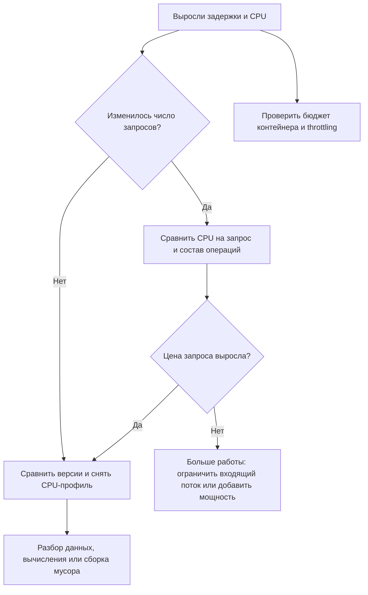

# Высокая загрузка процессора: как найти причину

Процессор выполняет инструкции программы: разбирает JSON, сравнивает строки, сжимает данные. Если вычислений стало больше, сервис успевает обработать меньше запросов. Остальные запросы ждут, и время ответа растёт.

Высокая загрузка сама по себе ещё не ошибка. Если сервис отвечает вовремя и обрабатывает нужный поток, он может просто эффективно использовать выделенный ресурс. Разбираемся, когда вместе с CPU выросли задержки или ошибки.

## Сколько работы выполняет процесс

Процессорное время суммируется по ядрам. **Одна CPU-секунда** — одна секунда работы одного ядра. Два ядра, занятые полсекунды каждое, тоже дают одну CPU-секунду.

Сервис получает 1000 запросов в секунду. До обновления каждый запрос требовал в среднем 0,5 миллисекунды вычислений:

```text
1000 × 0,0005 = 0,5 CPU-секунды за секунду
```

После обновления запрос требует 1,5 миллисекунды. Теперь нужно 1,5 ядра при той же входящей нагрузке. Если сервису доступно одно ядро, работа начнёт накапливаться. Все числа в статье учебные.

В Prometheus счётчик `process_cpu_seconds_total` показывает накопленное процессорное время. Если библиотека вашего сервиса экспортирует эту метрику, запрос ниже оценивает среднее число занятых ядер за последние пять минут:

```promql
rate(process_cpu_seconds_total{job="ads"}[5m])
```

Значение `0.5` означает половину ядра, `1.5` — полтора. Сравнивайте отдельные экземпляры и версии: сумма по десяти экземплярам скрывает один перегруженный процесс. Чтобы оценить цену запроса, разделите CPU в ядрах на число запросов в секунду **за то же окно и у тех же экземпляров**. Фоновые задачи тоже расходуют CPU, поэтому результат не всегда равен стоимости HTTP-запроса.

## Почему у контейнера может закончиться CPU на свободной машине

Контейнеру задают бюджет процессорного времени. В Linux этим управляет группа процессов — **cgroup**. В cgroup v2 файл `cpu.max` может содержать:

```text
100000 100000
```

Первое число — разрешённое время работы в микросекундах, второе — период его выдачи. Здесь бюджет равен 100 мс работы за каждые 100 мс: в среднем одно ядро. Несколько потоков могут совместно потратить этот бюджет раньше конца периода. Тогда ядро приостанавливает их до пополнения бюджета. Это называют **throttling**, ограничением процессорного времени.

Внутри Linux-контейнера с cgroup v2, если эти файлы доступны в его пространстве имён:

```sh
cat /sys/fs/cgroup/cpu.max
cat /sys/fs/cgroup/cpu.stat
```

`max` вместо первого числа означает отсутствие ограничения именно в этой группе; ограничение может быть у родительской группы. В `cpu.stat` сравните два снимка с интервалом: `usage_usec` — использованное время; рост `nr_throttled` показывает периоды, в которых сработало ограничение. `throttled_usec` помогает увидеть его масштаб, но не является прямой задержкой каждого запроса. Пути и поля отличаются в cgroup v1; при недоступных файлах смотрите метрики контейнера в своей системе мониторинга.

При бюджете одного ядра средняя загрузка `0.9` может сопровождаться ограничениями во время коротких всплесков. Поэтому «машина занята только на 10%» не исключает нехватку CPU у конкретного контейнера.

## Как различить причины



Если запросов стало вдвое больше, а цена каждого прежняя, ищите источник нагрузки. Например, один пользовательский запрос теперь вызывает три внутренних повтора. Если поток прежний, но вырос CPU на запрос, сравните обновления кода, размер входных данных и состав операций. Тысяча чтений и тысяча запросов с компрессией — разная нагрузка.

Если CPU растёт даже без запросов, проверьте фоновые задачи. Цикл, который постоянно проверяет пустую очередь без ожидания, расходует ядро без полезной работы. Если же CPU низкий, а запросы долго ждут БД или соединения, начните с [разбора задержек](high-latency.md): CPU-профиль не объясняет время ожидания сети.

## Как снять профиль Go и прочитать результат

CPU-профиль периодически отмечает, какой код выполнялся. Он отвечает на вопрос «где процесс тратил вычисления», а не «сколько ждал пользователь».

Ниже предполагается, что сервис **уже** предоставляет `net/http/pprof` на отдельном административном порту 6060, доступ к нему ограничен, а у вас есть право подключиться к выбранному pod. Публичный HTTP-маршрутизатор не должен автоматически публиковать `/debug/pprof/`: профиль раскрывает внутреннее устройство приложения, а его сбор расходует ресурсы.

Откройте локальный туннель к одному затронутому экземпляру Kubernetes:

```sh
kubectl -n ads port-forward pod/ads-api-example 6060:6060
```

Имя pod и namespace замените своими. В другом терминале с установленным Go:

```sh
go tool pprof -top 'http://127.0.0.1:6060/debug/pprof/profile?seconds=30'
```

Команда собирает 30 секунд наблюдений и печатает таблицу. Если административный порт требует отдельной аутентификации, используйте предусмотренный вашим сервисом способ доступа; туннель сам её не отменяет. Начните с одного короткого сбора и оцените его влияние на нагрузку.

Упрощённый пример для профиля с суммарным процессорным временем 15 секунд. Остальные строки опущены: в таблице показана не вся работа процесса и не все потомки обработчика:

```text
flat    flat%    cum     cum%    function
0.00s    0.0%  12.00s   80.0%   main.handleSearch
9.00s   60.0%   9.00s   60.0%   main.decodeFilters
3.00s   20.0%   3.00s   20.0%   runtime.gcDrain
```

**flat** — наблюдения непосредственно в функции. **cum** — в ней и вызванных ею функциях. Обработчик `handleSearch` почти не вычисляет сам, но вызывает дорогой разбор фильтров. Нельзя складывать его `cum` с `flat` дочерней функции: это повторный учёт той же работы.

Заметная сборка мусора (`gcDrain`) даёт гипотезу о частом создании временных объектов. Чтобы проверить её, сравните число выделений памяти и одинаковый запрос до и после изменения. Большой `decodeFilters` тоже не доказывает дефект: возможно, пользователь прислал фильтр в десять раз крупнее. Для подтверждения воспроизведите эту операцию и измерьте её отдельно.

Проценты таблицы относятся к наблюдаемому процессорному времени. Они не говорят, что пользователь провёл 60% времени ответа в разборе фильтров: остальную часть ответа он мог ждать БД. При нескольких работающих ядрах суммарное процессорное время профиля может превышать длительность сбора.

## Что делать после диагноза

Если проблема появилась после обновления, откат или отключение дорогой операции может быстро восстановить ответы. Если вырос полезный поток, добавление экземпляров помогает при доступной мощности и отсутствии общего узкого места, например БД. Ограничение входящего потока сохраняет работоспособность, но часть запросов придётся отклонить.

Повышение CPU-limit помогает только при нехватке бюджета и доступном ресурсе узла. Оно не исправляет бесконечный цикл. Оптимизацию проверяйте на одинаковом составе запросов: нужны меньшая цена запроса, приемлемое время ответа и сохранённый результат операции.

## Проверь себя

1. При 2000 запросов/с процесс расходует 1 CPU-секунду за секунду. Какова средняя цена запроса, если фоновой работы нет?
2. Почему большой `cum` у обработчика ещё не повод переписывать его собственный код?
3. Может ли контейнер с загрузкой 0,8 ядра испытывать throttling при лимите в одно ядро?

<details>
<summary>Ответы</summary>

1. `1 / 2000 = 0,0005 с`, то есть 0,5 мс процессорного времени на запрос.
2. В `cum` включены потомки. Нужно найти, кто действительно расходует CPU, по `flat` и цепочке вызовов.
3. Да: среднее за большое окно скрывает всплески, которые исчерпывают бюджет внутри отдельного периода.

</details>

## Источники

- [Go: выбор диагностического инструмента](https://go.dev/doc/diagnostics).
- [net/http/pprof: сбор профиля через административный HTTP-интерфейс](https://pkg.go.dev/net/http/pprof).
- [Linux cgroup v2: cpu.max и cpu.stat](https://docs.kernel.org/admin-guide/cgroup-v2.html).
