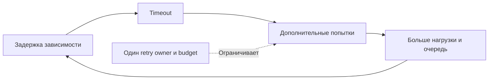

# Retry storm

Шторм повторов — ошибка вызывает больше попыток, те увеличивают перегрузку и создают новые ошибки.

## Симптомы

Downstream requests значительно превышают user traffic, errors/latency и resource saturation (насыщение ресурса и образование очереди) растут после первоначальной деградации; recovery откладывается даже после устранения trigger.

## Возможные причины

Retries на нескольких слоях, no backoff/jitter, одинаковые deadlines, retry non-idempotent/permanent errors, timeout короче реальной latency (срок ответа), queueing без budget, reconnect loop или autoscaling feedback.

## Что измерить

Logical operations vs attempts, attempts per request по layer/reason, retry success, timeout budget, downstream QPS/saturation, queue age и unique idempotency keys.

## Проверка гипотез

Постройте amplification tree по trace/metrics: client → gateway → service → SDK. Найдите первый failure и каждый retry owner. Проверьте classification, cap, backoff/jitter и remaining deadline (крайний срок завершения). Сравните user success, а не только долю успешных retry.

## Инструменты

Attempt-labeled bounded (с явным конечным пределом) metrics, distributed traces/events, client/server logs, rate-limit/circuit-breaker state и dependency dashboards.

## Как уменьшить ущерб

Отключить/ограничить retries на верхнем слое, shed/rate-limit, circuit break, увеличить backoff с jitter, вернуть fast failure или снять traffic с dependency. Не увеличивайте все timeouts: это удержит resources дольше.

## Механизм причины

Укажите transient (временный, потенциально устранимый повтором) trigger и control loop, который умножил load: сколько слоёв × attempts и почему budget/admission не ограничили cascade. Отделите исходный fault от amplifier.

## Предотвращение

Один явный retry owner, capped exponential backoff + jitter, retry budget, deadline propagation, error classification, idempotency, circuit/load shedding и fault-injection tests. См. [retries](../backend-patterns/retries.md).

## Разбор с числами

Учебные числа: user traffic=1 000/s, gateway attempts=2 000/s, service SDK calls=6 000/s. Amplification=6; 90% последних попыток падают. Исходный сбой — DB задержка, усилитель — два retry layers. Снижение retries может снизить общий error count не потому, что каждый запрос успешен, а потому, что лишние attempts исчезли: проверяем success логических операций.

Увеличение всех timeouts повышает in-flight и может усугубить проблему. Mitigation — отключить лишний слой, ранний отказ, bounded concurrency, jitter и полезный deadline. После восстановления зависимости измеряем attempts/logical request и скорость drain (завершение уже принятой работы), чтобы feedback loop действительно прекратился.

## Источник механизма

[Google SRE: cascading failures](https://sre.google/sre-book/addressing-cascading-failures/). Числа и topology в примерах — учебные допущения, не параметры этой системы.

## Проверь себя

1. Почему jitter недостаточно?
2. Что является успехом mitigation?

Ориентиры для ответа

1. Он разводит время, но не ограничивает общее число attempts.
2. Восстановленный user success при снижении amplification и saturation.

