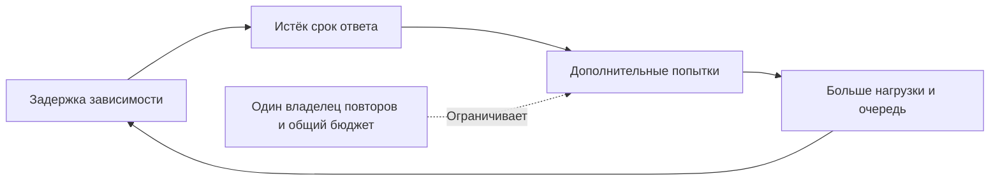

# Шторм повторов: ошибка усиливает сама себя

Зависимость замедлилась, запросы не дождались ответа и начали повторяться. Дополнительные попытки увеличили нагрузку, и ошибок стало ещё больше. Так возникает шторм повторов.

## Как это работает

Считайте отдельно намерения пользователей и реальные попытки. Тысяча операций может породить шесть тысяч обращений. В трассировке найдите, какие слои повторяют вызов: клиент, шлюз, сервис и библиотека.

Чтобы остановить цикл, ограничьте число попыток, назначьте один ответственный слой и прекращайте вызовы после общего срока. Случайные паузы разводят запросы во времени, но не уменьшают их количество. Быстрые отказы и предел одновременных операций дают зависимости шанс восстановиться.

Не увеличивайте все таймауты одновременно: дольше живущие запросы могут занять ещё больше соединений и памяти. После действия проверяйте успешные пользовательские операции, а не только исчезновение ошибок лишних попыток.

## Разобранный пример

Пользователи создают 1000 операций/с, шлюз делает 2000 попыток/с, библиотека сервиса — 6000 обращений/с. Нагрузка умножена в шесть раз. Исходной причиной могла быть задержка БД, а повторы стали усилителем.

После отключения лишнего слоя ошибок в абсолютных числах меньше, потому что попыток меньше. Это ещё не доказательство восстановления: сравните долю успешных намерений, длину очередей и время ответа. После восстановления зависимости убедитесь, что накопленная работа убывает, а число попыток на одну операцию вернулось к норме.

## Проверь себя

1. Почему случайного разброса недостаточно?
2. По какому результату судить об исправлении?

Ответы

1. Он меняет расписание, но не общий объём лишних попыток.
2. По успешности пользовательских операций и прекращению роста очередей, а не только числу ошибок.

## Источники

- [Google SRE: cascading failures](https://sre.google/sre-book/addressing-cascading-failures/)
