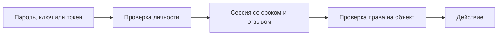

# Аутентификация: как сервис узнаёт пользователя

Аутентификация проверяет предъявленное доказательство личности: пароль, ключ, сессию или сертификат. После проверки сервис знает, от чьего имени пришёл запрос. Право читать конкретное объявление или менять чужую запись проверяется отдельно — это [авторизация](authorization.md).

## Как работает сессия в браузере

Пользователь входит с паролем. Сервер создаёт запись сессии, а браузеру выдаёт случайный идентификатор в cookie. В следующем запросе браузер отправляет cookie, сервер находит запись и получает пользователя. Такой непрозрачный идентификатор (opaque ID) не содержит читаемых сведений о правах.

После входа и повышения привилегий идентификатор меняют. Иначе атакующий может заранее навязать жертве известную ему сессию и использовать её после входа — это фиксация сессии (session fixation). Сервер ограничивает срок бездействия и общий срок, а при выходе или отзыве делает запись недействительной.

Атрибут `Secure` ограничивает передачу cookie защищённым каналом, `HttpOnly` закрывает чтение JavaScript, `SameSite` влияет на отправку с другого сайта. Область Domain/Path не должна быть шире необходимой. Cookie отправляется автоматически, поэтому изменение состояния требует [защиты от CSRF](backend-security.md#cors-и-csrf). Не помещайте идентификатор сессии в URL и журналы.

## Чем отличается предъявляемый токен

Bearer token даёт доступ тому, кто его предъявил: отдельное доказательство владения ключом обычно не требуется. Украденная копия может работать до истечения срока или отзыва. Ограничивайте получателя токена (audience), допустимый объём доступа (scope) и срок; передавайте по TLS.

Хранение с доступом JavaScript увеличивает ущерб внедрённого скрипта (XSS). HttpOnly cookie закрывает чтение токена скриптом, но не запрещает скрипту действовать через страницу и не отменяет CSRF. Выбор хранения требует учёта конкретных угроз.

Access token предъявляют серверу API. Refresh token передают серверу авторизации для выдачи новых access tokens. Refresh token нужно защищать и связывать с клиентом и выданным разрешением. Для публичных OAuth-клиентов RFC 9700 требует обнаруживать повтор через замену refresh token при использовании либо привязку к ключу клиента (sender constraint). Подробнее: [OAuth и OIDC](oauth2-and-oidc.md).

## Почему защита входа не заканчивается паролем

Не раскрывайте существование учётной записи разными ответами «пользователь неизвестен» и «пароль неверен». Ограничивайте число попыток с учётом пользователя, источника и общей мощности проверки, но не позволяйте легко заблокировать чужую запись одними неверными попытками.

Для важных действий могут потребоваться второй фактор или повторная проверка личности. Восстановление доступа не должно быть слабее входа: оно выдаёт ту же возможность действовать. После смены секрета или восстановления явно определите, какие сессии отзываются. Записывайте события для расследования, не записывая сами пароли и токены.

## Разбор на примере

Сервер выдаёт cookie браузерной сессии:

```http
Set-Cookie: __Host-session=<random-opaque-id>; Secure; HttpOnly; Path=/; SameSite=Lax
```

`<random-opaque-id>` заменяется случайным идентификатором; это не настоящий секрет. Префикс `__Host-` требует Secure, Path=/ и отсутствия Domain в браузере, который поддерживает эти правила. Запись на сервере связывает ID с пользователем и сроком. После входа ID меняется; прежняя анонимная сессия не получает привилегии сама.

Теперь атакующий украл ID действующей сессии. Если смена пароля не отзывает эту запись, украденный ID может продолжать работать. Второй фактор, проверенный при входе, не защищает такую копию автоматически. Для смены телефона или выплаты сервис может потребовать новую проверку, а после восстановления — отозвать нужные записи.

HttpOnly запрещает скрипту читать cookie, но внедрённый скрипт может отправить запрос из самой страницы. SameSite ограничивает часть межсайтовых отправок, но выбранная CSRF-защита всё ещё нужна. Неверный пароль и неизвестный пользователь дают согласованный внешний ответ; лимит попыток сочетает отдельные записи, источники и общую мощность проверки.



## Источники

- [OWASP Authentication Cheat Sheet](https://cheatsheetseries.owasp.org/cheatsheets/Authentication_Cheat_Sheet.html)
- [OWASP Session Management Cheat Sheet](https://cheatsheetseries.owasp.org/cheatsheets/Session_Management_Cheat_Sheet.html)
- [OAuth 2.0 Bearer Token Usage, RFC 6750](https://www.rfc-editor.org/rfc/rfc6750)
- [OAuth 2.0 Security Best Current Practice, RFC 9700](https://www.rfc-editor.org/rfc/rfc9700)


## Проверь себя

1. Чем вход отличается от разрешения удалить объявление?
2. Защищает ли HttpOnly от всех последствий внедрённого скрипта?

<details>
<summary>Ответы</summary>

1. Вход устанавливает личность. Отдельная проверка права решает, может ли этот пользователь удалить именно этот объект.

2. Нет. Он закрывает чтение cookie, но скрипт может отправлять запросы из контекста страницы.

</details>
