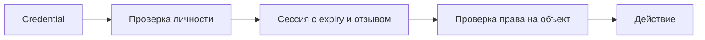

# Authentication

Аутентификация проверяет, кто обращается: пользователь, сервис или устройство. Успешная проверка личности ещё не разрешает читать любой объект. Секрет предъявителя нужно защищать на всём пути, включая logs и восстановление доступа.

## Термины в этой статье

- **identity** — подтверждённая личность пользователя или службы.
- **credential** — предъявляемое доказательство личности: пароль, ключ, токен или сертификат.
- **CSRF** — запрос с чужого сайта, который браузер отправляет с автоматически приложенными данными входа.
- **audience** — получатель, для которого выпущен токен.
- **scope** — заявленный объём доступа, который всё ещё требует проверки политикой сервера.
- **XSS** — выполнение внедрённого злоумышленником скрипта в контексте доверенной страницы.
- **replay** — повтор ранее переданного сообщения, который может снова вызвать действие.

Authentication подтверждает identity через credential: пароль, session cookie, private key, passkey, client certificate или identity-provider token. Успешный login не даёт автоматического права на resource — далее нужна [authorization](authorization.md).

## Web session

Server-side session хранит state/revocation на сервере, browser получает случайный opaque ID. Cookie обычно должна иметь `Secure`, `HttpOnly`, подходящий `SameSite`, узкие `Domain`/`Path`; ID меняют после login и privilege change для защиты от fixation. Session получает idle и absolute expiry, explicit logout/revocation и server-side invalidation.

Cookie автоматически отправляется browser-ом, поэтому state-changing endpoints требуют [CSRF](backend-security.md#cors-и-csrf) защиты. Не помещайте credential в URL: он попадает в history, referrer и logs.

## Bearer token

Bearer token даёт доступ любому предъявителю. Передавайте его только по TLS, не логируйте, ограничивайте audience, scope и lifetime. Browser storage с JavaScript-доступом увеличивает ущерб XSS; HttpOnly cookie меняет риск на CSRF — универсально безопасного контейнера нет.

Access token короткоживущий и предназначен resource server; refresh token выдаёт новые access tokens только authorization server. Refresh token защищают в storage/transit, связывают с client/grant, ограничивают и отзывают; для public clients RFC 9700 требует replay detection через rotation либо sender-constrained tokens.

## Login defenses

- одинаковые внешние ответы/похожее время для unknown user и wrong password;
- rate limit по account, source/risk и global capacity без простого DoS-lockout;
- MFA/passkeys для чувствительных действий, step-up при повышении риска;
- reauthentication после recovery, credential change и high-risk operation;
- audit успешных/неуспешных событий без credential values;
- recovery не слабее основного login.

## Разбор на примере

После login сервер выдаёт случайный opaque session ID: в нём не закодирован пароль. Сервер хранит связь ID с пользователем, сроками и состоянием отзыва. Идентификатор меняют после входа, чтобы заранее известная anonymous session не стала authenticated session: это защита от session fixation.

Пример cookie для browser-сессии:

```http
Set-Cookie: __Host-session=<random-opaque-id>; Secure; HttpOnly; Path=/; SameSite=Lax
```

Это формат заголовка, placeholder заменяет криптографически случайный ID; cookie с префиксом `__Host-` не получает Domain. HttpOnly запрещает чтение cookie из JavaScript, но XSS всё ещё может инициировать действия от имени пользователя. SameSite снижает часть CSRF-рисков, но не заменяет проверку выбранного flow; state-changing GET недопустим.

Учебный incident: украден session ID. Смена пароля без отзыва сессий не обязательно прекращает доступ. Определите, какие сессии отзываются после reset, как долго credential действует, требуется ли повторная проверка для смены телефона/выплат. MFA не спасает уже украденную активную bearer-сессию автоматически.

Неверный пароль и неизвестный account должны давать согласованный внешний ответ. Rate limit сочетает account/source/global budget: лимит только по account позволяет атакующему блокировать жертву.



## Источники

- [OWASP Authentication Cheat Sheet](https://cheatsheetseries.owasp.org/cheatsheets/Authentication_Cheat_Sheet.html)
- [OWASP Session Management Cheat Sheet](https://cheatsheetseries.owasp.org/cheatsheets/Session_Management_Cheat_Sheet.html)
- [OAuth 2.0 Bearer Token Usage, RFC 6750](https://www.rfc-editor.org/rfc/rfc6750)
- [OAuth 2.0 Security Best Current Practice, RFC 9700](https://www.rfc-editor.org/rfc/rfc9700)


## Проверь себя

1. Чем успешный login отличается от разрешения удалить объявление?
2. Защищает ли HttpOnly от всех последствий XSS?

<details>
<summary>Ответы</summary>

1. Login устанавливает identity, authorization проверяет право на конкретное действие и объект.

2. Нет: JS не читает cookie, но может выполнять запросы и действия из контекста страницы.

</details>
