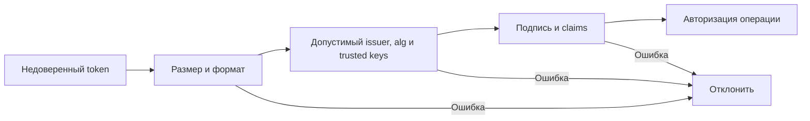

# JWT

JWT — формат передачи утверждений (claims). Подписанный JWT позволяет проверить, кем они выпущены и не изменились ли они, но его payload обычно можно прочитать. Подпись и шифрование — разные свойства.

## Термины в этой статье

- **payload** — полезные данные сообщения, без служебных заголовков.
- **issuer** — сторона, которая выпустила токен или сертификат.
- **audience** — получатель, для которого выпущен токен.
- **SSRF** — использование сервера для отправки запроса по адресу, контролируемому атакующим.
- **rotation** — замена ключа или секрета с прекращением использования предыдущего.
- **revocation** — досрочный отзыв ранее выданного доступа.
- **credential** — предъявляемое доказательство личности: пароль, ключ, токен или сертификат.

JSON Web Token — compact container claims, обычно JWS-signed, иногда JWE-encrypted. Base64url encoding не шифрует payload: не помещайте туда секреты или лишнее PII.

## Validation contract

Verifier заранее знает допустимый token kind, issuer, audience и algorithms. Он проверяет cryptographic signature, `iss`, `aud`, `exp`, при необходимости `nbf`, и application claims. Не выбирайте algorithm по недоверенному `alg` без allowlist; не принимайте `none`; не смешивайте access, ID, email-verification и reset tokens одним validation path.

Header parameters (`kid`, `jku`, `x5u`) недоверенны. Key lookup ограничен configured issuer/key set; иначе возможны SSRF и key confusion. Rotation должна поддерживать overlap старого ключа до истечения выданных tokens.

## Trade-offs

Signed JWT позволяет локальную проверку без network hop и переносит ограниченные claims. Цена — revocation и stale authorization: уже выданный token живёт до expiry. Большой token увеличивает headers; содержимое раскрывается holder-у; изменение roles не мгновенно.

Opaque token с introspection/server-side session проще немедленно отозвать и скрывает claims, но создаёт storage/network dependency. Выбирайте по revocation, scale и trust boundaries, не по моде.

## Практика access/refresh

Короткий access token ограничивает окно утечки. Refresh token — высокоценный credential; часто лучше opaque, хранить только защищённое представление, rotation/reuse detection и grant-family revocation. Logout должен иметь честную semantics: удаление browser copy не отзывает JWT во всех resource servers.

Не кладите быстро меняющиеся permissions в долгоживущий JWT. Проверяйте критичную authorization по authoritative state или используйте короткий TTL/versioning.

## Разбор на примере

Условный token содержит:

```json
{"iss":"https://id.example.test","aud":"ads-api","sub":"user-42","exp":1791283200}
```

Это пример claims, не готовый credential. Проверенная подпись с audience `billing-api` всё равно не подходит для `ads-api`. Истёкший token тоже нельзя принять; допустимое небольшое clock skew — заранее заданная policy, не обход exp. Claims используются только после полной валидации выбранного вида token.

Сначала ограничьте размер и формат, затем примените заранее известные issuer, algorithms и ключи. `kid` выбирает ключ из доверенного набора, не путь к файлу или произвольный URL. Неизвестный kid не должен инициировать неограниченный запрос JWKS для каждого входа: нужны cache, rate limit и контролируемое обновление.

При rotation новый ключ начинает подписывать, старый остаётся для проверки до истечения допустимых tokens. При компрометации это правило меняется: старый ключ надо отозвать, принять последствия для активных клиентов и расследовать выпуск tokens. Локальная проверка JWT сама не узнаёт, что роль пользователя только что отозвали. Для мгновенного запрета нужен authoritative state/introspection/version check, либо явно принято окно короткого expiry.



## Источники

- [JSON Web Token, RFC 7519](https://www.rfc-editor.org/rfc/rfc7519)
- [JWT Best Current Practices, RFC 8725](https://www.rfc-editor.org/rfc/rfc8725)
- [OWASP JWT Cheat Sheet](https://cheatsheetseries.owasp.org/cheatsheets/JSON_Web_Token_for_Java_Cheat_Sheet.html)


## Проверь себя

1. Почему валидной подписи недостаточно?
2. Что делает logout с уже скопированным JWT?

<details>
<summary>Ответы</summary>

1. Нужны issuer, audience, время, назначение token и application policy; правильный token другого API не подходит.

2. Удаление локальной копии не отзывает другие копии; нужны серверная revocation policy или истечение.

</details>
