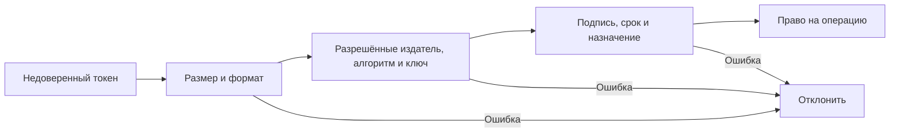

# JWT: что доказывает подпись токена

JWT передаёт набор утверждений о пользователе или разрешении: кто выпустил токен, кому он предназначен, когда истекает срок. Подписанный токен можно проверить без запроса к издателю. Его обычное содержимое при этом читается: подпись защищает от подмены, а не шифрует данные.

## Формат и назначение

JWT часто используется в подписанном формате JWS; существует и шифрованный формат JWE. Кодирование Base64url только превращает байты в удобную текстовую запись. Не помещайте в обычный JWT пароли, секреты и лишние персональные данные.

Поля содержимого называются claims. Например, `iss` обозначает издателя, `aud` — получателя, `sub` — субъекта, `exp` — срок действия. Их наличие не подтверждает истинность: сначала нужна проверка подписи и ожидаемого назначения.

## Что заранее знает сервер

Сервер выбирает допустимые типы токенов, издателя, получателя и алгоритмы в своей конфигурации. Затем проверяет подпись, `iss`, `aud`, `exp`, при необходимости `nbf` и прикладные поля. Поле `alg` внутри недоверенного токена не может само разрешить алгоритм, например `none`.

Access token, ID token, письмо подтверждения и токен сброса пароля решают разные задачи. Одинаковая подпись не делает их взаимозаменяемыми. Разделяйте пути проверки и назначение, чтобы токен одной операции не давал доступ к другой.

## Как выбирается ключ

`kid` помогает выбрать ключ из заранее доверенного набора. Другие параметры заголовка также недоверенны. Нельзя разрешать токену указать произвольный адрес загрузки ключа через `jku`/`x5u`: это позволяет перенаправить сервер или подменить источник доверия.

При плановой смене ключа новый используется для выдачи, а старый может оставаться доступным для проверки ещё действующих токенов. При компрометации старого ключа нужно отдельно решить вопрос немедленного прекращения доверия; обычный период перекрытия не подходит автоматически.

## Почему отзыв сложнее, чем проверка подписи

Локальная проверка не узнаёт, что пользователя уже заблокировали. Если не предусмотрена дополнительная проверка состояния, токен действует до срока. Удаление копии из браузера тоже не отзывает другие копии. Быстро меняющиеся права лучше проверять по актуальным данным либо задавать ограниченное окно устаревания.

Непрозрачный токен или серверная сессия позволяют искать актуальное разрешение в хранилище. Их проще немедленно отозвать, но проверка зависит от доступности хранилища и, возможно, сети. Выбор определяется нужным сроком отзыва и границами доверия.

Короткий access token сокращает окно утечки. Refresh token даёт возможность получить новый и требует защиты, ограничения срока и обнаружения повторного использования. Размер JWT также влияет на заголовки каждого запроса: не переносите в него всё состояние пользователя.

## Разбор на примере

В условном содержимом токена записано:

```json
{"iss":"https://id.example.test","aud":"ads-api","sub":"user-42","exp":1791283200}
```

Это иллюстрация полей, не действующий токен. Издатель — `id.example.test`, получатель — `ads-api`, пользователь — `user-42`. `exp` — момент истечения срока в формате Unix time. Если предъявленный токен имеет `aud=billing-api`, корректная подпись не разрешает использовать его в `ads-api`.

Сервер ограничивает размер, выбирает заранее доверенный набор ключей, проверяет подпись, время и назначение. Небольшой допуск расхождения часов определяется конфигурацией; он не позволяет игнорировать истёкший срок. Неизвестный `kid` может вызвать контролируемое обновление JWKS, но не неограниченную загрузку на каждый запрос атакующего.

При плановой смене новый ключ подписывает, а старый проверяет ещё действующие токены. При утечке старого ключа приходится прекращать доверие к нему и учитывать последствия для клиентов. Чтобы блокировка пользователя действовала немедленно, одной локальной проверки недостаточно: нужна актуальная серверная проверка или заранее принятое окно до истечения.



## Источники

- [JSON Web Token, RFC 7519](https://www.rfc-editor.org/rfc/rfc7519)
- [JWT Best Current Practices, RFC 8725](https://www.rfc-editor.org/rfc/rfc8725)
- [OWASP JWT Cheat Sheet](https://cheatsheetseries.owasp.org/cheatsheets/JSON_Web_Token_for_Java_Cheat_Sheet.html)


## Проверь себя

1. Почему корректной подписи токена недостаточно?
2. Что выход из браузера делает с ранее скопированным JWT?

<details>
<summary>Ответы</summary>

1. Нужны ожидаемые издатель, получатель, срок и назначение. Подписанный токен другого API не подходит.

2. Удаление одной копии не отзывает другие. Нужны предусмотренная серверная проверка отзыва или истечение срока.

</details>
