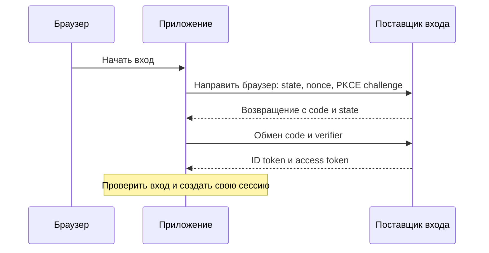

# OAuth 2.0 и OpenID Connect: доступ к API и вход

Пользователь разрешает приложению читать его данные в другой службе. OAuth 2.0 описывает выдачу такого делегированного доступа. Если приложение хочет узнать результат входа пользователя, применяется OpenID Connect (OIDC), надстройка над OAuth. Эти задачи связаны, но требуют разных токенов и проверок.

## Кто участвует

Пользователь владеет ресурсом. Приложение-клиент запрашивает доступ. Сервер авторизации проверяет пользователя, получает разрешение и выдаёт токены. Сервер ресурса принимает токен для своего API. Эти роли могут быть у одной компании, но получатели сообщений различаются.

**Access token** предъявляют API для доступа. **ID token** сообщает клиенту проверяемый результат входа и сведения о пользователе; это не замена access token. **Refresh token** предъявляют серверу авторизации для получения новых access tokens. Одноразовый **code** сначала обменивают на токены.

## Как проходит обмен кода

Клиент направляет браузер к серверу авторизации с зарегистрированным redirect URI. После разрешения браузер возвращается с кодом. Клиент обменивает код через отдельный запрос и получает токены. URI сравнивается строго с зарегистрированным, а код используется однократно.

PKCE связывает начало обмена с его завершением: клиент генерирует секрет `code_verifier`, заранее передаёт производное значение `code_challenge` методом S256, затем предъявляет исходный секрет при обмене кода. Перехваченного кода без этого секрета недостаточно. Это не заменяет все остальные проверки.

`state` связывает возвращённый ответ с инициированным браузерным действием; `nonce` в OIDC связывает ID token с ожидаемым обменом и помогает предотвратить повтор. Для клиента, который может безопасно хранить секрет, отдельная аутентификация клиента решает свою задачу. Не смешивайте эти механизмы в одно «проверить токен».

## Как проверить результат

Для JWT проверяются подпись, ожидаемый алгоритм, издатель, получатель, срок и назначение. Для ID token дополнительно проверяются nonce и необходимые поля выбранного режима. Для непрозрачного access token применяются правила издателя, например запрос проверки (introspection); подписи JWT у него нет.

Ключи получают из настроек доверенного издателя и его JWKS (набора опубликованных открытых ключей для проверки подписи), а не по произвольному адресу из токена. Идентификатор пользователя связывают с издателем: один `sub` из разных служб не обязательно означает одного человека.

## Границы доступа и обновление

Scope задаёт выданный объём доступа, например чтение профиля, но не заменяет проверку права на конкретный объект. Запрашивайте только необходимые разрешения и нужного получателя. Не записывайте коды и токены в аналитику или журналы.

Для публичных клиентов RFC 9700 требует обнаружения повторного использования refresh token через замену при каждом использовании либо привязку к ключу. Замену нужно согласовать с конкурентными запросами клиента: законный повтор после потерянного ответа и кража требуют определённой политики. Старые способы Implicit и выдача по паролю пользователя не соответствуют рекомендуемой современной схеме; используйте Authorization Code с PKCE и поддерживаемую библиотеку.

## Разбор на примере

Веб-приложение сохраняет случайные `state`, `nonce` и секрет PKCE. Затем отправляет браузер к поставщику входа с производным `code_challenge`. После возвращения проверяет `state`, обменивает одноразовый code вместе с `code_verifier` и проверяет ID token, включая `nonce`. Если клиент имеет собственный способ аутентификации, PKCE его не отменяет.

API принимает access token, предназначенный этому API. Если токен непрозрачный, сервер обращается к предусмотренной издателем проверке. Если он JWT, применяется соответствующая JWT-политика. Название OAuth не требует, чтобы каждый токен был JWT.

Refresh token R1 при использовании заменяется на R2. Повтор R1 может означать кражу; поставщик отзывает связанные разрешения по своей политике. Но два законных одновременных обновления тоже могут использовать R1. Клиент должен координировать обновление и понимать неясный исход потерянного ответа, а не бесконечно повторять старый токен.

При связывании учётных записей нельзя считать одинаковый email у двух издателей доказательством одной личности. Проверенная пара издатель+subject (поле `sub`, идентификатор пользователя у этого издателя) определяет личность в соответствующей области; объединение записей требует отдельного подтверждения.

## Источники

- [OAuth 2.0 Security Best Current Practice, RFC 9700](https://www.rfc-editor.org/rfc/rfc9700)
- [OpenID Connect Core 1.0 with errata](https://openid.net/specs/openid-connect-core-1_0.html)
- [PKCE, RFC 7636](https://www.rfc-editor.org/rfc/rfc7636)

## Проверь себя

1. Можно ли заменить access token произвольным ID token в API?
2. Как проверяется непрозрачный access token?

Ответы

1. Нет: ID token предназначен клиенту для результата входа, а API принимает предназначенный ему access token.

2. По контракту издателя, например запросом introspection с проверкой активности, получателя, срока и разрешений. Это не проверка подписи JWT.

